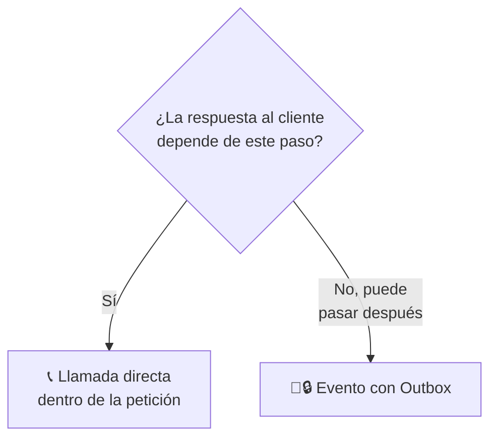
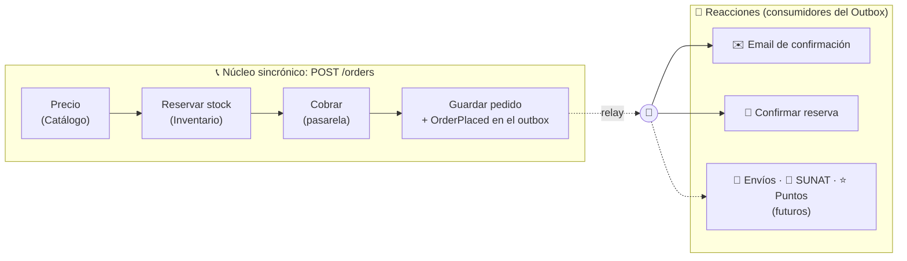
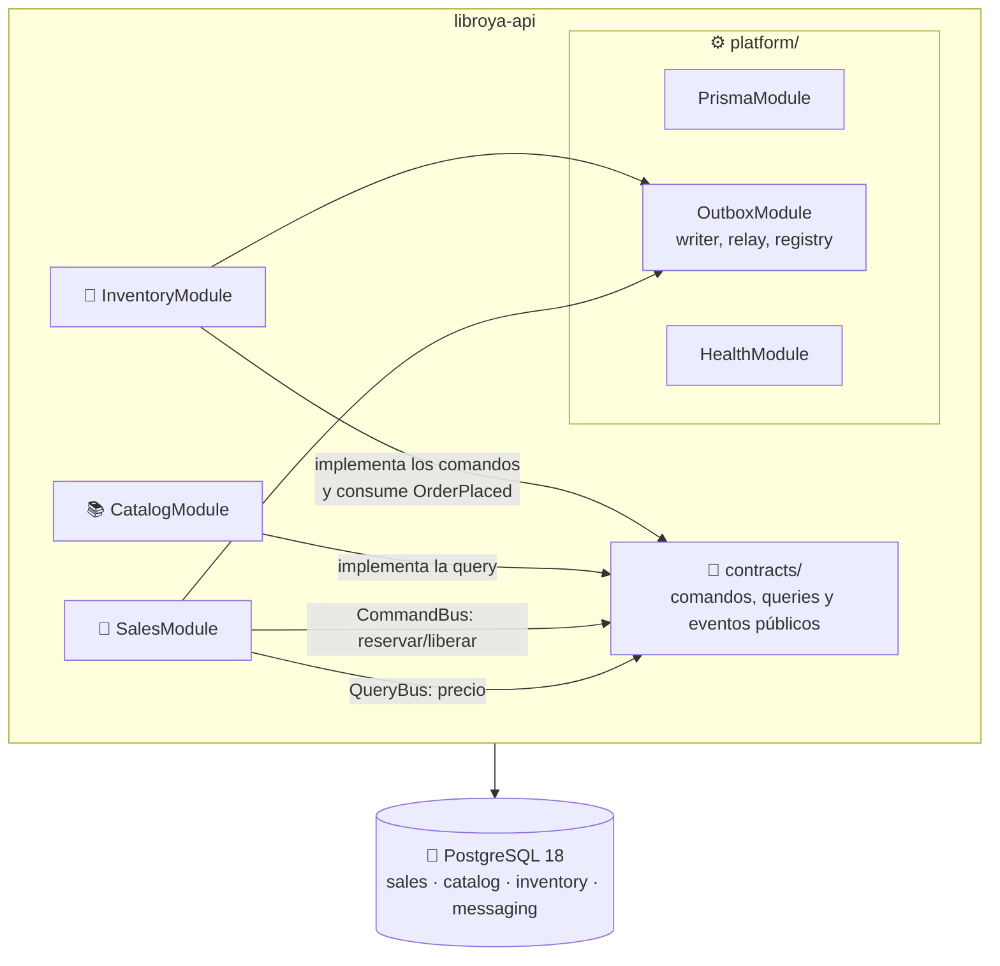

# Backend: decisiones, stack y arquitectura

> Secciones 1 y 2 de la guía.

## 1. Decisiones y stack

| Tema | Decisión |
|---|---|
| Despliegue | **Monolito modular**: una app NestJS; cada bounded context es un módulo Nest con fronteras estrictas |
| Venta y pago | **Sincrónicos**: reservar stock, cobrar y guardar ocurren en la misma petición, con compensación inmediata si algo falla |
| Reintentos del cliente | `POST /orders` exige una **`Idempotency-Key`**: un reintento nunca crea otro pedido ni cobra dos veces |
| Caídas a mitad de la venta | **Saga mínima persistida**: un registro de *checkout* en la BD y un job que reembolsa y libera lo que quedó a medias |
| Eventos | **Solo para reacciones posteriores** (email, confirmar reserva y, más adelante, envíos, SUNAT y puntos), mediante un **Outbox confiable** |
| Base de datos | **PostgreSQL 18**, una BD con un **schema por contexto**: `sales`, `catalog`, `inventory` y `messaging` |
| Montos | **`Decimal` exacto en BD y dominio** (decimal.js en `Money`); en la API y los contratos, **texto con 2 decimales y moneda** (`{ amount: "90.00", currency: "PEN" }`) |
| Pagos y email | **Simulados**, elegidos por variable de entorno |
| Observabilidad | **Identificador de correlación** (`X-Request-Id`) en cada log, guardado en el checkout y en el outbox: una compra se sigue desde el `POST` hasta el último consumidor |
| Seguridad | **Autenticación y roles desde el corte 7**: JWT de acceso de 15 minutos (HS256, `jose`) más token de refresco opaco de un solo uso, contraseñas con `scrypt`, guard global que **deniega por defecto**, roles `BUYER` y `ADMIN`, y el cliente de cada compra sale siempre del token, nunca del body. Además: límite de intentos en `/auth`, `helmet`, CORS por lista de orígenes y registro de accesos sin secretos |

| Pieza | Versión | Para qué |
|---|---|---|
| Node.js | 24 LTS (≥ 24.15) | Runtime y CLI de Nest (`@types/node` ^24 ya instalado) |
| pnpm | el del repositorio (`pnpm-lock.yaml`) | Gestor de paquetes |
| NestJS | 12.x ✅ (`^12.0.1` instalado) | Framework (ESM por defecto) |
| TypeScript | 6.x ✅ (`^6.0.2` instalado) | El CLI de Nest 12 aún no soporta TS 7 |
| `@nestjs/cqrs` | compatible con Nest 12 | CommandBus y QueryBus |
| `@nestjs/config` | compatible con Nest 12 | Variables de entorno validadas con Zod |
| `@nestjs/swagger` | compatible con Nest 12 | OpenAPI en `/docs` |
| `@nestjs/schedule` | compatible con Nest 12 | Relay del Outbox y recuperación de checkouts |
| `@nestjs/terminus` | compatible con Nest 12 | `GET /health/live`, `GET /health/ready` (BD, para el balanceador) y `GET /health/outbox` (monitoreo) |
| Prisma ORM | **7.x (fijado)** | ORM con `@prisma/adapter-pg` |
| Vitest | 4.x ✅ (`^4.1.2` instalado, con Vite 8 y `@vitest/coverage-v8`) | Tests unitarios, de integración y e2e |
| oxlint y Prettier | ✅ ya configurados (`pnpm lint`, `pnpm format`) | Lint con reglas que usan tipos y formato del código |
| Testcontainers | `@testcontainers/postgresql` | PostgreSQL 18 real en los tests |

> [!warning] Fija Prisma en la versión 7
> Desde agosto de 2026, instalar `prisma` sin versión (`pnpm add prisma`) instala **Prisma 8 RC**, que cambia por completo la API. Instala siempre `prisma@^7`, `@prisma/client@^7` y `@prisma/adapter-pg@^7`.

> [!tip] Versiones reproducibles
> Instala las dependencias nuevas con `-E` (versión exacta), sube el `pnpm-lock.yaml` y valida el conjunto en CI. Ya está confirmado que el CLI de Nest 12 instaló TypeScript 6 y Vitest 4 (con rangos `^`, que el scaffold dejó así); falta comprobar que funcionan con Prisma 7 al terminar la fase 1.

---

## 2. Arquitectura

### Qué es sincrónico y qué es un evento

### Módulos y dependencias

**Reglas:**

1. **Un contexto nunca importa de otro contexto.** Solo de `contracts/` (Published Language) y `shared-kernel/`.
2. **Las llamadas directas van en una sola dirección:** Ventas llama a Catálogo e Inventario; **ninguno llama a Ventas**. Así no se forman ciclos.
3. **`domain/` no importa nada de Nest, Prisma ni `platform/`.** `application/` usa decoradores de Nest, pero no Prisma: los consumidores que necesitan la transacción (`tx`) van en `infrastructure/`.

   Las reglas 1 y 3 las comprueba `test/unit/architecture/dependency-rules.spec.ts`, que lee los imports de `src/` y falla si `domain/` usa algo distinto de `decimal.js` y `node:*`, si `contracts/` importa de `contexts/` o `platform/`, si `shared-kernel/` depende de otra capa, o si un contexto importa a otro. Una librería nueva en `domain/` o `contracts/` se autoriza en `test/support/architecture.ts`.
4. **No hay transacciones, joins ni claves foráneas entre schemas de contextos.** Cada contexto escribe solo en el suyo. Dentro de un mismo schema sí se usan FK (ver [base de datos](03-base-de-datos.md)).
5. **Única excepción, explícita:** `messaging` no es un contexto, es infraestructura de la plataforma. El relay del Outbox puede confirmar **en una misma transacción** el efecto local de un consumidor (en el schema de su contexto) y la marca de su entrega en `messaging`. Si algún día un contexto se separa a otra BD, su consumidor deja de usar esa transacción y deduplica con una tabla *inbox* propia (patrón Inbox).
