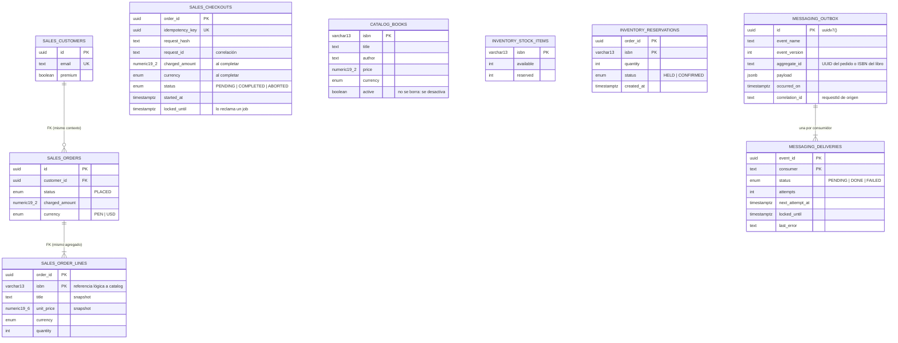
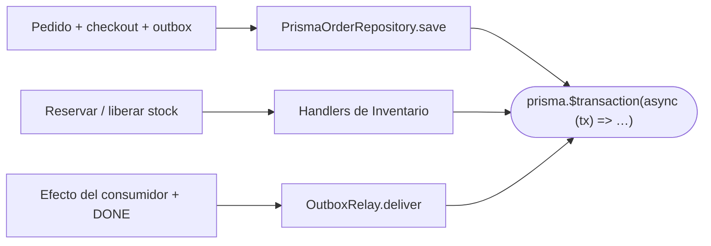

# Backend: base de datos con Prisma 7

> Sección 5 de la guía.

## 5. Base de datos con Prisma 7



### Montos: tipos y escalas

| Qué guarda la columna | Tipo | Ejemplo |
|---|---|---|
| Importe final (total cobrado, precio de venta, pagos, reembolsos) | `Decimal @db.Decimal(19, 2)` | `orders.charged_amount`, `books.price` |
| Valor intermedio (precio unitario, valor sin impuestos) | `Decimal @db.Decimal(19, 6)` | `order_lines.unit_price` |
| Tasa o coeficiente (descuento, IGV, prorrateo) | `Decimal @db.Decimal(9, 6)` | `0.180000` (más adelante, al modelar impuestos) |
| Moneda | `enum` (`PEN`, `USD`) | Validada por la BD, no texto libre |

Prisma no permite declarar `CHECK` en el schema: agrégalos a mano en el SQL de la migración, por ejemplo `CHECK (charged_amount >= 0)` y `CHECK (price > 0)`.

### Relaciones: cuándo usar clave foránea

| Relación | ¿FK? | Ejemplo |
|---|---|---|
| Dentro de un agregado | ✅ Sí | `order_lines → orders` |
| Entre agregados del **mismo** contexto | ✅ Sí: el mismo módulo es dueño de ambas tablas | `orders → customers` |
| Entre **contextos distintos** | ❌ No: solo el ID, como referencia lógica | `order_lines.isbn` → `catalog.books` |

Una FK entre contextos ataría sus migraciones y haría imposible separarlos. La integridad que se pierde se compensa así:

- **Se valida al escribir, a través de la API del dueño:** si el libro no existe o está inactivo, `GetBookPriceQuery` falla y el pedido no se crea.
- **Lo que otros referencian no se borra:** Catálogo **desactiva** libros (`active = false`) en vez de eliminarlos.
- **Lo que debe quedar congelado se copia** (*snapshot*): `title` y `unit_price` se guardan en la línea al comprar. Si mañana el libro cambia de precio o de título, el pedido de ayer no cambia, y `GET /orders/:id` no necesita consultar a Catálogo.

Para otras necesidades: si un dato actual se consulta de vez en cuando, se usa la API pública (`QueryBus` + `contracts/`). Si se consulta muy seguido, se mantiene una copia local actualizada por eventos (proyección). Los reportes que cruzan contextos van en un schema aparte, alimentado por eventos.

**`prisma/schema.prisma`** (lo esencial)

```prisma
generator client {
  provider = "prisma-client"
  output   = "../src/platform/prisma/generated"
}

datasource db {
  provider = "postgresql"
  schemas  = ["sales", "catalog", "inventory", "messaging"]
}

// ── sales ──────────────────────────────────────────────
model Customer {
  id      String  @id @db.Uuid
  email   String  @unique
  premium Boolean @default(false)
  orders  Order[]
  @@map("customers")
  @@schema("sales")
}

enum OrderStatus {
  PLACED
  @@schema("sales")
}

enum Currency {
  PEN
  USD
  @@schema("sales")
}

model Order {
  id           String      @id @db.Uuid
  customerId   String      @map("customer_id") @db.Uuid
  customer     Customer    @relation(fields: [customerId], references: [id])   // FK: mismo contexto
  status       OrderStatus
  chargedAmount Decimal    @map("charged_amount") @db.Decimal(19, 2)   // importe final: 2 decimales
  currency     Currency    @default(PEN)
  createdAt    DateTime    @default(now()) @map("created_at")
  // Dirección de entrega copiada en el pedido (fase 11). Admiten nulo: los pedidos anteriores no la tienen. Una CHECK
  // exige los seis campos obligatorios o ninguno; la referencia es opcional, pero no puede existir sola
  shipRecipient  String? @map("ship_recipient") @db.VarChar(100)
  shipPhone      String? @map("ship_phone") @db.VarChar(20)
  shipLine1      String? @map("ship_line1") @db.VarChar(200)
  shipDistrict   String? @map("ship_district") @db.VarChar(60)
  shipProvince   String? @map("ship_province") @db.VarChar(60)
  shipDepartment String? @map("ship_department") @db.VarChar(60)
  shipReference  String? @map("ship_reference") @db.VarChar(200)
  lines        OrderLine[]
  @@map("orders")
  @@schema("sales")
}

enum CheckoutStatus {
  PENDING
  COMPLETED
  ABORTED
  @@schema("sales")
}

// Estado de la saga: un registro por intento de compra (y la memoria de su Idempotency-Key)
model Checkout {
  orderId        String         @id @map("order_id") @db.Uuid
  idempotencyKey String         @unique @map("idempotency_key") @db.Uuid   // dos peticiones con la misma clave: solo una entra
  requestHash    String         @map("request_hash")                       // detecta la misma clave con otro carrito
  requestId      String?        @map("request_id")                         // correlación: el job de recuperación lo reutiliza en sus logs
  chargedAmount  Decimal?       @map("charged_amount") @db.Decimal(19, 2)  // se guarda al completar, para responder reintentos
  currency       Currency?                                                 // junto con el monto: sin ella, un reintento no sabe la moneda
  status    CheckoutStatus @default(PENDING)
  startedAt   DateTime       @default(now()) @map("started_at")
  lockedUntil DateTime?      @map("locked_until")     // evita que dos jobs recuperen el mismo checkout
  @@index([status, startedAt])
  @@map("checkouts")
  @@schema("sales")
}

model OrderLine {
  orderId        String @map("order_id") @db.Uuid
  isbn           String @db.VarChar(13)                       // referencia lógica a catalog (sin FK)
  title          String                                    // snapshot al comprar
  unitPrice      Decimal  @map("unit_price") @db.Decimal(19, 6)  // snapshot; valor intermedio (luego, el valor unitario de SUNAT)
  currency       Currency @default(PEN)
  quantity       Int
  order          Order  @relation(fields: [orderId], references: [id], onDelete: Cascade)
  @@id([orderId, isbn])
  @@map("order_lines")
  @@schema("sales")
}

// ── catalog ────────────────────────────────────────────
model Book {
  isbn       String @id @db.VarChar(13)
  title      String
  author     String
  price      Decimal         @db.Decimal(19, 2)      // precio final de venta
  currency   CatalogCurrency @default(PEN)
  active     Boolean         @default(true)          // los libros se desactivan, no se borran
  @@map("books")
  @@schema("catalog")
}

// Catálogo tiene su propio enum de moneda: usar el de `sales` crearía una dependencia entre schemas (regla 4 de la arquitectura)
enum CatalogCurrency {
  PEN
  USD
  @@map("Currency")
  @@schema("catalog")
}

// ── inventory ──────────────────────────────────────────
model StockItem {
  isbn      String @id @db.VarChar(13)
  available Int
  reserved  Int    @default(0)
  @@map("stock_items")
  @@schema("inventory")
}

enum ReservationStatus {
  HELD
  CONFIRMED
  @@schema("inventory")
}

model Reservation {
  orderId   String            @map("order_id") @db.Uuid
  isbn      String            @db.VarChar(13)
  quantity  Int
  status    ReservationStatus @default(HELD)
  createdAt DateTime          @default(now()) @map("created_at")
  @@id([orderId, isbn])
  @@index([status, createdAt])
  @@map("reservations")
  @@schema("inventory")
}

// ── messaging (solo lo usa platform/outbox) ────────────
model OutboxMessage {
  id           String     @id @default(dbgenerated("uuidv7()")) @db.Uuid
  eventName    String     @map("event_name")
  eventVersion Int        @map("event_version")
  aggregateId  String     @map("aggregate_id")            // texto: UUID de un pedido o ISBN de un libro; índice para el orden por agregado del relay
  payload      Json
  occurredOn   DateTime   @map("occurred_on")
  correlationId String?   @map("correlation_id")             // requestId de la petición que generó el evento
  deliveries   Delivery[]
  @@index([aggregateId])
  @@map("outbox")
  @@schema("messaging")
}

enum DeliveryStatus {
  PENDING
  DONE
  FAILED
  @@schema("messaging")
}

model Delivery {
  eventId       String         @map("event_id") @db.Uuid
  consumer      String
  status        DeliveryStatus @default(PENDING)
  attempts      Int            @default(0)
  nextAttemptAt DateTime       @default(now()) @map("next_attempt_at")
  lockedUntil   DateTime?      @map("locked_until")
  lastError     String?        @map("last_error")
  createdAt     DateTime       @default(now()) @map("created_at")
  event         OutboxMessage  @relation(fields: [eventId], references: [id], onDelete: Cascade)
  @@id([eventId, consumer])
  @@index([status, nextAttemptAt])
  @@map("deliveries")
  @@schema("messaging")
}
```

**`prisma.config.ts`** (en Prisma 7 la URL va aquí, no en el schema)

```ts
import 'dotenv/config';
import { defineConfig } from 'prisma/config';
import { buildDatabaseUrl } from './src/platform/config/database-url.js';

export default defineConfig({
  schema: 'prisma/schema.prisma',
  migrations: { path: 'prisma/migrations', seed: 'tsx prisma/seed.ts' },
  datasource: { url: buildDatabaseUrl(process.env) },
});
```

**`platform/prisma/prisma.service.ts`**

```ts
import { Injectable, OnApplicationShutdown, OnModuleInit } from '@nestjs/common';
import { ConfigService } from '@nestjs/config';
import { PrismaPg } from '@prisma/adapter-pg';
import { buildDatabaseUrl } from '../config/database-url.js';
import { PrismaClient } from './generated/client.js';   // NO desde '@prisma/client'

@Injectable()
export class PrismaService extends PrismaClient implements OnModuleInit, OnApplicationShutdown {
  constructor(config: ConfigService) {
    super({ adapter: new PrismaPg({ connectionString: buildDatabaseUrl({
      DB_HOST: config.getOrThrow('DB_HOST'), DB_PORT: config.getOrThrow('DB_PORT'),
      DB_USER: config.getOrThrow('DB_USER'), DB_PASSWORD: config.getOrThrow('DB_PASSWORD'),
      DB_NAME: config.getOrThrow('DB_NAME'),
    }),
    // platform/config/connection-options.ts: '-c timezone=UTC -c statement_timeout=5000'
    options: connectionOptions(config.getOrThrow('DB_STATEMENT_TIMEOUT_MS')),   // todas las conexiones de la app, en UTC y con límite por sentencia
    }) });
  }
  onModuleInit() { return this.$connect(); }
  // En la fase de apagado, no al destruir los módulos: el relay del Outbox espera su entrega en curso antes
  onApplicationShutdown() { return this.$disconnect(); }
}
```

> [!important] Schema `identity` (corte 7)
> Un cuarto schema de la aplicación, además de `sales`, `catalog` e `inventory` (y `messaging` para el Outbox). `identity.users` guarda `id`, `email` (único, recortado y en minúsculas: una `CHECK` lo exige), `password_hash`, `role` (`BUYER` o `ADMIN`) y `created_at`. **Nunca guarda la contraseña, solo su hash** (`scrypt$15$8$3$<sal>$<clave>`, con sal propia). `resetDatabase()` de los tests también lo vacía.
>
> `identity.refresh_tokens` (tarea 7.4) guarda los tokens de refresco entregados: `user_id` (cascada), `family_id` (una sesión), `token_hash` (único; **solo el SHA-256**, una `CHECK` exige 64 caracteres hexadecimales), `created_at`, `expires_at`, `used_at` y `revoked_at`. Cada renovación marca el token usado y crea uno nuevo en la misma familia; si se reutiliza uno usado, se revoca la familia entera.

> [!important] Las conexiones de la aplicación fuerzan UTC
> Las columnas `TIMESTAMP(3)` de Prisma **no llevan zona horaria**. Prisma rellena `@default(now())` en el cliente, en UTC, y el relay del Outbox compara contra `now()` de la base, que usa la zona de su sesión. Con la base en UTC−5 y sin `options: '-c timezone=UTC'`, una entrega nueva quedaba programada 5 horas en el futuro y no se entregaba nada. Con la opción, da igual qué zona tenga la base. El SQL que se escribe a mano (por ejemplo, reprocesar entregas `FAILED`) debe ejecutarse con `SET TIME ZONE 'UTC'`.

> [!important] Cada sentencia tiene un límite de tiempo
> `statement_timeout` (por defecto 5 s, `DB_STATEMENT_TIMEOUT_MS`) cancela cualquier sentencia que se quede esperando un bloqueo o una consulta lenta. Mantiene acotada la duración de la compra, de la que depende el umbral del job de recuperación (`CHECKOUT_RECOVERY_MINUTES`, 10 min). Una sentencia cancelada es un error normal: la saga compensa.

> [!important] El cliente se importa siempre desde la carpeta generada
> Con `output` propio, `@prisma/client` no conoce este schema. `PrismaClient` y el namespace `Prisma` (por ejemplo, `Prisma.TransactionClient` o `Prisma.PrismaClientKnownRequestError`) se importan desde `src/platform/prisma/generated/client.js`, con la ruta relativa que corresponda:
>
> ```ts
> import { Prisma } from '../../platform/prisma/generated/client.js';
> ```
>
> `prisma.config.ts` exige las variables `DB_*` **también para `prisma generate`**, aunque no se conecte. En CI defínelas siempre (para el paso de `generate` bastan valores de ejemplo, como `DB_HOST=localhost`, `DB_USER=u`, `DB_PASSWORD=p`, `DB_NAME=db`).

**Transacciones:** cada operación atómica abre su propia transacción interactiva y pasa `tx` a quien deba participar. No hay transacciones implícitas: lo que no recibe `tx` está fuera.



| Transacción | `timeout` | Por qué |
|---|---|---|
| Guardar pedido / reservar / liberar | 5 s (por defecto) | Solo hay operaciones en la BD |
| Entrega de un consumidor `db` | 5 s (por defecto) | Solo hay operaciones en la BD |
| Consumidor `external` | **Sin transacción** | Nunca se mantiene una transacción abierta mientras se espera la red. Su llamada externa lleva timeout propio (10 s) |
