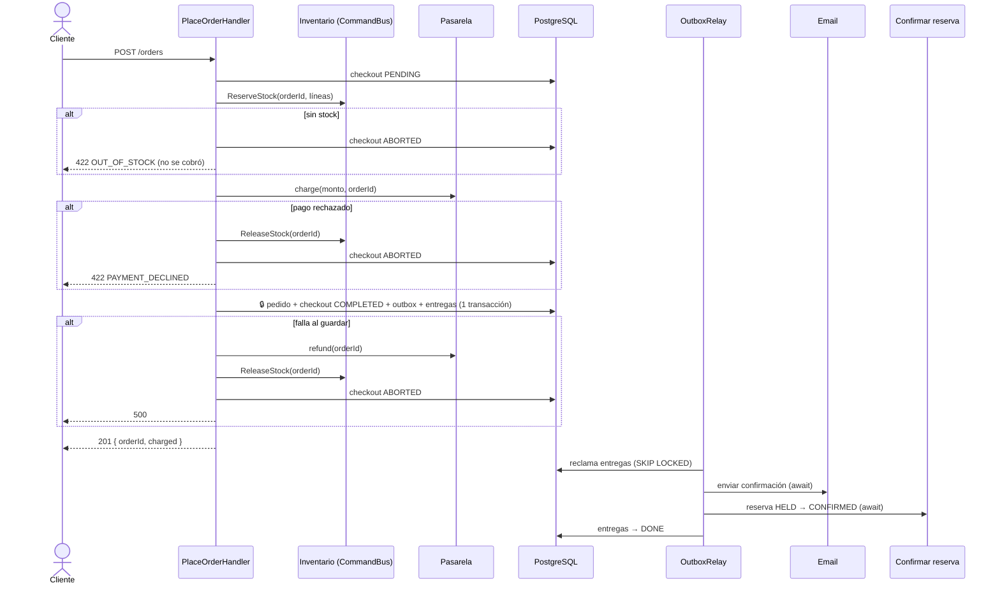
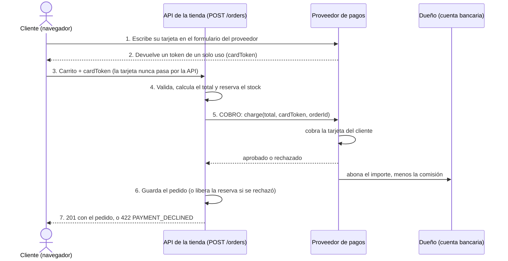
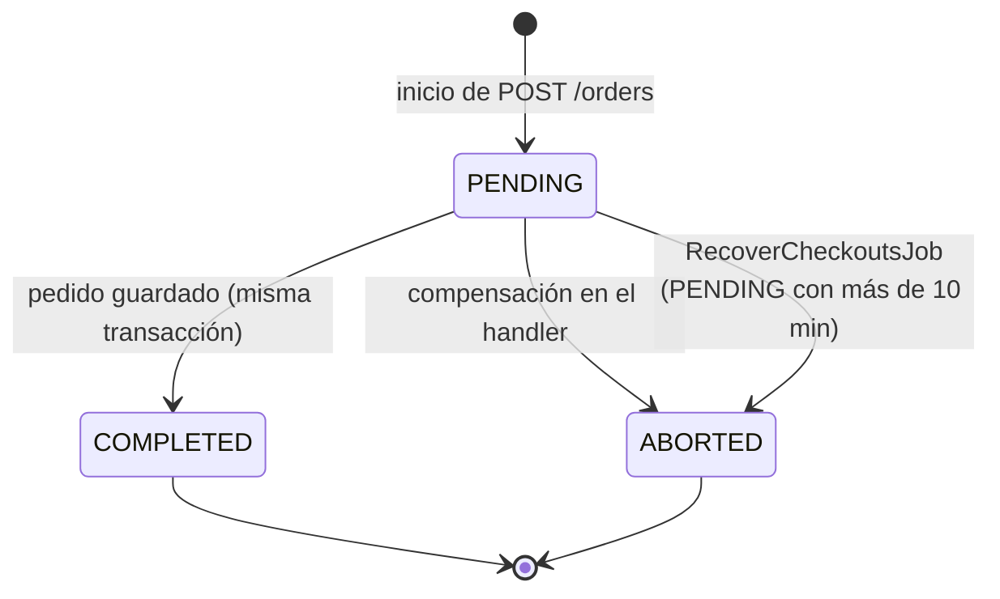
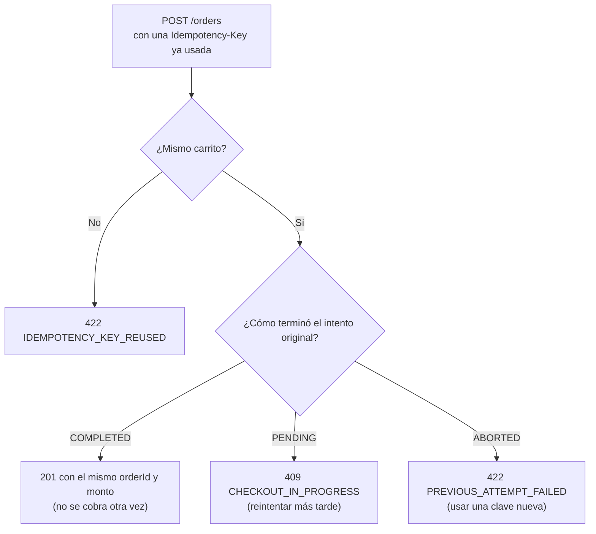

# Backend: flujo de un pedido y saga

> Sección 6 de la guía, más el código de la saga (handler y job de recuperación) que estaba en [05-piezas-clave.md](05-piezas-clave.md).

## 6. El flujo de un pedido



### Quién paga y en qué punto ocurre el cobro

En una tienda propia **paga el cliente**, no el dueño. El dueño es quien cobra: el dinero llega a su cuenta bancaria. Entre los dos está el **proveedor de pagos** (Stripe, Culqi, Niubiz, etc.), que cobra la tarjeta del cliente por cuenta del dueño y le deposita el importe menos su comisión. La tienda no procesa tarjetas por sí misma: hacerlo exigiría certificación PCI-DSS.

| Quién | Qué hace |
|---|---|
| **Cliente** | Elige los libros y paga con su tarjeta. |
| **Dueño de la tienda** | Vende los libros y recibe el dinero. No hace ningún pago. |
| **Proveedor de pagos** | Cobra la tarjeta del cliente, abona el importe al dueño y se queda una comisión por venta. |



- **El cobro es el paso 5**: ocurre después de reservar el stock y antes de guardar el pedido, dentro de `PlaceOrderHandler`. Si se rechaza, se libera la reserva y no queda pedido; si el cobro pasa y algo falla después, la saga reembolsa al cliente.
- **La API solo ve el token.** El número de la tarjeta lo escribe el cliente en el formulario del proveedor (pasos 1 y 2), así que no se guarda ni se registra en ningún sitio de la tienda.
- **En desarrollo no hay proveedor.** `SimulatedPaymentGateway` hace el papel del paso 5 sin mover dinero: decide por el texto del token (`tok_declined` rechaza, `tok_error` falla) y tarda 3 s. En producción lo hace el proveedor real, a través de `ExternalPaymentAdapter`, y la API no arranca con la simulada (`PAYMENT_PROVIDER=external`).
- **Pendiente de elegir proveedor:** el diseño actual supone un cobro síncrono con token. Si el proveedor exige 3-D Secure o una redirección con confirmación por webhook, el cobro quedaría pendiente hasta recibir la confirmación y habría que adaptar la saga, no solo el adaptador.

### La saga mínima: qué pasa si el proceso se cae



| Se cae… | Queda | Se resuelve con |
|---|---|---|
| Después de reservar, antes de cobrar | Checkout `PENDING`, reserva sin pedido | `RecoverCheckoutsJob`: reembolso (no hay cobro: no hace nada) y liberación |
| Después de cobrar, antes de guardar | Checkout `PENDING`, cobro y reserva sin pedido | `RecoverCheckoutsJob`: reembolsa y libera |
| El cobro excede el tiempo de espera (no se sabe si cobró) | Posible cobro sin pedido | El handler **reembolsa siempre** que se intentó cobrar (idempotente) |
| `save` confirmó en la BD, pero la respuesta se perdió | Pedido válido; el handler cree que falló | El handler ve el checkout `COMPLETED` y **no compensa** |
| … y además falla la revisión del checkout | Pedido válido (`COMPLETED`); el cliente recibe 500 | Nada que compensar. El cliente reintenta con la misma `Idempotency-Key` y recibe el pedido |
| La respuesta 201 se pierde en la red | El cliente no sabe si compró | El reintento con la misma `Idempotency-Key` devuelve el mismo pedido, **sin cobrar otra vez** |
| Durante una compensación (por ejemplo, falla el reembolso) | Checkout `PENDING` | `RecoverCheckoutsJob` la reintenta en cada vuelta |
| Después de guardar | Checkout `COMPLETED`; entregas pendientes | El relay las procesa al volver |
| A mitad de una entrega | Entrega bloqueada | El bloqueo vence a los 2 min y otra vuelta la retoma |

> [!warning] Requisito para la pasarela real
> El job reembolsa conociendo solo el `orderId`, incluso cuando no sabe si el cobro llegó a hacerse. La pasarela debe aceptar el `orderId` como **referencia o clave de idempotencia**, y permitir **anular o reembolsar por referencia** (sin efecto si no hubo cobro). Idealmente, también **consultar el estado de un cobro por referencia**, para resolver los timeouts sin adivinar. La pasarela simulada ya lo hace. Verifícalo antes de elegir la real.

## La saga en código

### Application: el handler con compensaciones (la saga)

> Desde el corte 9 (tarea `9.10`) el código real reparte estos pasos en métodos privados: `execute` (idempotencia y precios), `start` (registrar el intento), `charge` (reservar, cobrar y guardar), `compensate` (reembolsar, liberar y anular, en ese orden) y `replay`. El orden y la conducta son los de este fragmento, que se deja en un solo bloque para leer la saga de corrido.

```ts
// sales/application/order/place-order.handler.ts
@CommandHandler(PlaceOrderCommand)
export class PlaceOrderHandler implements ICommandHandler<PlaceOrderCommand> {
  private readonly logger = new Logger(PlaceOrderHandler.name);

  constructor(
    private readonly orders: OrderRepository,
    private readonly pricer: OrderPricer,
    private readonly stock: StockReservation,
    private readonly checkouts: CheckoutLog,
    private readonly payments: PaymentGateway,
  ) {}

  async execute(cmd: PlaceOrderCommand) {
    // 0. Idempotencia: un reintento con la misma clave nunca crea otro pedido ni cobra otra vez
    // Los ISBN se normalizan antes: "978-0-…" y "978…" son el mismo libro y deben dar el mismo hash
    const items = normalizeCart(cmd.items);
    // La dirección se valida y normaliza antes de la huella y de cualquier efecto: una inválida es un 422 sin reservar
    // ni cobrar nada, y los espacios sobrantes no hacen pasar por otra compra un reintento
    const address = ShippingAddress.create(cmd.shippingAddress);
    const requestHash = hashRequest(cmd.customerId, items, address);
    const previous = await this.checkouts.findByKey(cmd.idempotencyKey);
    if (previous) return this.replay(previous, requestHash);

    // 1. Sin efectos: cargar al cliente, pedir precios, armar el pedido y calcular el total. Lo hace `OrderPricer`, el mismo
    // servicio que usa la cotización (`POST /orders/quote`) (corte 9): el total cotizado y el cobrado no pueden divergir
    const { order, breakdown } = await this.pricer.price({ orderId: this.orders.nextId(), customerId: cmd.customerId, items, address });
    const finalPrice = breakdown.total.toFinal();
    const lines = order.getLines().map((l) => ({ isbn: l.isbn.value, quantity: l.quantity }));

    // 2. Efectos, en orden; si algo falla, se deshace lo hecho
    if (!(await this.checkouts.start(order.id, cmd.idempotencyKey, requestHash))) {
      // Otra petición con la misma clave entró justo antes (la clave es única en la BD)
      return this.replay((await this.checkouts.findByKey(cmd.idempotencyKey))!, requestHash);
    }
    // Desde aquí, si el proceso cae, el job recupera el checkout
    let chargeAttempted = false;
    try {
      await this.stock.reserve(order.id, lines);                     // sin stock → no reservó nada; release no hace nada
      chargeAttempted = true;
      const payment = await this.payments.charge(finalPrice, cmd.cardToken, order.id);
      if (!payment.approved) throw new DomainError('PAYMENT_DECLINED', `Pago rechazado: ${payment.reason}`);
      order.place();
      await this.orders.save(order, finalPrice);                      // pedido + checkout COMPLETED + outbox
    } catch (e) {
      if (await this.checkouts.isCompleted(order.id)) {               // el commit sí ocurrió: no compensar
        return { orderId: order.id, charged: finalPrice };
      }
      try {
        if (chargeAttempted) await this.payments.refund(order.id);   // idempotente: cubre rechazos y timeouts
        await this.stock.release(order.id);
        await this.checkouts.abort(order.id);                         // solo si TODAS las compensaciones terminaron
      } catch (compensationError) {
        // No se marca ABORTED: queda PENDING y RecoverCheckoutsJob reintenta las compensaciones
        this.logger.error(`Compensación incompleta para ${order.id}: ${String(compensationError)}`);
      }
      throw e;                                                        // el cliente recibe el error original
    }
    return { orderId: order.id, charged: finalPrice };
  }

  // Responde un reintento según cómo terminó el intento original
  private replay(c: CheckoutRecord, requestHash: string) {
    if (c.requestHash !== requestHash) {
      throw new DomainError('IDEMPOTENCY_KEY_REUSED', 'Esta Idempotency-Key ya se usó con otro carrito');
    }
    if (c.status === 'COMPLETED') return { orderId: c.orderId, charged: c.charged! };
    if (c.status === 'PENDING') throw new ConflictError('CHECKOUT_IN_PROGRESS', 'Esta compra todavía se está procesando');
    throw new DomainError('PREVIOUS_ATTEMPT_FAILED', 'El intento anterior con esta clave falló; usa una clave nueva');
  }
}

// Mismo cliente, mismo carrito y misma dirección → mismo hash. Fusiona las cantidades del mismo ISBN (como hace el
// agregado) y ordena, así {A:1, A:2} y {A:2, A:1} producen el mismo hash que {A:3}. La dirección llega ya normalizada
// (ShippingAddress.create) y va como lista JSON, no separada por un carácter: un texto con ese carácter podría
// confundirse con otro reparto de campos
function hashRequest(customerId: string, items: { isbn: string; quantity: number }[], address: ShippingAddress): string {
  const merged = new Map<string, number>();
  for (const i of items) merged.set(i.isbn, (merged.get(i.isbn) ?? 0) + i.quantity);
  const lines = [...merged].sort(([a], [b]) => (a < b ? -1 : a > b ? 1 : 0))   // comparación simple: localeCompare cambia según el idioma del sistema
    .map(([isbn, q]) => `${isbn}:${q}`).join(',');
  const shipping = JSON.stringify([address.recipient, address.phone, address.line1, address.district,
    address.province, address.department, address.reference ?? '']);
  return createHash('sha256').update(`${customerId}|${lines}|${shipping}`).digest('hex');
}
```

**Cómo responde un reintento** con la misma `Idempotency-Key`:



- **El cliente genera la clave** (un UUID) **una vez por intento de compra** y la reutiliza en todos los reintentos de ese intento.
- **Dos peticiones simultáneas con la misma clave:** el índice único deja entrar solo a una; la otra recibe 409 mientras la primera termina.

- **`charged` es un `Money` ya redondeado** (`toFinal()`). Se serializa con `toJSON()` como `{ amount: "90.00", currency: "PEN" }`, igual en el primer 201, en un reintento y en `GET /orders/:id`.
- **Se reembolsa siempre que se intentó cobrar.** Si el cobro excedió el tiempo de espera, no se sabe si la pasarela cobró. Como el reembolso por referencia es idempotente y no hace nada si no hubo cobro, llamarlo siempre es lo seguro.
- **Antes de compensar se revisa el checkout.** Si `save` confirmó en la BD pero la respuesta se perdió (commit ambiguo), el checkout ya está `COMPLETED` y el pedido es válido: no se toca.
- **Si esa revisión también falla** (por ejemplo, cayó la BD), el error sube sin compensar. Hay dos casos:
  - **`save` no llegó a confirmar:** el checkout sigue `PENDING`, y el job reembolsa y libera después.
  - **`save` sí confirmó:** el checkout está `COMPLETED` y el pedido es válido. No hay nada que compensar (el job nunca toca un `COMPLETED`), aunque el cliente recibió un error. Si reintenta con la misma `Idempotency-Key`, recibe el pedido ya creado (ver más abajo).
- **`ABORTED` solo se marca cuando todas las compensaciones terminaron.** Si el reembolso o la liberación fallan, el checkout queda `PENDING` (recuperable), se registra el error y el cliente recibe el error original, no el de la compensación.
- **Toda llamada externa lleva timeout:** `fetch(url, { …, signal: AbortSignal.timeout(10_000) })` en `ExternalPaymentAdapter`. Sin él, una pasarela colgada retendría la petición indefinidamente.

### Application: el job de recuperación

```ts
// sales/application/order/recover-checkouts.job.ts
@Injectable()
export class RecoverCheckoutsJob {
  private readonly logger = new Logger(RecoverCheckoutsJob.name);

  constructor(
    private readonly checkouts: CheckoutLog,
    private readonly payments: PaymentGateway,
    private readonly stock: StockReservation,
    private readonly config: ConfigService,
  ) {}

  @Cron(CronExpression.EVERY_5_MINUTES)
  async run(): Promise<number> {
    const stale = await this.checkouts.claimStale(this.config.getOrThrow<number>('CHECKOUT_RECOVERY_MINUTES'));
    for (const { orderId, requestId } of stale) {
      // Los logs de la recuperación llevan el mismo requestId que la compra original
      await RequestContext.run(requestId ?? `recovery-${orderId}`, () => this.recover(orderId));
    }
    return stale.length;
  }

  // Un checkout que falla no detiene a los demás: queda PENDING y se reintenta cuando venza su bloqueo
  private async recover(orderId: string): Promise<void> {
    try {
      // La compra pudo completarse después de reclamarse: reembolsar ahora dejaría un pedido sin cobro
      if (await this.checkouts.isCompleted(orderId)) return;
      await this.payments.refund(orderId);     // idempotente: sin cobro previo, no hace nada
      await this.stock.release(orderId);       // idempotente
      await this.checkouts.abort(orderId);     // solo si las dos compensaciones terminaron
      this.logger.warn(`Checkout ${orderId} recuperado: reembolsado y liberado`);
    } catch (e) {
      this.logger.error(`No se pudo recuperar ${orderId}; se reintenta cuando venza el bloqueo: ${String(e)}`);
    }
  }
}
```

- **Dos protecciones contra una compra que sigue viva:** el umbral (10 min) supera con mucho lo que puede tardar el handler, y `OrderRepository.save` solo completa un checkout que siga `PENDING`. El `isCompleted` previo cubre el caso en que la compra se complete entre reclamar y compensar. Queda una ventana mínima (completarse justo entre ese `isCompleted` y el reembolso) que solo es posible si un handler sigue vivo pasados los 10 minutos, algo que los timeouts de cada paso impiden.

- **El umbral (10 min) debe superar la duración máxima del handler**, no solo la de la petición HTTP: aunque el cliente se desconecte, el handler sigue ejecutándose. Esa duración está acotada por los timeouts de cada paso (BD 5 s, pasarela 10 s); en el peor caso, con compensaciones, es menos de 1 minuto.
- **Con varias instancias, cada job reclama checkouts distintos** (`SKIP LOCKED` y un bloqueo de 2 min). Aun así, los tres pasos son idempotentes y `abort` solo cambia filas `PENDING`.
- **Misma regla que el relay: lote × duración máxima por checkout < bloqueo** (5 × 15 s = 75 s < 120 s). Si el lote tardara más, otra instancia retomaría checkouts que este job todavía no procesó, y se reembolsarían dos veces en la pasarela (sin error de datos, pero con llamadas duplicadas). Los checkouts que no entren en una vuelta se toman en la siguiente, 5 min después.

#### Con proveedores lentos (3 s por operación)

Mientras no haya proveedores reales, la pasarela y el correo simulados tardan 3 s (`PAYMENT_SIMULATED_DELAY_MS` y `EMAIL_SIMULATED_DELAY_MS`), y el diseño tiene que aguantarlo. Los márgenes, con los valores por defecto (los comprueba `test/unit/sales/delay-margins.spec.ts`):

| Margen | Cuenta | Resultado |
|---|---|---|
| Vuelta del relay | `BATCH` (10) correos seguidos × 3 s | 30 s < 120 s de bloqueo de las entregas |
| Lote de la recuperación | `RECOVERY_BATCH` (5) × (reembolso 3 s + liberación 5 s) | 40 s < 120 s de bloqueo (`RECOVERY_LOCK_MINUTES`) |
| Compra fallida en el peor punto | cobro 3 s + reembolso 3 s + 3 sentencias de 5 s como máximo | 21 s < 2 min, el umbral mínimo de recuperación |
| Pasarela simulada | 3 s | no supera los 10 s del timeout del adaptador externo |

Lo que cambia en el comportamiento:

- **La respuesta de `POST /orders` tarda unos 3 s** (y unos 6 s si el cobro falla y se compensa con un reembolso). Durante ese rato, otra petición con la misma clave recibe `409 CHECKOUT_IN_PROGRESS`, sin necesidad de compuertas.
- **El correo llega unos 3 s después de que el relay lo reclame.** El relay entrega una a una, así que con varias compras seguidas un correo puede esperar detrás de otros y la confirmación de una reserva (`db`) también.
- **Un cierre ordenado puede cortar una vuelta con muchos correos:** el cierre espera 15 s (`STOP_TIMEOUT_MS`) y una vuelta completa puede durar 30 s. Los correos que no terminaron se reintentan al vencer el bloqueo, con la misma clave de idempotencia, así que no se duplican. Por eso el notificador escribe su log al terminar la espera y no al empezar.
- **Una pasarela lenta no abre una carrera nueva:** la simulada guarda la promesa del cobro en curso, así que dos cobros de la misma referencia dentro de la espera cuentan uno solo.

```ts
// sales/infrastructure/persistence/prisma-checkout-log.adapter.ts (fragmento)
async start(orderId: string, idempotencyKey: string, requestHash: string): Promise<boolean> {
  try {
    await this.prisma.checkout.create({
      data: { orderId, idempotencyKey, requestHash, requestId: RequestContext.requestId() ?? null },
    });
    return true;
  } catch (e) {
    if (e instanceof Prisma.PrismaClientKnownRequestError && e.code === 'P2002') return false; // clave repetida
    throw e;
  }
}

async claimStale(olderThanMinutes: number): Promise<{ orderId: string; requestId: string | null }[]> {
  const rows = await this.prisma.$queryRaw<{ order_id: string; request_id: string | null }[]>`
    UPDATE sales.checkouts SET locked_until = now() + interval '2 minutes'
    WHERE order_id IN (
      SELECT order_id FROM sales.checkouts
      WHERE status = 'PENDING'
        AND started_at < now() - (${olderThanMinutes} * interval '1 minute')
        AND (locked_until IS NULL OR locked_until < now())
      LIMIT 5                -- 5 × ~15 s (reembolso 10 s + liberación 5 s) = 75 s < bloqueo de 2 min
      FOR UPDATE SKIP LOCKED)
    RETURNING order_id, request_id`;
  return rows.map((r) => ({ orderId: r.order_id, requestId: r.request_id }));
}

abort(orderId: string) {
  return this.prisma.checkout.updateMany({ where: { orderId, status: 'PENDING' }, data: { status: 'ABORTED' } });
}
```
