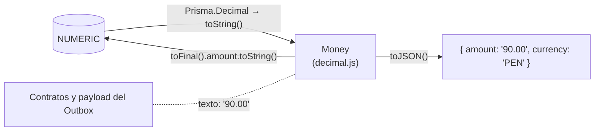
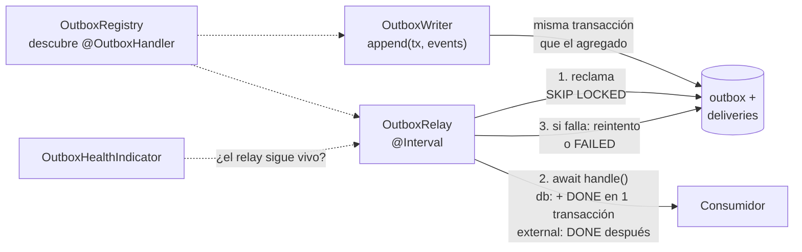
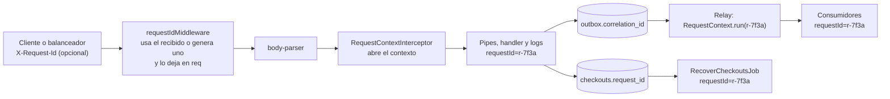

# Backend: piezas clave

> Sección 7 de la guía. El handler de la saga y el job de recuperación están en [04-flujo-pedido-y-saga.md](04-flujo-pedido-y-saga.md).

## 7. Piezas clave

El código del dominio es el de la guía v5. Abajo solo va lo nuevo o lo que cambia.

### Dominio: `Money` con decimal.js

```ts
// sales/domain/shared/money.vo.ts: decimal.js, NUNCA Prisma.Decimal (regla 3 de la arquitectura)
import { Decimal } from 'decimal.js';   // con nombre: el import por defecto no tiene tipos con `module: nodenext`

export type Currency = 'PEN' | 'USD';

export class Money {
  private constructor(readonly amount: Decimal, readonly currency: Currency) {}

  // Sin `number`: un float como 1.005 ya llega mal representado
  static of(value: string | Decimal, currency: Currency = 'PEN'): Money {
    const d = Money.parse(value);                                    // INVALID_AMOUNT si no es un número finito
    if (d.isNegative()) throw new DomainError('NEGATIVE_AMOUNT', 'El monto no puede ser negativo');
    return new Money(d, currency);
  }
  static zero(currency: Currency = 'PEN'): Money { return new Money(new Decimal(0), currency); }

  add(o: Money): Money { this.assertSame(o); return Money.of(this.amount.plus(o.amount), this.currency); }
  multiply(factor: string | Decimal): Money { return Money.of(this.amount.times(factor), this.currency); }   // un factor negativo falla

  // Importe final: 2 decimales, mitad hacia arriba. Explícito en cada uso, nunca con Decimal.set() global
  toFinal(): Money { return new Money(this.amount.toDecimalPlaces(2, Decimal.ROUND_HALF_UP), this.currency); }

  equals(o: Money): boolean { return this.currency === o.currency && this.amount.equals(o.amount); }
  isGreaterOrEqualThan(o: Money): boolean { this.assertSame(o); return this.amount.gte(o.amount); }

  toFixed(): string { return this.amount.toFixed(2); }                         // "90.00"
  toJSON() { return { amount: this.toFixed(), currency: this.currency }; }   // formato de la API

  private assertSame(o: Money): void {
    if (o.currency !== this.currency) throw new DomainError('CURRENCY_MISMATCH', 'No se pueden operar monedas distintas');
  }
}
```

**Reglas de los montos:**



1. **Se calcula con toda la precisión y se redondea una sola vez**, con `toFinal()`, antes de cobrar o guardar un importe final.
2. **El dominio nunca recibe `number`** como monto, y nunca compara con `===` o `>`: usa `equals` y `isGreaterOrEqualThan`.
3. **El mapper convierte en el borde a través de texto:** `Money.of(row.chargedAmount.toString(), row.currency)` al leer, y `chargedAmount: money.toFinal().amount.toString()` al escribir (Prisma acepta texto en columnas `Decimal`). `Prisma.Decimal` es una copia propia de decimal.js dentro del cliente generado, así que no se mezcla con la del dominio.
4. **Entre contextos y en la API, los montos viajan como texto** con 2 decimales y su moneda. Nunca como `number`.

**Cambios en el dominio de la guía v5:** `Money` pasa a la versión de arriba. `order.place()` crea el evento con `this.subtotal().toFinal().toFixed()` (texto) en lugar de `this.subtotal().cents`. `PricingService` aplica el descuento con `multiply('0.90')`; el costo de envío y el mínimo de envío gratis (`MinimumSubtotalSpec`) salen de la tabla `PRICING_RULES` de `pricing-rules.ts`, con valores propios para `PEN` (`10.00` y `150.00`) y para `USD` (`3.00` y `40.00`). El adaptador de la pasarela convierte el `Money` final al formato que pida el proveedor (por ejemplo, céntimos enteros: `money.toFinal().amount.times(100).toNumber()`).

### Dominio: puertos y eventos

```ts
// sales/domain/order/stock-reservation.port.ts
export abstract class StockReservation {
  abstract reserve(orderId: string, lines: { isbn: string; quantity: number }[]): Promise<void>; // lanza OutOfStockError
  abstract release(orderId: string): Promise<void>;
}

// sales/domain/order/order.repository.ts
export abstract class OrderRepository {
  abstract findById(id: string): Promise<Order | null>;
  abstract save(order: Order, charged: Money): Promise<void>;         // también marca el checkout COMPLETED
  abstract nextId(): string;
}

// sales/domain/order/checkout-log.port.ts: el estado de la saga
export abstract class CheckoutLog {
  abstract start(orderId: string, idempotencyKey: string, requestHash: string): Promise<boolean>; // false si la clave ya existe
  abstract findByKey(idempotencyKey: string): Promise<CheckoutRecord | null>;  // { orderId, status, requestHash, charged: Money | null }: Money.of(chargedAmount.toString(), currency)
  abstract isCompleted(orderId: string): Promise<boolean>;            // ¿el pedido llegó a guardarse?
  abstract abort(orderId: string): Promise<void>;                     // PENDING → ABORTED (nunca toca COMPLETED)
  abstract claimStale(olderThanMinutes: number): Promise<{ orderId: string; requestId: string | null }[]>; // reclama PENDING antiguos (SKIP LOCKED)
}
```

```ts
// shared-kernel/domain-event.ts
export interface DomainEvent {
  readonly eventName: string;
  readonly eventVersion: number;   // para cambiar el formato sin romper a los consumidores
  readonly aggregateId: string;
  readonly occurredOn: Date;
}

// contracts/sales/order-placed.event.ts
export class OrderPlacedEvent implements DomainEvent {
  readonly eventName = 'sales.order.placed';
  readonly eventVersion = 1;
  readonly occurredOn = new Date();
  readonly aggregateId: string;   // propiedad real (no getter), para que también viaje en el payload JSON
  constructor(
    readonly orderId: string,
    readonly customerId: string,
    readonly subtotal: string,                  // "100.00": los montos viajan como texto
    readonly lines: { isbn: string; quantity: number }[],
  ) {
    this.aggregateId = orderId;
  }
}
```

```ts
// shared-kernel/domain.errors.ts: el filtro HTTP decide el código según la clase
export class DomainError extends Error {                       // → 422
  constructor(readonly code: string, message: string) { super(message); }
}
export class NotFoundError extends DomainError {                // → 404
  constructor(entity: string, id: string) { super('NOT_FOUND', `${entity} ${id} no existe`); }
}
export class ConflictError extends DomainError {}               // → 409

// contracts/inventory/stock.errors.ts
export class OutOfStockError extends DomainError {              // → 422
  constructor(isbn: string) { super('OUT_OF_STOCK', `Sin stock suficiente para ${isbn}`); }
}
export class StockItemNotFoundError extends DomainError {       // → 422 (no 404: el libro existe en Catálogo)
  constructor(isbn: string) { super('STOCK_ITEM_NOT_FOUND', `No hay registro de stock para ${isbn}`); }
}
```

`order.place()` registra `OrderPlacedEvent`, como en la guía. Los consumidores reciben el **payload como JSON**: los eventos no deben tener métodos ni depender de que las fechas lleguen como `Date`.

### Ventas llama a Catálogo e Inventario por `contracts/`

```ts
// sales/infrastructure/order/inventory-in-process.adapter.ts
@Injectable()
export class InventoryInProcessAdapter extends StockReservation {
  constructor(private readonly commandBus: CommandBus) { super(); }
  reserve(orderId: string, lines: { isbn: string; quantity: number }[]) {
    return this.commandBus.execute(new ReserveStockCommand(orderId, lines));
  }
  release(orderId: string) {
    return this.commandBus.execute(new ReleaseStockCommand(orderId));
  }
}
```

```ts
// sales/infrastructure/order/catalog-in-process.adapter.ts
@Injectable()
export class CatalogInProcessAdapter extends CatalogPricing {
  constructor(private readonly queryBus: QueryBus) { super(); }

  async priceCart(items: CartItem[]): Promise<PricedCartItem[]> {
    return Promise.all(items.map(async (i) => {
      const book = await this.queryBus.execute(new GetBookPriceQuery(i.isbn)); // NotFoundError si no existe o está inactivo
      // book.price es { amount: "45.00", currency: "PEN" }: se toman ambos, sin pasar por number
      return { isbn: i.isbn, quantity: i.quantity, title: book.title, price: book.price.amount, currency: book.price.currency };
    }));
  }
}
```

**Cambio en el dominio de la guía v5:** el título viaja como snapshot. `PricedCartItem` y `OrderLine` agregan `title`, y la factory lo pasa a `order.addBook(isbn, title, price, quantity)`. `PricedCartItem` lleva `price` como texto (`"45.00"`) y `currency`, y la factory los convierte con `Money.of(item.price, item.currency)`, sin pasar por `number`.

### Inventario: reserva atómica, liberación y confirmación

```ts
// inventory/infrastructure/stock/reserve-stock.handler.ts
@CommandHandler(ReserveStockCommand)
export class ReserveStockHandler implements ICommandHandler<ReserveStockCommand> {
  constructor(private readonly prisma: PrismaService) {}

  async execute({ orderId, lines }: ReserveStockCommand): Promise<void> {
    await this.prisma.$transaction(async (tx) => {
      // Siempre en orden de ISBN: si dos pedidos con los libros {A, B} y {B, A} reservan a la vez,
      // ambos bloquean primero A y luego B, y no se produce un interbloqueo (deadlock)
      for (const { isbn, quantity } of sortByIsbn(lines)) {    // lock-order.ts: comparación de texto simple, no depende del idioma del sistema
        // Solo descuenta si alcanza: nunca queda en negativo, aunque haya pedidos simultáneos
        const { count } = await tx.stockItem.updateMany({
          where: { isbn, available: { gte: quantity } },
          data: { available: { decrement: quantity }, reserved: { increment: quantity } },
        });
        if (count === 0) {
          // Distingue "no alcanza" de "no existe el registro de stock" (dato inconsistente)
          const exists = await tx.stockItem.findUnique({ where: { isbn }, select: { isbn: true } });
          throw exists ? new OutOfStockError(isbn) : new StockItemNotFoundError(isbn);   // revierte todas las líneas
        }
      }
      await tx.reservation.createMany({ data: lines.map((l) => ({ orderId, ...l })) });
    });
  }
}
```

- **Las líneas llegan sin ISBN repetidos:** el agregado `Order` ya suma en una sola línea las unidades del mismo libro. El handler lo exige antes de abrir la transacción: sin líneas (`EMPTY_RESERVATION`), un ISBN repetido (`DUPLICATE_RESERVATION_LINE`) o una cantidad que no sea un entero ≥ 1 (`INVALID_QUANTITY`) son errores de dominio, no el error de la base.
- **Un pedido solo reserva una vez:** si ya tiene reservas, el handler lanza `ConflictError` (`ORDER_ALREADY_RESERVED`). Lo detecta una comprobación previa. Para que dos peticiones del mismo pedido a la vez no la esquiven, la transacción empieza con `pg_advisory_xact_lock(hashtext('inventory.reserve-stock'), hashtext(orderId))`: serializa las reservas del mismo pedido, también cuando sus libros son distintos (y por eso no compiten por ninguna fila de stock ni chocan en la clave primaria). Pedidos distintos no se esperan. Como último recurso queda la clave primaria de `reservations` (`P2002`), que se traduce al mismo error. La saga no debería llegar ahí, porque el checkout con su `Idempotency-Key` lo impide.
- **Toda transacción que toca `stock_items` bloquea las filas en orden de ISBN** (reservar y liberar). Es la regla que evita interbloqueos entre pedidos simultáneos; cualquier operación nueva sobre stock debe seguirla.
- **`StockItemNotFoundError`** (422, `STOCK_ITEM_NOT_FOUND`) indica un libro del catálogo sin registro de stock: además de rechazar la compra, se registra como error para corregir el dato.

```ts
// inventory/infrastructure/stock/release-stock.handler.ts: idempotente y segura bajo concurrencia
@CommandHandler(ReleaseStockCommand)
export class ReleaseStockHandler implements ICommandHandler<ReleaseStockCommand> {
  constructor(private readonly prisma: PrismaService) {}

  async execute({ orderId }: ReleaseStockCommand): Promise<void> {
    await this.prisma.$transaction(async (tx) => {
      // Borra y devuelve en un solo paso. Si dos liberaciones corren a la vez, la segunda espera
      // el bloqueo de fila, ya no encuentra reservas y no devuelve el stock otra vez
      const released = await tx.$queryRaw<{ isbn: string; quantity: number }[]>`
        DELETE FROM inventory.reservations
        WHERE order_id = ${orderId}::uuid AND status = 'HELD'
        RETURNING isbn, quantity`;
      released.sort((a, b) => a.isbn.localeCompare(b.isbn));   // mismo orden de bloqueo que la reserva
      for (const r of released) {
        await tx.stockItem.update({
          where: { isbn: r.isbn },
          data: { available: { increment: r.quantity }, reserved: { decrement: r.quantity } },
        });
      }
    });
  }
}
```

```ts
// inventory/infrastructure/stock/confirm-reservation.consumer.ts
// Reacción a OrderPlaced: usa el tx del relay, así el efecto y la marca DONE se confirman juntos → una sola vez
@OutboxHandler()
@Injectable()
export class ConfirmReservationConsumer implements DbOutboxConsumer<OrderPlacedEvent> {
  readonly kind = 'db' as const;
  readonly name = 'inventory.confirm-reservation';
  readonly event = 'sales.order.placed';
  async handle(e: OrderPlacedEvent, { tx }: DbDeliveryContext): Promise<void> {
    await tx.reservation.updateMany({
      where: { orderId: e.orderId, status: 'HELD' },
      data: { status: 'CONFIRMED' },
    });
  }
}
```

- **La liberación es idempotente por construcción:** el `DELETE … RETURNING` devuelve cada reserva una sola vez, así que liberar dos veces, o dos liberaciones simultáneas, devuelven el stock una sola vez. Solo toca reservas `HELD`: una `CONFIRMED` ya es definitiva. Es todo o nada: si una línea no se puede devolver (por ejemplo, falta su registro de stock), la transacción se revierte y la reserva se conserva para reintentar.
- **El `orderId` debe ser un UUID** en la reserva y en la liberación; si no, `INVALID_ORDER_ID` en lugar de un error crudo de la base.

Las reservas `HELD` sin pedido ya no necesitan un job propio en Inventario: las libera `RecoverCheckoutsJob` de Ventas, a través del mismo `ReleaseStockCommand`. Confirmar la reserva sirve para que Inventario distinga las reservas definitivas, que Envíos descontará más adelante.

### Ventas: guardar el pedido y su evento juntos

```ts
// sales/infrastructure/order/prisma-order.repository.ts
@Injectable()
export class PrismaOrderRepository extends OrderRepository {
  constructor(private readonly prisma: PrismaService, private readonly outbox: OutboxWriter) { super(); }

  nextId() { return randomUUID(); }

  async findById(id: string) {
    const row = await this.prisma.order.findUnique({ where: { id }, include: { lines: true } });
    return row ? OrderMapper.toDomain(row) : null;
  }

  async save(order: Order, charged: Money): Promise<void> {
    const events = order.pullEvents();
    await this.prisma.$transaction(async (tx) => {
      const chargedAmount = charged.toFinal().amount.toString();   // Prisma acepta texto en columnas Decimal
      await tx.order.create({ data: OrderMapper.toCreate(order, chargedAmount, charged.currency) });
      await tx.checkout.update({
        where: { orderId: order.id },
        data: { status: 'COMPLETED', chargedAmount, currency: charged.currency },   // monto y moneda, para los reintentos
      });
      await this.outbox.append(tx, events);                   // misma transacción: recibe tx
    });
  }
}
```

En esta fase los pedidos solo se crean. Cuando existan flujos que los modifiquen (por ejemplo, cancelar), se agrega una columna `version` con bloqueo optimista.

### Email: el primer consumidor

```ts
// sales/application/order/send-order-confirmation.consumer.ts
@OutboxHandler()
@Injectable()
export class SendOrderConfirmationConsumer implements ExternalOutboxConsumer<OrderPlacedEvent> {
  readonly kind = 'external' as const;      // el relay lo ejecuta fuera de toda transacción
  readonly name = 'sales.send-order-confirmation';
  readonly event = 'sales.order.placed';
  constructor(private readonly customers: CustomerRepository, private readonly notifier: Notifier) {}

  async handle(e: OrderPlacedEvent, { eventId }: DeliveryContext): Promise<void> {
    const customer = await this.customers.findById(e.customerId);
    if (!customer) return;
    // Servicio externo: se entrega "al menos una vez", con eventId como clave de idempotencia
    await this.notifier.send(customer.email.value, `¡Gracias! Tu pedido ${e.orderId} fue recibido.`, { idempotencyKey: eventId });
  }
}
```

**Cambio en el puerto de la guía v5:** `Notifier.send(to, message)` agrega un tercer parámetro opcional, `{ idempotencyKey?: string }`, que el adaptador real envía al proveedor de email.

### Platform: el Outbox



```ts
// platform/outbox/outbox-consumer.ts y outbox-handler.decorator.ts
export interface DeliveryContext {
  eventId: string;
  occurredOn: Date;
  attempt: number;
  correlationId: string | null;   // requestId de origen: un consumidor externo puede enviarlo al proveedor
}
export interface DbDeliveryContext extends DeliveryContext { tx: Prisma.TransactionClient }

// Efecto en la BD propia: el relay lo ejecuta dentro de su transacción, junto con la marca DONE
export interface DbOutboxConsumer<E> {
  readonly kind: 'db';
  readonly name: string;    // único: 'inventory.confirm-reservation'
  readonly event: string;   // 'sales.order.placed'
  handle(event: E, ctx: DbDeliveryContext): Promise<void>;
}

// Efecto externo (email, SUNAT): el relay lo ejecuta FUERA de toda transacción
export interface ExternalOutboxConsumer<E> {
  readonly kind: 'external';
  readonly name: string;
  readonly event: string;
  handle(event: E, ctx: DeliveryContext): Promise<void>;   // debe enviar ctx.eventId como clave de idempotencia
}

export type OutboxConsumer<E> = DbOutboxConsumer<E> | ExternalOutboxConsumer<E>;

export const OutboxHandler = DiscoveryService.createDecorator();
```

```ts
// platform/outbox/outbox.registry.ts
@Injectable()
export class OutboxRegistry implements OnModuleInit {
  private readonly byName = new Map<string, OutboxConsumer<unknown>>();
  private readonly byEvent = new Map<string, string[]>();

  constructor(private readonly discovery: DiscoveryService) {}

  onModuleInit() {
    for (const { instance } of this.discovery.getProviders({ metadataKey: OutboxHandler.KEY })) {
      const c = instance as OutboxConsumer<unknown>;
      if (this.byName.has(c.name)) throw new Error(`Consumidor duplicado: ${c.name}`);
      this.byName.set(c.name, c);
      this.byEvent.set(c.event, [...(this.byEvent.get(c.event) ?? []), c.name]);
    }
  }

  consumersOf(eventName: string): string[] { return this.byEvent.get(eventName) ?? []; }
  get(name: string): OutboxConsumer<unknown> | undefined { return this.byName.get(name); }
}
```

El registro hace una comprobación más que el código de arriba: al arrancar rechaza un consumidor mal formado (un `kind` que no sea `db` o `external`, sin `name`, sin `event` o sin método `handle()`), con un mensaje que nombra la clase. Así el error aparece al desplegar y no cuando llega el primer evento. `OutboxModule` importa `DiscoveryModule` y **no** `ScheduleModule`, que se queda en `AppModule`: los tests construyen el Outbox sin intervalo y manejan el relay a mano.

```ts
// platform/outbox/outbox.writer.ts
@Injectable()
export class OutboxWriter {
  constructor(private readonly registry: OutboxRegistry) {}

  // Siempre recibe la transacción de quien guarda el agregado: nunca abre la suya
  async append(tx: Prisma.TransactionClient, events: DomainEvent[]): Promise<void> {
    for (const e of events) {
      const consumers = this.registry.consumersOf(e.eventName);
      if (consumers.length === 0) continue;   // nadie escucha este evento todavía
      const { id } = await tx.outboxMessage.create({
        data: {
          eventName: e.eventName, eventVersion: e.eventVersion, aggregateId: e.aggregateId,
          payload: JSON.parse(JSON.stringify(e)), occurredOn: e.occurredOn,
          correlationId: RequestContext.requestId() ?? null,   // fuera del payload: es un dato técnico, no de negocio
        },
      });
      await tx.delivery.createMany({ data: consumers.map((consumer) => ({ eventId: id, consumer })) });
    }
  }
}
```

Las entregas se crean al escribir el evento. Un consumidor nuevo solo recibe los eventos que se guarden **después** de desplegarlo.

**Las tres reglas del relay:**

| Regla | Por qué |
|---|---|
| **Lote × duración máxima por entrega < bloqueo** (10 × 10 s = 100 s < 2 min) | Si el lote tardara más que el bloqueo, otra instancia reclamaría entregas que todavía esperan en la cola de esta, y se procesarían dos veces |
| **Fencing por `attempts`** en cada actualización | Si el bloqueo venció y otra instancia reclamó la entrega, la instancia lenta no pisa su estado (por ejemplo, devolver a PENDING algo que ya está DONE). En un consumidor `db`, además, revierte el efecto |
| **Orden por agregado y consumidor** | Un consumidor nunca procesa un evento de un pedido antes que otro anterior del mismo pedido (por ejemplo, `OrderCancelled` antes que `OrderPlaced`). Si un evento queda FAILED, los posteriores de ese mismo pedido y consumidor siguen adelante; si un consumidor necesita orden estricto incluso con fallos, debe incluir `FAILED` en el `NOT EXISTS` |

```ts
// platform/outbox/outbox.relay.ts
const LEASE_MS = 2 * 60_000;   // bloqueo de cada entrega reclamada
const BATCH = 10;              // BATCH × duración máxima por entrega (10 s) = 100 s < LEASE_MS

type Claimed = {
  eventId: string; consumer: string; attempts: number;
  payload: unknown; occurredOn: Date; correlationId: string | null;
};

class LeaseLostError extends Error {
  constructor(d: Claimed) { super(`Entrega ${d.consumer}/${d.eventId} reclamada por otra instancia`); }
}

@Injectable()
export class OutboxRelay {
  private readonly logger = new Logger(OutboxRelay.name);
  private running = false;
  private runStartedAt: number | null = null;
  private lastRunAt: number | null = null;

  // Viva si está en una vuelta que aún no supera el bloqueo, o si terminó una hace menos de 1 min.
  // Una vuelta legítima dura hasta ~100 s (10 × 10 s): mientras no supere LEASE_MS, cuenta como viva
  isAlive(now = Date.now()): boolean {
    if (this.running && this.runStartedAt !== null) return now - this.runStartedAt < LEASE_MS;
    return this.lastRunAt !== null && now - this.lastRunAt < 60_000;
  }

  get lastRunAtIso(): string | null {
    return this.lastRunAt === null ? null : new Date(this.lastRunAt).toISOString();
  }

  constructor(
    private readonly prisma: PrismaService,
    private readonly registry: OutboxRegistry,
    private readonly config: ConfigService,
  ) {}

  @Interval(1000)
  async tick(): Promise<void> {
    if (this.running) return;                  // una vuelta a la vez por instancia
    this.running = true;
    this.runStartedAt = Date.now();
    try {
      await this.runOnce();
      this.lastRunAt = Date.now();
    } catch (err) {
      this.logger.error(`Vuelta del relay fallida: ${String(err)}`);
    } finally {
      this.running = false;
      this.runStartedAt = null;
    }
  }

  async runOnce(): Promise<number> {
    // Reclama un lote acotado. SKIP LOCKED: dos instancias nunca toman la misma entrega.
    // NOT EXISTS: no adelanta un evento si el mismo consumidor tiene pendiente uno anterior
    // del mismo agregado (orden por agregado y consumidor).
    const claimed = await this.prisma.$queryRaw<Claimed[]>`
      WITH c AS (
        UPDATE messaging.deliveries d
        SET locked_until = now() + make_interval(secs => ${LEASE_MS / 1000}),
            attempts = d.attempts + 1
        WHERE (d.event_id, d.consumer) IN (
          SELECT d2.event_id, d2.consumer
          FROM messaging.deliveries d2
          JOIN messaging.outbox o2 ON o2.id = d2.event_id
          WHERE d2.status = 'PENDING' AND d2.next_attempt_at <= now()
            AND (d2.locked_until IS NULL OR d2.locked_until < now())
            AND NOT EXISTS (
              SELECT 1 FROM messaging.deliveries p
              JOIN messaging.outbox po ON po.id = p.event_id
              WHERE p.consumer = d2.consumer AND po.aggregate_id = o2.aggregate_id
                AND p.status = 'PENDING' AND p.event_id < d2.event_id)
          ORDER BY d2.event_id
          LIMIT ${BATCH}
          FOR UPDATE OF d2 SKIP LOCKED)
        RETURNING d.event_id, d.consumer, d.attempts)
      SELECT c.event_id AS "eventId", c.consumer, c.attempts, o.payload,
             o.occurred_on AS "occurredOn", o.correlation_id AS "correlationId"
      FROM c JOIN messaging.outbox o ON o.id = c.event_id
      ORDER BY c.event_id`;

    for (const d of claimed) {
      // Restaura el requestId de origen: los logs del consumidor (y los eventos que genere) lo heredan
      await RequestContext.run(d.correlationId ?? `event-${d.eventId}`, () => this.deliver(d));
    }
    return claimed.length;
  }

  private async deliver(d: Claimed): Promise<void> {
    // Fencing: cada actualización exige que la entrega siga siendo nuestra (mismo intento, aún PENDING).
    // Si el bloqueo venció y otra instancia la reclamó, attempts ya cambió y no pisamos su estado.
    const mine = { eventId: d.eventId, consumer: d.consumer, attempts: d.attempts, status: 'PENDING' as const };
    try {
      const consumer = this.registry.get(d.consumer);
      if (!consumer) throw new Error(`Consumidor no registrado: ${d.consumer}`);
      const ctx = { eventId: d.eventId, occurredOn: d.occurredOn, attempt: d.attempts, correlationId: d.correlationId };

      if (consumer.kind === 'db') {
        // Efecto local + DONE en la misma transacción. Si perdimos la entrega, se revierte también el efecto
        await this.prisma.$transaction(async (tx) => {
          await consumer.handle(d.payload, { ...ctx, tx });
          const { count } = await tx.delivery.updateMany({ where: mine, data: { status: 'DONE', lockedUntil: null } });
          if (count === 0) throw new LeaseLostError(d);
        });
      } else {
        // Efecto externo: ninguna transacción abierta mientras se espera la red.
        // Si el proceso cae entre estas dos líneas, se reintenta: por eso el proveedor recibe eventId
        await consumer.handle(d.payload, ctx);
        const { count } = await this.prisma.delivery.updateMany({ where: mine, data: { status: 'DONE', lockedUntil: null } });
        if (count === 0) this.logger.warn(`Entrega ${d.consumer}/${d.eventId} reclamada por otra instancia; puede repetirse (idempotencia por eventId)`);
      }
    } catch (err) {
      if (err instanceof LeaseLostError) {
        this.logger.warn(`Entrega ${d.consumer}/${d.eventId} reclamada por otra instancia; efecto revertido`);
        return;
      }
      const max = this.config.get<number>('OUTBOX_MAX_ATTEMPTS', 8);
      const failed = d.attempts >= max;
      const backoffMs = Math.min(2 ** d.attempts * 1000, 5 * 60_000);   // 2 s, 4 s, 8 s… hasta 5 min
      await this.prisma.delivery.updateMany({
        where: mine,                                                     // también con fencing
        data: {
          status: failed ? 'FAILED' : 'PENDING',
          nextAttemptAt: new Date(Date.now() + backoffMs),
          lockedUntil: null,
          lastError: String(err).slice(0, 1000),
        },
      });
      const msg = `Entrega ${d.consumer} de ${d.eventId}, intento ${d.attempts}: ${String(err)}`;
      failed ? this.logger.error(`FAILED. ${msg}`) : this.logger.warn(msg);
    }
  }
}
```

```ts
// platform/outbox/outbox.health.ts: lo usa GET /health/outbox
@Injectable()
export class OutboxHealthIndicator {
  constructor(
    private readonly relay: OutboxRelay,
    private readonly prisma: PrismaService,
    private readonly health: HealthIndicatorService,
  ) {}

  async check(key = 'outbox') {
    const indicator = this.health.check(key);
    const relayAlive = this.relay.isAlive();

    // Solo informativo: no cambia el estado
    const [failed, due] = await Promise.all([
      this.prisma.delivery.count({ where: { status: 'FAILED' } }),
      this.prisma.delivery.count({ where: { status: 'PENDING', nextAttemptAt: { lte: new Date() } } }),
    ]);

    const details = { relayLastRunAt: this.relay.lastRunAtIso, failed, due };
    return relayAlive ? indicator.up(details) : indicator.down(details);
  }
}
```

```ts
// platform/health/health.controller.ts
@Controller('health')
export class HealthController {
  constructor(
    private readonly health: HealthCheckService,
    private readonly db: DbHealthIndicator,           // SELECT 1
    private readonly outbox: OutboxHealthIndicator,
  ) {}

  @Get('live')
  live() { return { status: 'ok' }; }                                         // liveness: el proceso responde (no toca la BD)

  @Get('ready') @HealthCheck()
  ready() { return this.health.check([() => this.db.check()]); }             // readiness: para el balanceador (solo la BD)

  @Get('outbox') @HealthCheck()
  outboxStatus() { return this.health.check([() => this.outbox.check()]); }  // para monitoreo y alertas
}
```

> [!important] Cada endpoint tiene un solo uso
> - **`/health/live`** (liveness): solo dice que el proceso responde. Si consultara la BD, una caída de la base haría que el orquestador **reinicie** todas las instancias, sin arreglar nada.
> - **`/health/ready`** (readiness): consulta la BD. Si falla, el balanceador deja de enviar tráfico a esa instancia, pero no la reinicia.
> - **`/health/outbox`**: va a monitoreo y alertas. Si el balanceador lo usara, un proveedor de email lento sacaría de servicio todas las instancias, aunque las ventas funcionen.

**Reprocesar entregas fallidas** (sin autenticación no conviene un endpoint; se hace por SQL o con un script):

```sql
UPDATE messaging.deliveries
SET status = 'PENDING', attempts = 0, next_attempt_at = now(), last_error = NULL
WHERE status = 'FAILED' AND consumer = 'sales.send-order-confirmation';
```

`FAILED` no borra nada: el evento, su payload y `last_error` quedan en la BD para inspeccionarlos. Cada paso a `FAILED` se registra como error en el log; conéctalo a una alerta.

> [!note] Qué mide `/health/outbox` y qué no
> Marca **down** solo cuando el relay de esa instancia está detenido: no terminó una vuelta en el último minuto **y** no está en medio de una, o lleva una vuelta más larga que el bloqueo (2 min). Una vuelta legítima de hasta ~100 s cuenta como viva, así que el indicador no parpadea con cola continua. Así no hay falsos positivos: una entrega en espera de reintento, una bloqueada detrás de un evento anterior del mismo pedido o una `FAILED` antigua ya revisada **no** lo ponen en rojo. Las cantidades `failed` y `due` van en el detalle, para que el monitoreo alerte con sus propios umbrales (por ejemplo, `failed` creció o `due` lleva varios minutos alto).

| Garantía | Para |
|---|---|
| **Efecto único en la BD** (consumidores `db`) | El cambio en PostgreSQL y la marca DONE se confirman juntos: aunque la entrega se repita, el efecto queda aplicado una sola vez. Es una garantía de la transacción local, no universal |
| **Al menos una vez** (consumidores `external`) | La llamada externa no queda protegida por PostgreSQL y puede repetirse. Solo la clave de idempotencia (`eventId`), si el proveedor la acepta, evita el efecto doble |

### Platform: identificador de correlación



```ts
// platform/observability/request-context.ts: AsyncLocalStorage nativo de Node, sin librerías
import { AsyncLocalStorage } from 'node:async_hooks';

const storage = new AsyncLocalStorage<{ requestId: string }>();

export const RequestContext = {
  run<T>(requestId: string, fn: () => T): T { return storage.run({ requestId }, fn); },
  requestId(): string | undefined { return storage.getStore()?.requestId; },
};
```

```ts
// platform/observability/request-id.middleware.ts
import { randomUUID } from 'node:crypto';
import type { NextFunction, Request, Response } from 'express';

// Solo decide el ID y lo devuelve. NO abre el contexto: el body-parser, que corre después,
// continúa desde eventos del stream y lo perdería (problema conocido de AsyncLocalStorage con Express)
export function requestIdMiddleware(req: Request, res: Response, next: NextFunction): void {
  const incoming = req.header('x-request-id');
  // Solo se acepta un valor con formato razonable: evita inyectar texto arbitrario en los logs
  const requestId = incoming && /^[\w.-]{1,64}$/.test(incoming) ? incoming : randomUUID();
  (req as Request & { requestId: string }).requestId = requestId;
  res.setHeader('X-Request-Id', requestId);   // el cliente puede reportarlo
  next();
}
```

```ts
// platform/observability/request-context.interceptor.ts
// Abre el contexto DESPUÉS del body-parser y antes de los pipes: validación, handler y todo lo que llamen lo heredan
@Injectable()
export class RequestContextInterceptor implements NestInterceptor {
  intercept(ctx: ExecutionContext, next: CallHandler): Observable<unknown> {
    const requestId: string = ctx.switchToHttp().getRequest().requestId;
    return new Observable((subscriber) =>
      RequestContext.run(requestId, () => next.handle().subscribe(subscriber)),
    );
  }
}
```

```ts
// platform/observability/request-aware.logger.ts: agrega el requestId a cada línea del log (campo en JSON, prefijo `[id]` en texto)
export class RequestAwareLogger extends ConsoleLogger {
  override log(message: unknown, ...rest: unknown[]) { super.log(this.tag(message), ...rest); }
  override warn(message: unknown, ...rest: unknown[]) { super.warn(this.tag(message), ...rest); }
  override error(message: unknown, ...rest: unknown[]) { super.error(this.tag(message), ...rest); }

  private tag(message: unknown) {
    const requestId = RequestContext.requestId();
    if (!requestId) return message;
    if (!this.options.json && typeof message === 'string') return `[${requestId}] ${message}`;
    return { requestId, message };
  }
}
```

- **Todo `new Logger(...)` de la app usa este logger** (se registra en `main.ts`), así que el `requestId` aparece sin cambiar ningún handler ni consumidor.
- **El ID viaja guardado en la BD:** en `checkouts.request_id` (lo reutiliza el job de recuperación) y en `outbox.correlation_id` (lo restaura el relay). Va fuera del payload, porque es un dato técnico.
- **Es diagnóstico, no lógica de negocio:** si en algún punto el contexto se perdiera, el log saldría sin `requestId`, pero ningún cobro, reserva o entrega cambia.
- **Middleware e interceptor se registran en `configureApp`:** el middleware primero (para que toda respuesta lleve el header, incluso un 400), y el interceptor como global. El test e2e de abajo comprueba que el `requestId` llega hasta el handler y los consumidores en un `POST` con cuerpo.
- **Los guards corren antes que los interceptores**, así que sus logs no llevarían `requestId`. Hoy el único guard es `AdminApiEnabledGuard` (ver [07-fases-y-roadmap.md](07-fases-y-roadmap.md)), que no escribe logs; cuando llegue la autenticación, leer `req.requestId` directamente o abrir el contexto también ahí.
- **Siguiente paso natural:** OpenTelemetry (`traceparent`), que además mide tiempos por paso. La idea es la misma, así que este diseño se puede migrar.

### HTTP, errores y arranque

```ts
// sales/infrastructure/order/place-order.dto.ts: valida la forma; las reglas las protege el dominio
class CartItemDto {
  @ApiProperty({ example: '9780132350884' }) @IsString() @Length(13, 13) isbn!: string;
  @ApiProperty({ example: 1 }) @IsInt() @Min(1) quantity!: number;
}
export class PlaceOrderDto {
  @ApiProperty() @IsUUID() customerId!: string;
  @ApiProperty() @IsString() cardToken!: string;
  @ApiProperty({ type: [CartItemDto] })
  @ArrayMinSize(1) @ValidateNested({ each: true }) @Type(() => CartItemDto)
  items!: CartItemDto[];
}

// sales/infrastructure/order/order.controller.ts
@ApiTags('orders')
@Controller('orders')
export class OrderController {
  constructor(private readonly commandBus: CommandBus, private readonly queryBus: QueryBus) {}

  @Post()
  @ApiHeader({ name: 'Idempotency-Key', required: true, description: 'UUID generado por el cliente, uno por intento de compra' })
  place(@Headers('idempotency-key') key: string | undefined, @Body() dto: PlaceOrderDto) {
    if (!key || !isUUID(key)) throw new BadRequestException('Falta el header Idempotency-Key (UUID)');
    return this.commandBus.execute(new PlaceOrderCommand(key, dto.customerId, dto.items, dto.cardToken));
  }

  @Get(':id')
  get(@Param('id', ParseUUIDPipe) id: string) {
    return this.queryBus.execute(new GetOrderQuery(id));   // lee directo con Prisma, sin agregado
  }
}
```

```ts
// platform/http/domain-exception.filter.ts
@Catch(DomainError)
export class DomainExceptionFilter implements ExceptionFilter {
  catch(error: DomainError, host: ArgumentsHost) {
    const status = error instanceof NotFoundError ? 404 : error instanceof ConflictError ? 409 : 422;
    host.switchToHttp().getResponse()
      .status(status)
      .json({ statusCode: status, errorCode: error.code, message: error.message });
  }
}

// platform/http/configure-app.ts: lo usan main.ts y los tests e2e
export function configureApp(app: INestApplication): void {
  app.use(requestIdMiddleware);                             // primero: toda respuesta lleva X-Request-Id
  app.useGlobalInterceptors(new RequestContextInterceptor());  // abre el contexto tras el body-parser
  app.useGlobalPipes(new ValidationPipe({ whitelist: true, forbidNonWhitelisted: true, transform: true }));
  app.useGlobalFilters(new DomainExceptionFilter());
  app.enableShutdownHooks();
}
```

```ts
// contexts/sales/sales.module.ts
@Module({
  controllers: [OrderController],
  providers: [
    PlaceOrderHandler, GetOrderHandler, SendOrderConfirmationConsumer, RecoverCheckoutsJob, PricingService,
    { provide: OrderRepository, useClass: PrismaOrderRepository },
    { provide: CheckoutLog, useClass: PrismaCheckoutLog },
    { provide: CustomerRepository, useClass: PrismaCustomerRepository },
    { provide: CatalogPricing, useClass: CatalogInProcessAdapter },
    { provide: StockReservation, useClass: InventoryInProcessAdapter },
    { provide: Notifier, useClass: ConsoleNotifier },
    {
      provide: PaymentGateway,
      inject: [ConfigService],
      useFactory: (config: ConfigService) =>
        config.get('PAYMENT_PROVIDER') === 'external'
          ? new ExternalPaymentAdapter(config.getOrThrow('PAYMENT_API_URL'))
          : new FakePaymentGateway(),
    },
  ],
})
export class SalesModule {}
```

Importa los puertos como **valor**, no con `import type`: Nest necesita la clase en runtime para inyectarla.

**Lo que conecta todo** (sin esto no hay buses, cron, descubrimiento de consumidores ni `/docs`):

```ts
// app.module.ts
@Module({
  imports: [
    ConfigModule.forRoot({ isGlobal: true, validate: (env) => envSchema.parse(env) }),
    CqrsModule.forRoot(),          // CommandBus y QueryBus
    ScheduleModule.forRoot(),      // @Interval del relay y @Cron del job de recuperación
    PrismaModule,                  // @Global: exporta PrismaService
    OutboxModule,                  // @Global: writer, registry y relay
    HealthModule,
    SalesModule, CatalogModule, InventoryModule,
  ],
})
export class AppModule {}

// platform/outbox/outbox.module.ts
@Global()
@Module({
  imports: [DiscoveryModule],      // OutboxRegistry encuentra los @OutboxHandler()
  providers: [OutboxRegistry, OutboxWriter, OutboxRelay],
  exports: [OutboxWriter, OutboxRelay],
})
export class OutboxModule {}

// platform/health/health.module.ts
@Module({
  imports: [TerminusModule],       // HealthCheckService y HealthIndicatorService
  controllers: [HealthController],
  providers: [DbHealthIndicator, OutboxHealthIndicator],
})
export class HealthModule {}
```

```ts
// main.ts
// JSON en producción (lo leen herramientas); en desarrollo, texto con colores
const app = await NestFactory.create(AppModule, {
  logger: new RequestAwareLogger({ json: process.env.NODE_ENV === 'production' }),
});
configureApp(app);

const doc = new DocumentBuilder()
  .setTitle('LibroYa API')
  .setVersion('1.0')
  .addGlobalParameters({ name: 'X-Request-Id', in: 'header', required: false, description: 'Opcional; si falta, la API genera uno' })
  .build();
SwaggerModule.setup('docs', app, () => SwaggerModule.createDocument(app, doc));

await app.listen(app.get(ConfigService).getOrThrow<number>('PORT'));
```

El `main.ts` actual (`NestFactory.create(AppModule)` y `app.listen(process.env.PORT ?? 3000)`) ya usa ESM con `await` de nivel superior, y se mantiene ese estilo. Cambia en dos puntos: el logger propio y el puerto, que pasa de `process.env.PORT` a `ConfigService`, ya validado por Zod.

Los consumidores del Outbox se registran en los `providers` del módulo de su contexto (por ejemplo, `ConfirmReservationConsumer` en `InventoryModule`). El registro los descubre por el decorador, sin importar en qué módulo estén.
