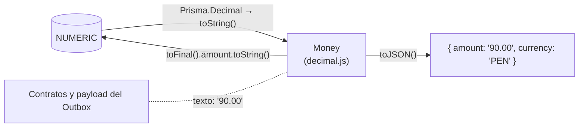
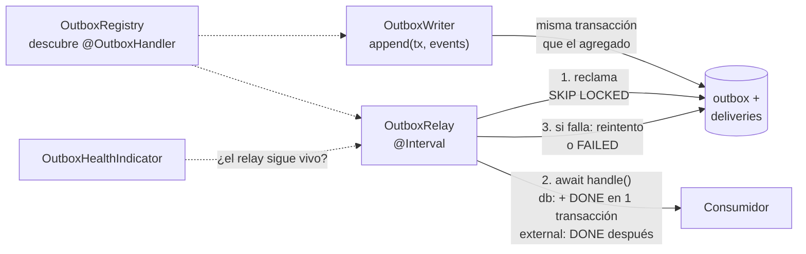
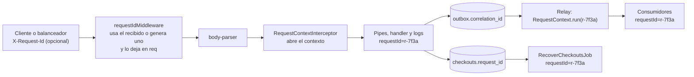

# Backend: piezas clave

> Sección 7 de la guía. El handler de la saga y el job de recuperación están en [04-flujo-pedido-y-saga.md](04-flujo-pedido-y-saga.md).

## 7. Piezas clave

El código del dominio es el de la guía v5. Abajo solo va lo nuevo o lo que cambia.

### Convención por contexto

Los cuatro contextos (Ventas, Catálogo, Inventario e Identidad) siguen **una sola arquitectura hexagonal**, sin excepciones (corte 10). Quien llega no tiene que elegir una forma: la estructura es la misma en todos y la hace cumplir un test. Que un contexto tenga poca lógica no cambia su forma; solo hace más pequeñas sus carpetas.

| Capa | Qué contiene | Qué puede importar |
|---|---|---|
| `domain/` | En `model/<agregado>/`, los agregados, objetos de valor, reglas puras (y specifications en Ventas) y los eventos que publica; en `ports/`, los **puertos**: clases abstractas que dicen qué necesita el contexto de afuera (`OrderRepository`, `StockRepository`, `BookCatalog`, `SessionRepository`, `PasswordHasher`…); y, si hace falta, `shared/` con lo que usan varios agregados del contexto (`Money` y `Specification` en Ventas) | `decimal.js`, `node:*`, `shared-kernel/`, `contracts/` y su propio `domain/` |
| `application/` | Los casos de uso (comandos, consultas y **todos** sus handlers, los de escritura y los de lectura) en `use-cases/`, más los servicios de aplicación en `services/`, los jobs en `jobs/` y, en `support/`, lo que es formato de la API y no una regla. Hablan con los puertos, nunca con la base | Nest, su `domain/`, `shared-kernel/`, `contracts/` y `platform/` (menos Prisma); nunca su `infrastructure/` |
| `interface/` | **Quien llama al contexto** (adaptadores de entrada): `interface/http/` (controladores, DTO y respuestas) e `interface/consumers/` (los `@OutboxHandler`, que reaccionan a un evento). Solo envían comandos y consultas | `application/`, `domain/`, `shared-kernel/`, `contracts/` y `platform/`; nunca `infrastructure/` ni Prisma (salvo el ayudante de la transacción del relay) |
| `infrastructure/` | **A quien llama el contexto** (adaptadores de salida): `infrastructure/persistence/` (los repositorios y lectores de Prisma, con el SQL) e `infrastructure/adapters/` (lo que sale del proceso: pasarela de pago, correo, hash de contraseñas, otro contexto en proceso) | `domain/` (para implementar los puertos), Prisma y `platform/` |

**Cómo se ordena `domain/`**, igual en los cuatro contextos y con la misma lógica que `application/`: la raíz es por *tipo de pieza* y los nombres del negocio van dentro.

| Carpeta | Qué va |
|---|---|
| `domain/model/<agregado>/` | El agregado, sus entidades, objetos de valor, fábrica, reglas, vistas de lectura y las funciones puras de ese agregado (`sales/domain/model/order/order.aggregate.ts`, `catalog/domain/model/book/book.aggregate.ts`, `inventory/domain/model/stock/stock-rules.ts`, `identity/domain/model/user/user.aggregate.ts`). Ventas tiene además `customer/` y `pricing/`; Identidad, `session/` |
| `domain/ports/` | Los puertos: `*.repository.ts` para los repositorios y `*.port.ts` para los demás (`order-history.port.ts`, `access-token-issuer.port.ts`) |
| `domain/shared/` | Opcional. Lo que usan varios agregados del mismo contexto; hoy solo Ventas (`domain/shared/money.vo.ts`) |

Ni la raíz de `domain/` ni `model/` admiten archivos sueltos: un archivo suelto es un concepto que todavía no tiene carpeta.

**Entrada y salida.** `interface/` e `infrastructure/` son los dos lados del núcleo (`domain/` + `application/`): `interface/` es quien llama al contexto (una petición HTTP, `sales/interface/http/order.controller.ts`, o un evento, `sales/interface/consumers/create-customer.consumer.ts`) e `infrastructure/` es a quien llama el contexto (la base, la pasarela de pago, el correo). Un contexto sin consumidores, como Catálogo, no tiene `interface/consumers/`.

**Qué es un caso de uso.** Un comando o una consulta junto con su handler, en `application/use-cases/<agregado>/`. El handler orquesta: valida la entrada con el dominio, pide al puerto lo que necesita y devuelve una vista o nada; no contiene SQL ni reglas de negocio. Algunos comandos viven en `contracts/` porque otro contexto los envía, y en ese caso solo está el handler. Lo demás de `application/` tiene su carpeta (`application/services/`, `application/jobs/` y `application/support/`; la raíz de `application/` no admite archivos sueltos):

| Carpeta | Qué va |
|---|---|
| `use-cases/<agregado>/` | `*.command.ts`, `*.query.ts` y `*.handler.ts` |
| `services/` | Servicios de aplicación que usan varios casos de uso o puertos (`OrderPricer`, `SessionService`, `create-admin.ts`) y el tipo que devuelven |
| `jobs/` | Los `*.job.ts` que disparan casos de uso por tiempo |
| `support/` | Lo que es formato de la API y no una regla de negocio (el cursor de paginación del historial) |

Un ejemplo por contexto:

| Contexto | Caso de uso | Archivo |
|---|---|---|
| Ventas | Hacer un pedido | `sales/application/use-cases/order/place-order.handler.ts` |
| Catálogo | Crear un libro | `catalog/application/use-cases/book/create-book.handler.ts` |
| Inventario | Reservar stock | `inventory/application/use-cases/stock/reserve-stock.handler.ts` |
| Identidad | Iniciar sesión | `identity/application/use-cases/session/login.handler.ts` |

**La lógica pura va en `domain/`, no en `application/`.** Una función que no usa Nest, `platform/` ni ningún puerto no orquesta nada: es una regla (`normalizeCart`, `hashRequest`, `replayOf`, `Customer.fromRegisteredUser`, `Email.tryCreate`) y vive en el dominio, donde se prueba sin nada más. Un puerto (una clase abstracta) vive siempre en `domain/ports/`, también `AccessTokenIssuer`. El test de estructura lo comprueba: un archivo puro en `application/` es una violación, salvo en `support/`.

Cómo se reparten las cosas:

- **Un handler nunca toca Prisma.** Pide al puerto lo que necesita (`books.save(book)`, `stock.reserve(orderId, lines)`, `sessions.rotate(hash, decidir)`) y el adaptador de `persistence/` lo hace con el mismo SQL de siempre. Las operaciones atómicas (la reserva de stock, la rotación del token de refresco) son **métodos del puerto**: el SQL no se esconde, vive en un solo lugar y se prueba contra la base real.
- **Las lecturas también van por puertos**: `BookCatalog`, `OrderHistory`. Devuelven vistas, sin reconstruir el agregado.
- **Un consumidor del Outbox es un adaptador de entrada fino.** Vive en `interface/consumers/`, convierte `ctx.tx` en un identificador opaco (`TransactionHandle`, con `platform/prisma/transaction-handle.ts`) y envía un comando; las reglas están en el handler de `application/`. Los puertos aceptan ese identificador como `tx?` para que lo que escriben se confirme junto con la marca DONE de la entrega.
- **Los puertos se prueban una vez para todos sus adaptadores**: un contrato (`test/support/*.contract.ts`) corre contra el fake en memoria y contra PostgreSQL real, así el fake con el que se prueban los casos de uso no se desvía de lo real.
- **Las dependencias van hacia adentro**: `infrastructure/` conoce a `application/` y a `domain/`, nunca al revés. Un contexto nunca importa de otro: se hablan por `contracts/` y `shared-kernel/`.

**Lo que hace cumplir cada test.** `test/unit/architecture/dependency-rules.spec.ts` comprueba los imports: un contexto no importa de otro, `domain/` no depende de Nest, de Prisma ni de `platform/`, `application/` no usa Prisma ni importa `infrastructure/` ni `interface/`, e `interface/` no importa `infrastructure/` ni Prisma (la entrada habla con los casos de uso, no con la salida). `test/unit/architecture/structure-rules.spec.ts` comprueba la forma: la raíz del contexto solo tiene `domain/`, `application/`, `interface/`, `infrastructure/` y su módulo; `interface/` solo se divide en `http/` y `consumers/`, e `infrastructure/` en `persistence/` y `adapters/`; los controladores, DTO y respuestas viven en `interface/http/`; `domain/` solo se divide en `model/<agregado>/`, `ports/` (todo puerto termina en `.repository.ts` o `.port.ts`) y `shared/`, sin archivos sueltos; `application/` solo se divide en `use-cases/`, `services/`, `jobs/` y `support/`, con los comandos, las consultas y los handlers bajo `use-cases/<agregado>/` y los jobs en `jobs/`; los `@OutboxHandler` van en `interface/consumers/`; cada contexto tiene `domain/ports/`, todo puerto va ahí y ninguna clase abstracta vive fuera de él. Una excepción nueva se discute y se escribe en esos tests, no se improvisa en el código.

**Regla práctica para el que añada algo:** una regla de negocio va en `domain/`; lo que el caso de uso necesita de afuera es un puerto en `domain/ports/` con su adaptador en `infrastructure/persistence/` o `adapters/`, su fake y su contrato; el caso de uso va en `application/use-cases/<agregado>/`; y lo que entra por HTTP o por un evento es un adaptador fino que envía el comando.

### Límites conocidos

Lo que hoy no escala o no está resuelto, para que nadie lo descubra en producción. Lo que sigue abierto está además en «Problemas abiertos» de [`00-avance.md`](00-avance.md).

| Límite | Qué pasa | Qué hay que saber |
|---|---|---|
| **Ritmo del relay del Outbox** | Una vuelta por segundo y un lote de `BATCH` = 10 entregas: **hasta 10 entregas por segundo por instancia**, y solo si cada una es rápida | Las entregas de una vuelta se procesan una tras otra y no hay otra vuelta mientras una sigue en curso, así que con un consumidor lento el ritmo baja: con el correo simulado de 3 s es del orden de una entrega cada 3 s por instancia. Varias instancias se reparten el trabajo (`SKIP LOCKED`) |
| **Lote y bloqueo van juntos** | Una entrega reclamada queda bloqueada `LEASE_MS` = 2 minutos | La regla del código es `BATCH × duración máxima por entrega < LEASE_MS` (10 × 10 s = 100 s < 120 s). **El relay no impone un tiempo máximo por entrega**: el 10 s es una suposición de los consumidores. Si uno tarda más (unos 12 s o más por entrega), el bloqueo vence a mitad del lote, otra instancia la toma y la primera pierde la entrega (`LeaseLostError`; un efecto de base se revierte, uno externo puede repetirse y por eso debe usar `eventId` como clave de idempotencia). No se sube `BATCH` sin revisar `LEASE_MS` |
| **Retención de datos** | Cada noche se purga lo ya terminado (corte 9): `RETENTION_OUTBOX_DAYS` (30), `RETENTION_CHECKOUT_DAYS` (30), `RETENTION_RESERVATION_DAYS` (90) y `RETENTION_REFRESH_TOKEN_DAYS` (7) | **Nunca se purga** lo pendiente, en curso o fallido: un checkout `PENDING`, una reserva `HELD`, un mensaje con una entrega `PENDING` o `FAILED` ni un token vigente. Purgar un checkout olvida su `Idempotency-Key`; purgar un token usado hace que su reutilización se vea como un token desconocido (`401`) y no revoque la sesión. Las consultas de purga no tienen índice propio sobre sus fechas: hoy recorren la tabla cada noche |
| **Límites de intentos en memoria** | Los de `/auth/*` viven en memoria de cada instancia | Con varias instancias el límite real es el de cada una por separado; haría falta un almacén compartido (Redis) |
| **Cotización sin límite propio** | `POST /orders/quote` no tiene límite de intentos | La acotan la sesión de comprador, el máximo de 100 líneas y que ahora es **una sola consulta** al catálogo por cotización |
| **Una sola base y una sola zona** | Las columnas `TIMESTAMP(3)` no llevan zona horaria | La base debe ejecutarse en UTC; con otra zona, las comparaciones con `now()` (relay, purga) se desfasan unas horas |

### Dominio: `Money` con decimal.js

```ts
// sales/domain/shared/money.vo.ts: decimal.js, NUNCA Prisma.Decimal (regla 3 de la arquitectura)
import { Decimal } from 'decimal.js';   // con nombre: el import por defecto no tiene tipos con `module: nodenext`

export type Currency = 'PEN' | 'USD';

export class Money {
  private constructor(readonly amount: Decimal, readonly currency: Currency) {}

  // Sin `number`: un float como 1.005 ya llega mal representado
  static of(value: string | Decimal, currency: Currency = 'PEN'): Money {
    const d = Money.parse(value);                                    // INVALID_AMOUNT si no es un número finito
    if (d.isNegative()) throw new DomainError('NEGATIVE_AMOUNT', 'El monto no puede ser negativo');
    return new Money(d, currency);
  }
  static zero(currency: Currency = 'PEN'): Money { return new Money(new Decimal(0), currency); }

  add(o: Money): Money { this.assertSame(o); return Money.of(this.amount.plus(o.amount), this.currency); }
  multiply(factor: string | Decimal): Money { return Money.of(this.amount.times(factor), this.currency); }   // un factor negativo falla

  // Importe final: 2 decimales, mitad hacia arriba. Explícito en cada uso, nunca con Decimal.set() global
  toFinal(): Money { return new Money(this.amount.toDecimalPlaces(2, Decimal.ROUND_HALF_UP), this.currency); }

  equals(o: Money): boolean { return this.currency === o.currency && this.amount.equals(o.amount); }
  isGreaterOrEqualThan(o: Money): boolean { this.assertSame(o); return this.amount.gte(o.amount); }

  toFixed(): string { return this.amount.toFixed(2); }                         // "90.00"
  toJSON() { return { amount: this.toFixed(), currency: this.currency }; }   // formato de la API

  private assertSame(o: Money): void {
    if (o.currency !== this.currency) throw new DomainError('CURRENCY_MISMATCH', 'No se pueden operar monedas distintas');
  }
}
```

**Reglas de los montos:**



1. **Se calcula con toda la precisión y se redondea una sola vez**, con `toFinal()`, antes de cobrar o guardar un importe final.
2. **El dominio nunca recibe `number`** como monto, y nunca compara con `===` o `>`: usa `equals` y `isGreaterOrEqualThan`.
3. **El mapper convierte en el borde a través de texto:** `Money.of(row.chargedAmount.toString(), row.currency)` al leer, y `chargedAmount: money.toFinal().amount.toString()` al escribir (Prisma acepta texto en columnas `Decimal`). `Prisma.Decimal` es una copia propia de decimal.js dentro del cliente generado, así que no se mezcla con la del dominio.
4. **Entre contextos y en la API, los montos viajan como texto** con 2 decimales y su moneda. Nunca como `number`.

**Cambios en el dominio de la guía v5:** `Money` pasa a la versión de arriba. `order.place()` crea el evento con `this.subtotal().toFinal().toFixed()` (texto) en lugar de `this.subtotal().cents`. `PricingService` aplica el descuento con `multiply('0.90')`; el costo de envío y el mínimo de envío gratis (`MinimumSubtotalSpec`) salen de la tabla `PRICING_RULES` de `pricing-rules.ts`, con valores propios para `PEN` (`10.00` y `150.00`) y para `USD` (`3.00` y `40.00`). El adaptador de la pasarela convierte el `Money` final al formato que pida el proveedor (por ejemplo, céntimos enteros: `money.toFinal().amount.times(100).toNumber()`).

### Dominio: puertos y eventos

```ts
// sales/domain/ports/stock-reservation.port.ts
export abstract class StockReservation {
  abstract reserve(orderId: string, lines: { isbn: string; quantity: number }[]): Promise<void>; // lanza OutOfStockError
  abstract release(orderId: string): Promise<void>;
}

// sales/domain/ports/order.repository.ts
export abstract class OrderRepository {
  abstract findById(id: string): Promise<Order | null>;
  abstract save(order: Order, charged: Money): Promise<void>;         // también marca el checkout COMPLETED
  abstract nextId(): string;
}

// sales/domain/ports/checkout-log.port.ts: el estado de la saga
export abstract class CheckoutLog {
  abstract start(orderId: string, idempotencyKey: string, requestHash: string): Promise<boolean>; // false si la clave ya existe
  abstract findByKey(idempotencyKey: string): Promise<CheckoutRecord | null>;  // { orderId, status, requestHash, charged: Money | null }: Money.of(chargedAmount.toString(), currency)
  abstract isCompleted(orderId: string): Promise<boolean>;            // ¿el pedido llegó a guardarse?
  abstract abort(orderId: string): Promise<void>;                     // PENDING → ABORTED (nunca toca COMPLETED)
  abstract claimStale(olderThanMinutes: number): Promise<{ orderId: string; requestId: string | null }[]>; // reclama PENDING antiguos (SKIP LOCKED)
}
```

```ts
// shared-kernel/domain-event.ts
export interface DomainEvent {
  readonly eventName: string;
  readonly eventVersion: number;   // para cambiar el formato sin romper a los consumidores
  readonly aggregateId: string;
  readonly occurredOn: Date;
}

// contracts/sales/order-placed.event.ts
// Versión 2: agrega shippingAddress (la necesitará Envíos). Los consumidores de la versión 1 la ignoran, y los eventos
// ya guardados siguen siendo de la versión 1, sin dirección
export interface ShippingAddressPayload { recipient: string; phone: string; line1: string; district: string; province: string; department: string; reference: string | null }
export class OrderPlacedEvent implements DomainEvent {
  readonly eventName = 'sales.order.placed';
  readonly eventVersion = 2;
  readonly occurredOn = new Date();
  readonly aggregateId: string;   // propiedad real (no getter), para que también viaje en el payload JSON
  constructor(
    readonly orderId: string,
    readonly customerId: string,
    readonly subtotal: string,                  // "100.00": los montos viajan como texto
    readonly lines: { isbn: string; quantity: number }[],
    readonly shippingAddress: ShippingAddressPayload,
  ) {
    this.aggregateId = orderId;
  }
}
```

```ts
// shared-kernel/domain.errors.ts: el filtro HTTP decide el código según la clase
export class DomainError extends Error {                       // → 422
  constructor(readonly code: string, message: string) { super(message); }
}
export class NotFoundError extends DomainError {                // → 404
  constructor(entity: string, id: string) { super('NOT_FOUND', `${entity} ${id} no existe`); }
}
export class ConflictError extends DomainError {}               // → 409

// contracts/inventory/stock.errors.ts
export class OutOfStockError extends DomainError {              // → 422
  constructor(isbn: string) { super('OUT_OF_STOCK', `Sin stock suficiente para ${isbn}`); }
}
export class StockItemNotFoundError extends DomainError {       // → 422 (no 404: el libro existe en Catálogo)
  constructor(isbn: string) { super('STOCK_ITEM_NOT_FOUND', `No hay registro de stock para ${isbn}`); }
}
```

`order.place()` registra `OrderPlacedEvent`, como en la guía. Los consumidores reciben el **payload como JSON**: los eventos no deben tener métodos ni depender de que las fechas lleguen como `Date`.

### Ventas llama a Catálogo e Inventario por `contracts/`

```ts
// sales/infrastructure/adapters/inventory-in-process.adapter.ts
@Injectable()
export class InventoryInProcessAdapter extends StockReservation {
  constructor(private readonly commandBus: CommandBus) { super(); }
  reserve(orderId: string, lines: { isbn: string; quantity: number }[]) {
    return this.commandBus.execute(new ReserveStockCommand(orderId, lines));
  }
  release(orderId: string) {
    return this.commandBus.execute(new ReleaseStockCommand(orderId));
  }
}
```

```ts
// sales/infrastructure/adapters/catalog-in-process.adapter.ts
@Injectable()
export class CatalogInProcessAdapter extends CatalogPricing {
  constructor(private readonly queryBus: QueryBus) { super(); }

  async priceCart(items: CartItem[]): Promise<PricedCartItem[]> {
    if (items.length === 0) return [];
    // Una sola consulta para todo el carrito (corte 9): cotizar 100 líneas no son 100 consultas. NotFoundError, con el
    // primer ISBN según el orden pedido, si un libro no existe o está inactivo
    const books = await this.queryBus.execute(new GetBooksPricesQuery(items.map((i) => i.isbn)));
    const byIsbn = new Map(books.map((b) => [b.isbn, b]));
    return items.map((i) => {
      const book = byIsbn.get(i.isbn);
      if (!book) throw new NotFoundError('Book', i.isbn);
      // book.price es { amount: "45.00", currency: "PEN" }: se toman ambos, sin pasar por number
      return { isbn: i.isbn, quantity: i.quantity, title: book.title, price: book.price.amount, currency: book.price.currency };
    });
  }
}
```

```ts
// sales/infrastructure/adapters/console-notifier.adapter.ts
export class ConsoleNotifier extends Notifier {
  private readonly logger = new Logger(ConsoleNotifier.name);

  constructor(readonly delayMs = 0) { super(); /* valida: entero de 0 o más */ }

  async send(to: string, message: string, options?: { idempotencyKey?: string }): Promise<void> {
    if (this.delayMs > 0) await new Promise((resolve) => setTimeout(resolve, this.delayMs));   // como un proveedor real
    const key = options?.idempotencyKey;
    this.logger.log(`Email a ${to}: ${message}${key ? ` (clave de idempotencia ${key})` : ''}`);   // el requestId lo añade RequestAwareLogger
  }
}
```

Es un sustituto de desarrollo: escribe el destinatario en el log, así que no es para producción con datos reales. Tarda `EMAIL_SIMULATED_DELAY_MS` (3 s por defecto; los tests lo ponen en 0) y escribe el log **al terminar la espera**: si el proceso se detiene durante ella, el correo no "salió" y el relay lo reintenta con la misma clave. La crea la fábrica de `SalesModule`, que le pasa la demora.

**Cambio en el dominio de la guía v5:** el título viaja como snapshot. `PricedCartItem` y `OrderLine` agregan `title`, y la factory lo pasa a `order.addBook(isbn, title, price, quantity)`. `PricedCartItem` lleva `price` como texto (`"45.00"`) y `currency`, y la factory los convierte con `Money.of(item.price, item.currency)`, sin pasar por `number`.

### Inventario: reserva atómica, liberación y confirmación

```ts
// inventory/infrastructure/persistence/prisma-stock.repository.ts (reserve)
@CommandHandler(ReserveStockCommand)
export class ReserveStockHandler implements ICommandHandler<ReserveStockCommand> {
  constructor(private readonly prisma: PrismaService) {}

  async execute({ orderId, lines }: ReserveStockCommand): Promise<void> {
    await this.prisma.$transaction(async (tx) => {
      // Siempre en orden de ISBN: si dos pedidos con los libros {A, B} y {B, A} reservan a la vez,
      // ambos bloquean primero A y luego B, y no se produce un interbloqueo (deadlock)
      for (const { isbn, quantity } of sortByIsbn(lines)) {    // lock-order.ts: comparación de texto simple, no depende del idioma del sistema
        // Solo descuenta si alcanza: nunca queda en negativo, aunque haya pedidos simultáneos
        const { count } = await tx.stockItem.updateMany({
          where: { isbn, available: { gte: quantity } },
          data: { available: { decrement: quantity }, reserved: { increment: quantity } },
        });
        if (count === 0) {
          // Distingue "no alcanza" de "no existe el registro de stock" (dato inconsistente)
          const exists = await tx.stockItem.findUnique({ where: { isbn }, select: { isbn: true } });
          throw exists ? new OutOfStockError(isbn) : new StockItemNotFoundError(isbn);   // revierte todas las líneas
        }
      }
      await tx.reservation.createMany({ data: lines.map((l) => ({ orderId, ...l })) });
    });
  }
}
```

- **Las líneas llegan sin ISBN repetidos:** el agregado `Order` ya suma en una sola línea las unidades del mismo libro. El handler lo exige antes de abrir la transacción: sin líneas (`EMPTY_RESERVATION`), un ISBN repetido (`DUPLICATE_RESERVATION_LINE`) o una cantidad que no sea un entero ≥ 1 (`INVALID_QUANTITY`) son errores de dominio, no el error de la base.
- **Un pedido solo reserva una vez:** si ya tiene reservas, el handler lanza `ConflictError` (`ORDER_ALREADY_RESERVED`). Lo detecta una comprobación previa. Para que dos peticiones del mismo pedido a la vez no la esquiven, la transacción empieza con `pg_advisory_xact_lock(hashtext('inventory.reserve-stock'), hashtext(orderId))`: serializa las reservas del mismo pedido, también cuando sus libros son distintos (y por eso no compiten por ninguna fila de stock ni chocan en la clave primaria). Pedidos distintos no se esperan. Como último recurso queda la clave primaria de `reservations` (`P2002`), que se traduce al mismo error. La saga no debería llegar ahí, porque el checkout con su `Idempotency-Key` lo impide.
- **Toda transacción que toca `stock_items` bloquea las filas en orden de ISBN** (reservar y liberar). Es la regla que evita interbloqueos entre pedidos simultáneos; cualquier operación nueva sobre stock debe seguirla.
- **`StockItemNotFoundError`** (422, `STOCK_ITEM_NOT_FOUND`) indica un libro del catálogo sin registro de stock: además de rechazar la compra, se registra como error para corregir el dato.

```ts
// inventory/infrastructure/persistence/prisma-stock.repository.ts (release): idempotente y segura bajo concurrencia
@CommandHandler(ReleaseStockCommand)
export class ReleaseStockHandler implements ICommandHandler<ReleaseStockCommand> {
  constructor(private readonly prisma: PrismaService) {}

  async execute({ orderId }: ReleaseStockCommand): Promise<void> {
    await this.prisma.$transaction(async (tx) => {
      // Borra y devuelve en un solo paso. Si dos liberaciones corren a la vez, la segunda espera
      // el bloqueo de fila, ya no encuentra reservas y no devuelve el stock otra vez
      const released = await tx.$queryRaw<{ isbn: string; quantity: number }[]>`
        DELETE FROM inventory.reservations
        WHERE order_id = ${orderId}::uuid AND status = 'HELD'
        RETURNING isbn, quantity`;
      released.sort((a, b) => a.isbn.localeCompare(b.isbn));   // mismo orden de bloqueo que la reserva
      for (const r of released) {
        await tx.stockItem.update({
          where: { isbn: r.isbn },
          data: { available: { increment: r.quantity }, reserved: { decrement: r.quantity } },
        });
      }
    });
  }
}
```

```ts
// inventory/interface/consumers/confirm-reservation.consumer.ts
// Reacción a OrderPlaced: usa el tx del relay, así el efecto y la marca DONE se confirman juntos → una sola vez
@OutboxHandler()
@Injectable()
export class ConfirmReservationConsumer implements DbOutboxConsumer<OrderPlacedEvent> {
  readonly kind = 'db' as const;
  readonly name = 'inventory.confirm-reservation';
  readonly event = 'sales.order.placed';
  async handle(e: OrderPlacedEvent, { tx }: DbDeliveryContext): Promise<void> {
    await tx.reservation.updateMany({
      where: { orderId: e.orderId, status: 'HELD' },
      data: { status: 'CONFIRMED' },
    });
  }
}
```

- **La liberación es idempotente por construcción:** el `DELETE … RETURNING` devuelve cada reserva una sola vez, así que liberar dos veces, o dos liberaciones simultáneas, devuelven el stock una sola vez. Solo toca reservas `HELD`: una `CONFIRMED` ya es definitiva. Es todo o nada: si una línea no se puede devolver (por ejemplo, falta su registro de stock), la transacción se revierte y la reserva se conserva para reintentar.
- **El `orderId` debe ser un UUID** en la reserva y en la liberación; si no, `INVALID_ORDER_ID` en lugar de un error crudo de la base.

Las reservas `HELD` sin pedido ya no necesitan un job propio en Inventario: las libera `RecoverCheckoutsJob` de Ventas, a través del mismo `ReleaseStockCommand`. Confirmar la reserva sirve para que Inventario distinga las reservas definitivas, que Envíos descontará más adelante.

### Ventas: guardar el pedido y su evento juntos

```ts
// sales/infrastructure/persistence/prisma-order.repository.ts
@Injectable()
export class PrismaOrderRepository extends OrderRepository {
  constructor(private readonly prisma: PrismaService, private readonly outbox: OutboxWriter) { super(); }

  nextId() { return randomUUID(); }

  async findById(id: string) {
    const row = await this.prisma.order.findUnique({
      where: { id },
      include: { lines: { orderBy: { isbn: 'asc' } } },       // orden estable, no el físico
    });
    return row ? OrderMapper.toDomain(row) : null;           // Order.restore: confirmado y sin eventos
  }

  async save(order: Order, charged: Money): Promise<void> {
    if (order.status !== 'PLACED') throw new DomainError('ORDER_NOT_PLACED', 'Solo se guarda un pedido confirmado');
    if (charged.currency !== order.currency) throw new DomainError('CURRENCY_MISMATCH', 'El monto cobrado debe estar en la moneda del pedido');
    const final = charged.toFinal();                          // se redondea una sola vez, aquí
    const events = order.pullEvents();
    await this.prisma.$transaction(async (tx) => {
      // Solo completa un checkout que siga PENDING. Si la recuperación ya lo anuló (reembolsó y liberó), crear el
      // pedido lo dejaría sin cobro y sin stock: se lanza el error y la transacción se deshace
      const completed = await tx.checkout.updateMany({
        where: { orderId: order.id, status: 'PENDING' },
        data: { status: 'COMPLETED', chargedAmount: final.amount.toFixed(2), currency: final.currency },   // para los reintentos
      });
      if (completed.count === 0) throw new ConflictError('CHECKOUT_NOT_PENDING', `El checkout del pedido ${order.id} ya no está pendiente`);
      await tx.order.create({ data: OrderMapper.toCreate(order, final.amount.toFixed(2), final.currency) });
      await this.outbox.append(tx, events);                   // misma transacción: recibe tx
    });
  }
}
```

En esta fase los pedidos solo se crean. Cuando existan flujos que los modifiquen (por ejemplo, cancelar), se agrega una columna `version` con bloqueo optimista.

### Email: el primer consumidor

```ts
// sales/interface/consumers/send-order-confirmation.consumer.ts
@OutboxHandler()
@Injectable()
export class SendOrderConfirmationConsumer implements ExternalOutboxConsumer<OrderPlacedEvent> {
  readonly kind = 'external' as const;      // el relay lo ejecuta fuera de toda transacción
  readonly name = 'sales.send-order-confirmation';
  readonly event = 'sales.order.placed';
  constructor(private readonly customers: CustomerRepository, private readonly notifier: Notifier) {}

  async handle(e: OrderPlacedEvent, { eventId }: DeliveryContext): Promise<void> {
    const customer = await this.customers.findById(e.customerId);
    if (!customer) return;
    // Servicio externo: se entrega "al menos una vez", con eventId como clave de idempotencia
    await this.notifier.send(customer.email.value, `¡Gracias! Tu pedido ${e.orderId} fue recibido.`, { idempotencyKey: eventId });
  }
}
```

**Cambio en el puerto de la guía v5:** `Notifier.send(to, message)` agrega un tercer parámetro opcional, `{ idempotencyKey?: string }`, que el adaptador real envía al proveedor de email.

### Platform: el Outbox



```ts
// platform/outbox/outbox-consumer.ts y outbox-handler.decorator.ts
export interface DeliveryContext {
  eventId: string;
  occurredOn: Date;
  attempt: number;
  correlationId: string | null;   // requestId de origen: un consumidor externo puede enviarlo al proveedor
}
export interface DbDeliveryContext extends DeliveryContext { tx: Prisma.TransactionClient }

// Efecto en la BD propia: el relay lo ejecuta dentro de su transacción, junto con la marca DONE
export interface DbOutboxConsumer<E> {
  readonly kind: 'db';
  readonly name: string;    // único: 'inventory.confirm-reservation'
  readonly event: string;   // 'sales.order.placed'
  handle(event: E, ctx: DbDeliveryContext): Promise<void>;
}

// Efecto externo (email, SUNAT): el relay lo ejecuta FUERA de toda transacción
export interface ExternalOutboxConsumer<E> {
  readonly kind: 'external';
  readonly name: string;
  readonly event: string;
  handle(event: E, ctx: DeliveryContext): Promise<void>;   // debe enviar ctx.eventId como clave de idempotencia
}

export type OutboxConsumer<E> = DbOutboxConsumer<E> | ExternalOutboxConsumer<E>;

export const OutboxHandler = DiscoveryService.createDecorator();
```

```ts
// platform/outbox/outbox.registry.ts
@Injectable()
export class OutboxRegistry implements OnModuleInit {
  private readonly byName = new Map<string, OutboxConsumer<unknown>>();
  private readonly byEvent = new Map<string, string[]>();

  constructor(private readonly discovery: DiscoveryService) {}

  onModuleInit() {
    for (const { instance } of this.discovery.getProviders({ metadataKey: OutboxHandler.KEY })) {
      const c = instance as OutboxConsumer<unknown>;
      if (this.byName.has(c.name)) throw new Error(`Consumidor duplicado: ${c.name}`);
      this.byName.set(c.name, c);
      this.byEvent.set(c.event, [...(this.byEvent.get(c.event) ?? []), c.name]);
    }
  }

  consumersOf(eventName: string): string[] { return this.byEvent.get(eventName) ?? []; }
  get(name: string): OutboxConsumer<unknown> | undefined { return this.byName.get(name); }
}
```

El registro hace una comprobación más que el código de arriba: al arrancar rechaza un consumidor mal formado (un `kind` que no sea `db` o `external`, sin `name`, sin `event` o sin método `handle()`), con un mensaje que nombra la clase. Así el error aparece al desplegar y no cuando llega el primer evento. `OutboxModule` importa `DiscoveryModule` y **no** `ScheduleModule`, que se queda en `AppModule`: los tests construyen el Outbox sin intervalo y manejan el relay a mano.

```ts
// platform/outbox/outbox.writer.ts
@Injectable()
export class OutboxWriter {
  constructor(private readonly registry: OutboxRegistry) {}

  // Siempre recibe la transacción de quien guarda el agregado: nunca abre la suya
  async append(tx: Prisma.TransactionClient, events: DomainEvent[]): Promise<void> {
    for (const e of events) {
      const consumers = this.registry.consumersOf(e.eventName);
      if (consumers.length === 0) continue;   // nadie escucha este evento todavía
      const { id } = await tx.outboxMessage.create({
        data: {
          eventName: e.eventName, eventVersion: e.eventVersion, aggregateId: e.aggregateId,
          payload: JSON.parse(JSON.stringify(e)), occurredOn: e.occurredOn,
          correlationId: RequestContext.requestId() ?? null,   // fuera del payload: es un dato técnico, no de negocio
        },
      });
      await tx.delivery.createMany({ data: consumers.map((consumer) => ({ eventId: id, consumer })) });
    }
  }
}
```

Las entregas se crean al escribir el evento. Un consumidor nuevo solo recibe los eventos que se guarden **después** de desplegarlo.

**Las tres reglas del relay:**

| Regla | Por qué |
|---|---|
| **Lote × duración máxima por entrega < bloqueo** (10 × 10 s = 100 s < 2 min) | Si el lote tardara más que el bloqueo, otra instancia reclamaría entregas que todavía esperan en la cola de esta, y se procesarían dos veces |
| **Fencing por `attempts`** en cada actualización | Si el bloqueo venció y otra instancia reclamó la entrega, la instancia lenta no pisa su estado (por ejemplo, devolver a PENDING algo que ya está DONE). En un consumidor `db`, además, revierte el efecto |
| **Orden por agregado y consumidor** | Un consumidor nunca procesa un evento de un pedido antes que otro anterior del mismo pedido (por ejemplo, `OrderCancelled` antes que `OrderPlaced`). Si un evento queda FAILED, los posteriores de ese mismo pedido y consumidor siguen adelante; si un consumidor necesita orden estricto incluso con fallos, debe incluir `FAILED` en el `NOT EXISTS` |

**Límite conocido del orden:** `NOT EXISTS` compara el identificador del evento (uuidv7, que crece con el tiempo), no el orden de confirmación. Si dos transacciones del mismo pedido corrieran a la vez y la de id menor confirmara después, el relay podría ver primero el evento posterior. Hoy cada pedido genera un solo evento (`OrderPlaced`), así que no ocurre; si algún día hay varios por pedido, hay que revisar este punto.

```ts
// platform/outbox/outbox.relay.ts
const LEASE_MS = 2 * 60_000;   // bloqueo de cada entrega reclamada
const BATCH = 10;              // BATCH × duración máxima por entrega (10 s) = 100 s < LEASE_MS

type Claimed = {
  eventId: string; consumer: string; attempts: number;
  payload: unknown; occurredOn: Date; correlationId: string | null;
};

class LeaseLostError extends Error {
  constructor(d: Claimed) { super(`Entrega ${d.consumer}/${d.eventId} reclamada por otra instancia`); }
}

@Injectable()
export class OutboxRelay {
  private readonly logger = new Logger(OutboxRelay.name);
  private running = false;
  private runStartedAt: number | null = null;
  private lastRunAt: number | null = null;

  // Viva si está en una vuelta que aún no supera el bloqueo, o si terminó una hace menos de 1 min.
  // Una vuelta legítima dura hasta ~100 s (10 × 10 s): mientras no supere LEASE_MS, cuenta como viva
  isAlive(now = Date.now()): boolean {
    if (this.running && this.runStartedAt !== null) return now - this.runStartedAt < LEASE_MS;
    return this.lastRunAt !== null && now - this.lastRunAt < 60_000;
  }

  get lastRunAtIso(): string | null {
    return this.lastRunAt === null ? null : new Date(this.lastRunAt).toISOString();
  }

  constructor(
    private readonly prisma: PrismaService,
    private readonly registry: OutboxRegistry,
    private readonly config: ConfigService,
  ) {}

  @Interval(1000)
  async tick(): Promise<void> {
    if (this.running) return;                  // una vuelta a la vez por instancia
    this.running = true;
    this.runStartedAt = Date.now();
    try {
      await this.runOnce();
      this.lastRunAt = Date.now();
    } catch (err) {
      this.logger.error(`Vuelta del relay fallida: ${String(err)}`);
    } finally {
      this.running = false;
      this.runStartedAt = null;
    }
  }

  async runOnce(): Promise<number> {
    // Reclama un lote acotado. SKIP LOCKED: dos instancias nunca toman la misma entrega.
    // NOT EXISTS: no adelanta un evento si el mismo consumidor tiene pendiente uno anterior
    // del mismo agregado (orden por agregado y consumidor).
    const claimed = await this.prisma.$queryRaw<Claimed[]>`
      WITH c AS (
        UPDATE messaging.deliveries d
        SET locked_until = now() + make_interval(secs => ${LEASE_MS / 1000}),
            attempts = d.attempts + 1
        WHERE (d.event_id, d.consumer) IN (
          SELECT d2.event_id, d2.consumer
          FROM messaging.deliveries d2
          JOIN messaging.outbox o2 ON o2.id = d2.event_id
          WHERE d2.status = 'PENDING' AND d2.next_attempt_at <= now()
            AND (d2.locked_until IS NULL OR d2.locked_until < now())
            AND NOT EXISTS (
              SELECT 1 FROM messaging.deliveries p
              JOIN messaging.outbox po ON po.id = p.event_id
              WHERE p.consumer = d2.consumer AND po.aggregate_id = o2.aggregate_id
                AND p.status = 'PENDING' AND p.event_id < d2.event_id)
          ORDER BY d2.event_id
          LIMIT ${BATCH}
          FOR UPDATE OF d2 SKIP LOCKED)
        RETURNING d.event_id, d.consumer, d.attempts)
      SELECT c.event_id AS "eventId", c.consumer, c.attempts, o.payload,
             o.occurred_on AS "occurredOn", o.correlation_id AS "correlationId"
      FROM c JOIN messaging.outbox o ON o.id = c.event_id
      ORDER BY c.event_id`;

    for (const d of claimed) {
      // Restaura el requestId de origen: los logs del consumidor (y los eventos que genere) lo heredan
      await RequestContext.run(d.correlationId ?? `event-${d.eventId}`, () => this.deliver(d));
    }
    return claimed.length;
  }

  private async deliver(d: Claimed): Promise<void> {
    // Fencing: cada actualización exige que la entrega siga siendo nuestra (mismo intento, aún PENDING).
    // Si el bloqueo venció y otra instancia la reclamó, attempts ya cambió y no pisamos su estado.
    const mine = { eventId: d.eventId, consumer: d.consumer, attempts: d.attempts, status: 'PENDING' as const };
    try {
      const consumer = this.registry.get(d.consumer);
      if (!consumer) throw new Error(`Consumidor no registrado: ${d.consumer}`);
      const ctx = { eventId: d.eventId, occurredOn: d.occurredOn, attempt: d.attempts, correlationId: d.correlationId };

      if (consumer.kind === 'db') {
        // Efecto local + DONE en la misma transacción. Si perdimos la entrega, se revierte también el efecto
        await this.prisma.$transaction(async (tx) => {
          await consumer.handle(d.payload, { ...ctx, tx });
          const { count } = await tx.delivery.updateMany({ where: mine, data: { status: 'DONE', lockedUntil: null } });
          if (count === 0) throw new LeaseLostError(d);
        });
      } else {
        // Efecto externo: ninguna transacción abierta mientras se espera la red.
        // Si el proceso cae entre estas dos líneas, se reintenta: por eso el proveedor recibe eventId
        await consumer.handle(d.payload, ctx);
        const { count } = await this.prisma.delivery.updateMany({ where: mine, data: { status: 'DONE', lockedUntil: null } });
        if (count === 0) this.logger.warn(`Entrega ${d.consumer}/${d.eventId} reclamada por otra instancia; puede repetirse (idempotencia por eventId)`);
      }
    } catch (err) {
      if (err instanceof LeaseLostError) {
        this.logger.warn(`Entrega ${d.consumer}/${d.eventId} reclamada por otra instancia; efecto revertido`);
        return;
      }
      const max = this.config.getOrThrow<number>('OUTBOX_MAX_ATTEMPTS');
      const failed = d.attempts >= max;
      const backoffSeconds = Math.min(2 ** d.attempts, 5 * 60);   // 2 s, 4 s, 8 s… hasta 5 min
      // La hora del próximo intento sale del reloj de la base (el mismo del bloqueo), también con fencing por `attempts`
      await this.prisma.$executeRaw`
        UPDATE messaging.deliveries
        SET status = ${failed ? 'FAILED' : 'PENDING'}::messaging."DeliveryStatus",
            next_attempt_at = now() + make_interval(secs => ${backoffSeconds}),
            locked_until = NULL, last_error = ${String(err).slice(0, 1000)}
        WHERE event_id = ${d.eventId}::uuid AND consumer = ${d.consumer}
          AND attempts = ${d.attempts} AND status = 'PENDING'::messaging."DeliveryStatus"`;
      const msg = `Entrega ${d.consumer} de ${d.eventId}, intento ${d.attempts}: ${String(err)}`;
      failed ? this.logger.error(`FAILED. ${msg}`) : this.logger.warn(msg);
    }
  }
}
```

La instancia lenta nunca pisa a la que retomó la entrega, en ninguno de sus tres finales: si **termina bien**, la actualización a `DONE` no encuentra su intento (en `db` se revierte también el efecto; en `external` solo se avisa de que pudo repetirse); si **falla tarde**, el SQL del fallo tampoco modifica nada y el log lo registra como aviso, sin anunciar un `FAILED` que no ocurrió; y si termina **mientras la otra todavía trabaja**, tampoco marca `DONE`. Los tests lo comprueban con consumidores que se quedan parados hasta que el test los suelta y con el bloqueo vencido por SQL, sin esperar los 2 minutos.

**Apagado ordenado.** `stop()` impide empezar vueltas nuevas y espera (hasta 15 s) a la que esté en curso; el relay lo llama desde `beforeApplicationShutdown`. Por eso `PrismaService` se desconecta en `onApplicationShutdown`, una fase posterior: la conexión sigue abierta mientras el relay termina. Si el relay no alcanza a terminar, la entrega queda bloqueada y otra vuelta la retoma al vencer el bloqueo (a lo sumo, un efecto externo repetido, que por eso lleva el `eventId` como clave de idempotencia).

```ts
// platform/outbox/outbox.health.ts: lo usa GET /health/outbox
@Injectable()
export class OutboxHealthIndicator {
  constructor(
    private readonly relay: OutboxRelay,
    private readonly prisma: PrismaService,
    private readonly health: HealthIndicatorService,
  ) {}

  async check(key = 'outbox') {
    const indicator = this.health.check(key);
    const relayAlive = this.relay.isAlive();

    // Solo informativo: no cambia el estado
    const [failed, due] = await Promise.all([
      this.prisma.delivery.count({ where: { status: 'FAILED' } }),
      this.prisma.delivery.count({ where: { status: 'PENDING', nextAttemptAt: { lte: new Date() } } }),
    ]);

    const details = { relayLastRunAt: this.relay.lastRunAtIso, failed, due };
    return relayAlive ? indicator.up(details) : indicator.down(details);
  }
}
```

```ts
// platform/health/health.controller.ts
@Controller('health')
export class HealthController {
  constructor(
    private readonly health: HealthCheckService,
    private readonly db: DbHealthIndicator,           // SELECT 1
    private readonly outbox: OutboxHealthIndicator,
  ) {}

  @Get('live')
  live() { return { status: 'ok' }; }                                         // liveness: el proceso responde (no toca la BD)

  @Get('ready') @HealthCheck()
  ready() { return this.health.check([() => this.db.check()]); }             // readiness: para el balanceador (solo la BD)

  @Get('outbox') @HealthCheck()
  outboxStatus() { return this.health.check([() => this.outbox.check()]); }  // para monitoreo y alertas
}
```

> [!important] Cada endpoint tiene un solo uso
> - **`/health/live`** (liveness): solo dice que el proceso responde. Si consultara la BD, una caída de la base haría que el orquestador **reinicie** todas las instancias, sin arreglar nada.
> - **`/health/ready`** (readiness): consulta la BD. Si falla, el balanceador deja de enviar tráfico a esa instancia, pero no la reinicia.
> - **`/health/outbox`**: va a monitoreo y alertas. Si el balanceador lo usara, un proveedor de email lento sacaría de servicio todas las instancias, aunque las ventas funcionen.

**Reprocesar entregas fallidas** (sin autenticación no conviene un endpoint; se hace por SQL o con un script):

```sql
SET TIME ZONE 'UTC';   -- las columnas no llevan zona horaria: se escriben en UTC, como hace la aplicación
UPDATE messaging.deliveries
SET status = 'PENDING', attempts = 0, next_attempt_at = now(), last_error = NULL
WHERE status = 'FAILED' AND consumer = 'sales.send-order-confirmation';
```

`FAILED` no borra nada: el evento, su payload y `last_error` quedan en la BD para inspeccionarlos. Cada paso a `FAILED` se registra como error en el log; conéctalo a una alerta.

> [!note] Qué mide `/health/outbox` y qué no
> Marca **down** solo cuando el relay de esa instancia está detenido: no terminó una vuelta en el último minuto **y** no está en medio de una, o lleva una vuelta más larga que el bloqueo (2 min). Una vuelta legítima de hasta ~100 s cuenta como viva, así que el indicador no parpadea con cola continua. Así no hay falsos positivos: una entrega en espera de reintento, una bloqueada detrás de un evento anterior del mismo pedido o una `FAILED` antigua ya revisada **no** lo ponen en rojo. Las cantidades `failed` y `due` van en el detalle, para que el monitoreo alerte con sus propios umbrales (por ejemplo, `failed` creció o `due` lleva varios minutos alto).

| Garantía | Para |
|---|---|
| **Efecto único en la BD** (consumidores `db`) | El cambio en PostgreSQL y la marca DONE se confirman juntos: aunque la entrega se repita, el efecto queda aplicado una sola vez. Es una garantía de la transacción local, no universal |
| **Al menos una vez** (consumidores `external`) | La llamada externa no queda protegida por PostgreSQL y puede repetirse. Solo la clave de idempotencia (`eventId`), si el proveedor la acepta, evita el efecto doble |

### Platform: identificador de correlación



```ts
// platform/observability/request-context.ts: AsyncLocalStorage nativo de Node, sin librerías
import { AsyncLocalStorage } from 'node:async_hooks';

const storage = new AsyncLocalStorage<{ requestId: string }>();

export const RequestContext = {
  run<T>(requestId: string, fn: () => T): T { return storage.run({ requestId }, fn); },
  requestId(): string | undefined { return storage.getStore()?.requestId; },
};
```

```ts
// platform/observability/request-id.middleware.ts
import { randomUUID } from 'node:crypto';
import type { NextFunction, Request, Response } from 'express';

// Solo decide el ID y lo devuelve. NO abre el contexto: el body-parser, que corre después,
// continúa desde eventos del stream y lo perdería (problema conocido de AsyncLocalStorage con Express)
export function requestIdMiddleware(req: Request, res: Response, next: NextFunction): void {
  const incoming = req.header('x-request-id');
  // Solo se acepta un valor con formato razonable: evita inyectar texto arbitrario en los logs
  const requestId = incoming && /^[\w.-]{1,64}$/.test(incoming) ? incoming : randomUUID();
  (req as Request & { requestId: string }).requestId = requestId;
  res.setHeader('X-Request-Id', requestId);   // el cliente puede reportarlo
  next();
}
```

```ts
// platform/observability/request-context.interceptor.ts
// Abre el contexto DESPUÉS del body-parser y antes de los pipes: validación, handler y todo lo que llamen lo heredan
@Injectable()
export class RequestContextInterceptor implements NestInterceptor {
  intercept(ctx: ExecutionContext, next: CallHandler): Observable<unknown> {
    const requestId: string = ctx.switchToHttp().getRequest().requestId;
    return new Observable((subscriber) =>
      RequestContext.run(requestId, () => next.handle().subscribe(subscriber)),
    );
  }
}
```

```ts
// platform/observability/request-aware.logger.ts: agrega el requestId a cada línea del log
// (campo de primer nivel en JSON, prefijo `[id]` en texto). Se hace al FORMATEAR, así que cubre los seis niveles
export class RequestAwareLogger extends ConsoleLogger {
  protected override getJsonLogObject(message: unknown, options: Parameters<ConsoleLogger['getJsonLogObject']>[1]) {
    const entry = super.getJsonLogObject(message, options);
    const requestId = RequestContext.requestId();
    return requestId ? { ...entry, requestId } : entry;          // `message` conserva su tipo
  }

  protected override stringifyMessage(message: unknown, logLevel: LogLevel): string {
    const requestId = RequestContext.requestId();
    if (!requestId) return super.stringifyMessage(message, logLevel);
    return super.stringifyMessage(typeof message === 'string' ? `[${requestId}] ${message}` : { requestId, message }, logLevel);
  }
}
```

En JSON, una línea con petición en curso es `{"level":"log","pid":1,"timestamp":…,"requestId":"r-7f3a","message":"hola","context":"Demo"}`. `message` es **siempre texto** (o el objeto que se haya pasado a propósito), nunca un contenedor del `requestId`: un campo que unas veces es texto y otras un objeto provoca conflictos de tipo en los indexadores de logs (Elasticsearch, OpenSearch, Datadog) y se pierden líneas. La primera versión lo anidaba y sobrescribía solo `log`, `warn` y `error`; `debug`, `verbose` y `fatal` salían sin el id.

- **Todo `new Logger(...)` de la app usa este logger** (se registra en `main.ts`), así que el `requestId` aparece sin cambiar ningún handler ni consumidor.
- **El ID viaja guardado en la BD:** en `checkouts.request_id` (lo reutiliza el job de recuperación) y en `outbox.correlation_id` (lo restaura el relay). Va fuera del payload, porque es un dato técnico.
- **Es diagnóstico, no lógica de negocio:** si en algún punto el contexto se perdiera, el log saldría sin `requestId`, pero ningún cobro, reserva o entrega cambia.
- **Middleware e interceptor se registran en `configureApp`:** el middleware primero (para que toda respuesta lleve el header, incluso un 400), y el interceptor como global. El test e2e de abajo comprueba que el `requestId` llega hasta el handler y los consumidores en un `POST` con cuerpo.
- **Los guards corren antes que los interceptores**, así que sus logs no llevarían `requestId`. `AuthGuard` y el guard del límite de intentos escriben avisos al denegar, y lo resuelven así: leen `req.requestId` (que ya puso el middleware) y abren el contexto con `RequestContext.run` solo para escribir ese aviso, sin cambiar nada más.
- **Siguiente paso natural:** OpenTelemetry (`traceparent`), que además mide tiempos por paso. La idea es la misma, así que este diseño se puede migrar.

### HTTP, errores y arranque

```ts
// sales/interface/http/place-order.dto.ts: valida la forma; las reglas las protege el dominio
class CartItemDto {
  @ApiProperty({ example: '9780132350884' }) @IsString() @IsNotEmpty() @MaxLength(32) isbn!: string;   // el dominio lo normaliza: INVALID_ISBN → 422
  @ApiProperty({ example: 1 }) @IsInt() @Min(1) quantity!: number;
}
export class PlaceOrderDto {
  // Sin customerId: el cliente es el sub del token. Un customerId en el cuerpo es un 400 (forbidNonWhitelisted)
  @ApiProperty() @IsString() @IsNotEmpty() @MaxLength(255) cardToken!: string;
  @ApiProperty({ type: [CartItemDto] })
  @IsArray() @ArrayMinSize(1) @ArrayMaxSize(100) @ValidateNested({ each: true }) @Type(() => CartItemDto)
  items!: CartItemDto[];
  @ApiProperty({ type: ShippingAddressDto })
  @IsDefined() @IsObject() @ValidateNested() @Type(() => ShippingAddressDto)
  shippingAddress!: ShippingAddressDto;   // obligatoria; la forma la valida el DTO, el contenido (teléfono, caracteres) el dominio
}
// ShippingAddressDto: recipient, phone, line1, district, province, department (@Transform(trim) @IsString @IsNotEmpty
// @MaxLength(SHIPPING_LIMITS.x)) y reference (@IsOptional, @MaxLength). El cliente nunca manda precios ni totales

// sales/interface/http/order.controller.ts
@ApiTags('orders')
@Controller('orders')   // sin @Public: toda ruta exige sesión por defecto (AuthGuard global)
export class OrderController {
  constructor(private readonly commandBus: CommandBus, private readonly queryBus: QueryBus) {}

  @Post()
  @Roles('BUYER')   // solo compradores; 401 sin token, 403 con otro rol
  @ApiHeader({ name: 'Idempotency-Key', required: true, description: 'UUID generado por el cliente, uno por intento de compra' })
  place(@CurrentUser() user: AuthenticatedUser | undefined, @Headers('idempotency-key') key: string | undefined, @Body() dto: PlaceOrderDto) {
    const { userId } = requireUser(user);   // el cliente es el sub del token
    if (!key || !isUUID(key)) throw new BadRequestException('Falta el header Idempotency-Key (UUID)');
    // Se copian solo isbn y quantity: el comando lleva objetos planos, no instancias del DTO
    return this.commandBus.execute(
      new PlaceOrderCommand(key, userId, dto.items.map(({ isbn, quantity }) => ({ isbn, quantity })), { ...dto.shippingAddress }, dto.cardToken),
    );
  }

  @Get(':id')
  get(@CurrentUser() user: AuthenticatedUser | undefined, @Param('id', ParseUUIDPipe) id: string) {
    const { userId, role } = requireUser(user);
    // lee directo con Prisma, sin agregado. Un comprador solo ve los suyos: la condición va dentro de la consulta y un
    // pedido ajeno da el mismo NotFoundError que uno que no existe
    return this.queryBus.execute(new GetOrderQuery(id, { userId, role }));
  }
}
```

```ts
// platform/http/domain-exception.filter.ts
@Catch(DomainError)
export class DomainExceptionFilter implements ExceptionFilter {
  catch(error: DomainError, host: ArgumentsHost) {
    const status = error instanceof NotFoundError ? 404 : error instanceof ConflictError ? 409 : 422;
    host.switchToHttp().getResponse()
      .status(status)
      .json({ statusCode: status, errorCode: error.code, message: error.message });
  }
}

// platform/http/configure-app.ts: lo usan main.ts y los tests e2e
export function configureApp(app: INestApplication): void {
  app.use(requestIdMiddleware);                             // primero: toda respuesta lleva X-Request-Id
  app.useGlobalInterceptors(new RequestContextInterceptor());  // abre el contexto tras el body-parser
  app.useGlobalPipes(new ValidationPipe({ whitelist: true, forbidNonWhitelisted: true, transform: true }));
  app.useGlobalFilters(new DomainExceptionFilter());
  app.enableShutdownHooks();
}
```

```ts
// contexts/sales/sales.module.ts
@Module({
  imports: [OutboxModule],            // PrismaOrderRepository guarda el evento con OutboxWriter (el módulo no es global)
  controllers: [OrderController],
  providers: [
    PlaceOrderHandler, GetOrderHandler, SendOrderConfirmationConsumer, RecoverCheckoutsJob, PricingService,
    { provide: OrderRepository, useClass: PrismaOrderRepository },
    { provide: CheckoutLog, useClass: PrismaCheckoutLog },
    { provide: CustomerRepository, useClass: PrismaCustomerRepository },
    { provide: CatalogPricing, useClass: CatalogInProcessAdapter },
    { provide: StockReservation, useClass: InventoryInProcessAdapter },
    { provide: Notifier, useClass: ConsoleNotifier },
    {
      provide: PaymentGateway,
      inject: [ConfigService],
      useFactory: (config: ConfigService) =>
        config.get('PAYMENT_PROVIDER') === 'external'
          ? new ExternalPaymentAdapter(config.getOrThrow('PAYMENT_API_URL'))
          : new SimulatedPaymentGateway(),
    },
  ],
})
export class SalesModule {}
```

### Pasarelas de pago

`SimulatedPaymentGateway` (la que usa la aplicación con `PAYMENT_PROVIDER=fake`) no hace red: el token de la tarjeta decide el resultado. `tok_declined` rechaza, `tok_error` lanza un error (una pasarela caída) y cualquier otro token aprueba. Cada operación tarda `PAYMENT_SIMULATED_DELAY_MS` (3 s por defecto; los tests lo ponen en 0), como un proveedor real. Es idempotente por `orderId`, **también entre dos cobros que coinciden dentro de la demora** (guarda la promesa del cobro en curso, no solo su resultado, para no contarlo dos veces), y un reembolso pedido con el cobro en curso espera a que termine. Expone un libro de cobros y reembolsos (`charges`, `refunds`) y nunca guarda el token. La clase `FakePaymentGateway` de `test/fakes/` sigue siendo el doble de los tests unitarios.

`ExternalPaymentAdapter` habla con un contrato HTTP mínimo, provisional hasta elegir proveedor:

| Operación | Petición | Respuesta |
|---|---|---|
| Cobrar | `POST {PAYMENT_API_URL}/charges` con `{ reference, amount: "90.00", currency, token }` | `200 { approved: boolean, reason?: string }`. Un rechazo es un 200 con `approved: false` |
| Reembolsar | `POST {PAYMENT_API_URL}/refunds` con `{ reference }` | `200`, `204` o `404` (no había cobro): las tres se toman como hecho |

- `reference` es el `orderId`, y también viaja en la cabecera `Idempotency-Key`.
- Tiempo máximo de 10 s (configurable en el constructor). Si se agota, o si el proveedor responde con otro código o con algo que no cumple el contrato, es un **error**, no un rechazo: el cobro pudo haberse hecho y la saga reembolsa.
- No sigue redirecciones. El motivo de un rechazo se limita a 200 caracteres porque llega al cliente.
- El token de la tarjeta solo viaja en el cuerpo del cobro: los errores lanzados no lo incluyen (ni a la petición) y nunca se escribe en un log.

Importa los puertos como **valor**, no con `import type`: Nest necesita la clase en runtime para inyectarla.

**Lo que conecta todo** (sin esto no hay buses, cron, descubrimiento de consumidores ni `/docs`):

```ts
// app.module.ts
@Module({
  imports: [
    ConfigModule.forRoot({ isGlobal: true, validate: (env) => envSchema.parse(env) }),
    CqrsModule.forRoot(),          // CommandBus y QueryBus
    ScheduleModule.forRoot(),      // @Interval del relay y @Cron del job de recuperación
    PrismaModule,                  // @Global: exporta PrismaService
    OutboxModule,                  // @Global: writer, registry y relay
    HealthModule,
    SalesModule, CatalogModule, InventoryModule,
  ],
})
export class AppModule {}

// platform/outbox/outbox.module.ts
@Global()
@Module({
  imports: [DiscoveryModule],      // OutboxRegistry encuentra los @OutboxHandler()
  providers: [OutboxRegistry, OutboxWriter, OutboxRelay],
  exports: [OutboxWriter, OutboxRelay],
})
export class OutboxModule {}

// platform/health/health.module.ts
@Module({
  imports: [TerminusModule],       // HealthCheckService y HealthIndicatorService
  controllers: [HealthController],
  providers: [DbHealthIndicator, OutboxHealthIndicator],
})
export class HealthModule {}
```

```ts
// main.ts
// JSON en producción (lo leen herramientas); en desarrollo, texto con colores
const app = await NestFactory.create(AppModule, {
  logger: new RequestAwareLogger({ json: process.env.NODE_ENV === 'production' }),
});
configureApp(app);

const doc = new DocumentBuilder()
  .setTitle('LibroYa API')
  .setVersion('1.0')
  .addGlobalParameters({ name: 'X-Request-Id', in: 'header', required: false, description: 'Opcional; si falta, la API genera uno' })
  .build();
SwaggerModule.setup('docs', app, () => SwaggerModule.createDocument(app, doc));

await app.listen(app.get(ConfigService).getOrThrow<number>('PORT'));
```

El `main.ts` actual (`NestFactory.create(AppModule)` y `app.listen(process.env.PORT ?? 3000)`) ya usa ESM con `await` de nivel superior, y se mantiene ese estilo. Cambia en dos puntos: el logger propio y el puerto, que pasa de `process.env.PORT` a `ConfigService`, ya validado por Zod.

Los consumidores del Outbox se registran en los `providers` del módulo de su contexto (por ejemplo, `ConfirmReservationConsumer` en `InventoryModule`). El registro los descubre por el decorador, sin importar en qué módulo estén.
