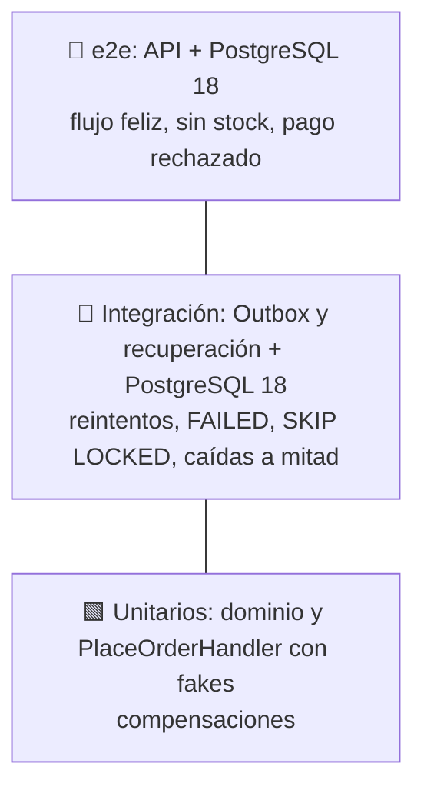

# Backend: tests con Vitest

> Sección 9 de la guía.

## 9. Tests con Vitest



| Nivel | Casos mínimos |
|---|---|
| Unitarios | Invariantes del dominio · sin stock: no se cobra y el checkout queda ABORTED · pago rechazado: se libera el stock · falla al guardar: reembolso y liberación · **timeout del cobro: se reembolsa** · **commit ambiguo (`save` falla pero el checkout está COMPLETED): no compensa y responde 201** · **el reembolso falla: el checkout sigue PENDING y el cliente recibe el error original** · **reintento con la misma clave tras COMPLETED: mismo orderId y un solo cobro** · **misma clave con otro carrito: 422** · **el mismo carrito con líneas repetidas o en otro orden produce el mismo hash** · **`Money`: `Money.of('1.005').toFinal()` da `"1.01"`, y `toFinal()` redondea mitad hacia arriba** |
| Integración (Outbox) | Entrega y marca DONE · el consumidor falla: reintenta y luego FAILED · dos relays en paralelo: cada entrega una sola vez · bloqueo vencido: se retoma · un consumidor `external` corre sin transacción abierta · **bloqueo vencido: la instancia lenta no pisa el DONE de la otra (fencing) y revierte su efecto `db`** · **dos eventos del mismo pedido se entregan en orden** · **el relay restaura el `correlationId` del evento en los logs del consumidor** |
| Integración (saga e inventario) | Checkout PENDING antiguo con cobro: el job reembolsa, libera y queda ABORTED · un COMPLETED no se toca · si el reembolso falla, sigue PENDING y se reintenta · dos jobs en paralelo no toman el mismo checkout · **dos liberaciones simultáneas devuelven el stock una sola vez** · **dos pedidos con los mismos libros en orden inverso reservan a la vez sin interbloqueo** |
| e2e | `POST /orders` 201 y la reserva queda CONFIRMED · sin stock: 422 sin cobro · pago rechazado: 422 y stock intacto · **dos `POST` simultáneos con la misma clave: un pedido, un cobro, y la otra respuesta es 409 o el mismo pedido** · **`POST` con `X-Request-Id: r-test`: la respuesta lo devuelve, `checkouts.request_id` y `outbox.correlation_id` lo guardan, y el log del email lo incluye** · **sin el header, la respuesta trae uno generado** |

```ts
// test/unit/place-order.handler.spec.ts
it('si el pago es rechazado, libera el stock y no guarda el pedido', async () => {
  const stock = new FakeStockReservation();
  const orders = new InMemoryOrderRepository();
  const checkouts = new InMemoryCheckoutLog();
  const handler = new PlaceOrderHandler(orders, customersWithPremium(), fixedCatalog(), stock, checkouts,
    new PricingService(), new FakePaymentGateway({ approved: false, reason: 'fondos insuficientes' }));

  await expect(handler.execute(new PlaceOrderCommand(randomUUID(), 'c-1', [{ isbn: ISBN, quantity: 1 }], 'tok')))
    .rejects.toThrow(/Pago rechazado/);
  expect(stock.released).toHaveLength(1);
  expect(orders.count()).toBe(0);
  expect(checkouts.statusOf(stock.released[0])).toBe('ABORTED');
});

it('commit ambiguo: si el checkout quedó COMPLETED, no compensa', async () => {
  const orders = new InMemoryOrderRepository({ failAfterCommit: true }); // guarda y luego lanza un error
  const payments = new FakePaymentGateway({ approved: true });
  const handler = new PlaceOrderHandler(orders, customersWithPremium(), fixedCatalog(), new FakeStockReservation(),
    orders.checkoutLog, new PricingService(), payments);

  const result = await handler.execute(new PlaceOrderCommand(randomUUID(), 'c-1', [{ isbn: ISBN, quantity: 1 }], 'tok'));
  // fixedCatalog(): 1 libro a "100.00". Cliente premium: −10 % y envío gratis → se cobra "90.00"
  expect(result.charged.toJSON()).toEqual({ amount: '90.00', currency: 'PEN' });
  expect(payments.refunded).toHaveLength(0);
});
```

```ts
// test/integration/outbox.relay.spec.ts (PostgreSQL 18 con Testcontainers)
it('dos relays en paralelo entregan cada evento una sola vez', async () => {
  await seedEvents(20);                               // 20 eventos con un consumidor que cuenta llamadas
  await Promise.all([relayA.runOnce(), relayB.runOnce()]);
  expect(countingConsumer.calls).toBe(20);
  expect(await prisma.delivery.count({ where: { status: 'DONE' } })).toBe(20);
});

it('tras agotar los intentos, la entrega queda FAILED', async () => {
  failingConsumer.alwaysThrow = true;
  await seedEvents(1);
  for (let i = 0; i < MAX_ATTEMPTS; i++) { await makeDeliveriesDue(); await relay.runOnce(); }
  expect(await prisma.delivery.findFirst()).toMatchObject({ status: 'FAILED', attempts: MAX_ATTEMPTS });
});

// test/integration/recover-checkouts.job.spec.ts
it('caída después de cobrar: el job reembolsa, libera y marca ABORTED', async () => {
  await simulateCrashAfterCharge(ORDER_ID);           // checkout PENDING, reserva HELD, cobro hecho, sin pedido
  await backdateCheckout(ORDER_ID, 11);               // lo deja con más de 10 min
  await job.run();
  expect(payments.refunded).toContain(ORDER_ID);
  expect(await prisma.reservation.count({ where: { orderId: ORDER_ID } })).toBe(0);
  expect(await prisma.checkout.findUnique({ where: { orderId: ORDER_ID } })).toMatchObject({ status: 'ABORTED' });
});
```

**Cómo se prueba un interbloqueo (`test/integration/stock.handlers.spec.ts`).** Con operaciones de milisegundos, dos pedidos en orden inverso casi nunca se cruzan, y una prueba así pasaría aunque el código estuviera mal. Por eso `slowDownStockUpdates(ms)` instala en la base de pruebas un disparador que hace que cada actualización de una fila de `stock_items` tarde 40 ms. Con ese retardo, si las transacciones no bloquearan en el mismo orden, se cruzarían siempre y PostgreSQL abortaría una por interbloqueo (`40P01`). Se comprobó quitando el orden de `reserve`, de `release` y de `lock-order.ts`, y haciendo que cada uno ordene distinto: en todos los casos el test falla. El disparador solo existe durante esos tests: se quita al terminar, y `resetDatabase()` lo elimina si un test falló antes de limpiar.

**Todos los tests de integración y e2e corren contra PostgreSQL 18 real** (Testcontainers): `SKIP LOCKED`, los bloqueos de fila, `DELETE … RETURNING` y `uuidv7()` no se pueden validar con fakes ni con otra base de datos.

En e2e se llama a `app.get(OutboxRelay).runOnce()` directamente, en vez de esperar al intervalo. Usa `import request from 'supertest'` (import por defecto, como ya hace `test/app.e2e-spec.ts`). Los dos archivos de configuración ya están hechos: `vitest.config.ts` incluye solo `test/unit/**/*.spec.ts`, así que `pnpm test` no necesita Docker, y `vitest.config.e2e.ts` incluye `test/{integration,e2e}/**/*.spec.ts` y añade tres cosas:

- **`globalSetup`** (`test/support/global-setup.ts`): levanta `postgres:18` con Testcontainers, aplica `prisma migrate deploy` y define `DB_*`, que tienen prioridad sobre `.env`. Así los tests no dependen de la base de desarrollo.
- **`fileParallelism: false`:** todos los archivos comparten ese contenedor y vacían las tablas antes de sus tests (`resetDatabase()`), así que no pueden correr a la vez.
- **Guardián:** `resetDatabase()` solo opera si el `globalSetup` marcó la base como suya (`INTEGRATION_DB_CONTAINER`); no puede vaciar la base de desarrollo.
