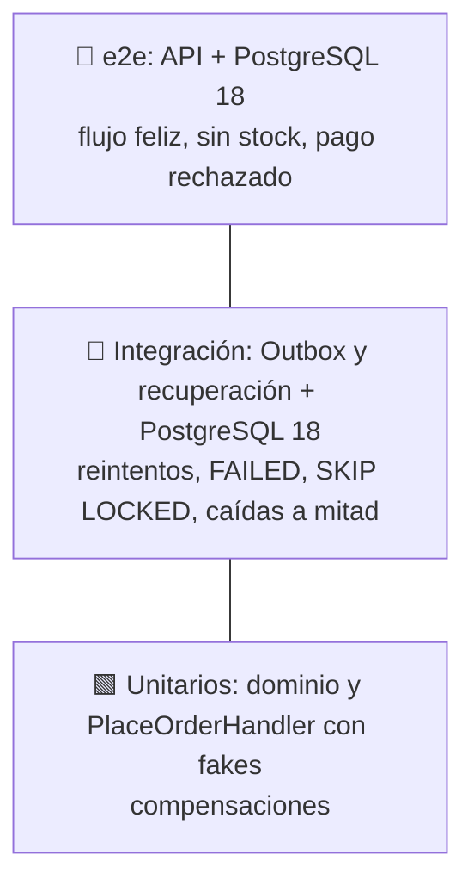

# Backend: tests con Vitest

> Sección 9 de la guía.

## 9. Tests con Vitest



| Nivel | Casos mínimos |
|---|---|
| Unitarios | Invariantes del dominio · sin stock: no se cobra y el checkout queda ABORTED · pago rechazado: se libera el stock · falla al guardar: reembolso y liberación · **timeout del cobro: se reembolsa** · **commit ambiguo (`save` falla pero el checkout está COMPLETED): no compensa y responde 201** · **el reembolso falla: el checkout sigue PENDING y el cliente recibe el error original** · **reintento con la misma clave tras COMPLETED: mismo orderId y un solo cobro** · **misma clave con otro carrito: 422** · **el mismo carrito con líneas repetidas o en otro orden produce el mismo hash** · **`Money`: `Money.of('1.005').toFinal()` da `"1.01"`, y `toFinal()` redondea mitad hacia arriba** |
| Integración (Outbox) | Entrega y marca DONE · el consumidor falla: reintenta y luego FAILED · dos relays en paralelo: cada entrega una sola vez · bloqueo vencido: se retoma · un consumidor `external` corre sin transacción abierta · **bloqueo vencido: la instancia lenta no pisa el DONE de la otra (fencing) y revierte su efecto `db`** · **dos eventos del mismo pedido se entregan en orden** · **el relay restaura el `correlationId` del evento en los logs del consumidor** |
| Integración (saga e inventario) | Checkout PENDING antiguo con cobro: el job reembolsa, libera y queda ABORTED · un COMPLETED no se toca · si el reembolso falla, sigue PENDING y se reintenta · dos jobs en paralelo no toman el mismo checkout · **dos liberaciones simultáneas devuelven el stock una sola vez** · **dos pedidos con los mismos libros en orden inverso reservan a la vez sin interbloqueo** |
| e2e | `POST /orders` 201 y la reserva queda CONFIRMED · sin stock: 422 sin cobro · pago rechazado: 422 y stock intacto · **dos `POST` simultáneos con la misma clave: un pedido, un cobro, y la otra respuesta es 409 o el mismo pedido** · **`POST` con `X-Request-Id: r-test`: la respuesta lo devuelve, `checkouts.request_id` y `outbox.correlation_id` lo guardan, y el log del email lo incluye** · **sin el header, la respuesta trae uno generado** |

```ts
// test/unit/sales/place-order.handler.spec.ts
it('si el pago es rechazado, libera el stock y no guarda el pedido', async () => {
  const stock = new FakeStockReservation();
  const orders = new InMemoryOrderRepository();
  const checkouts = new InMemoryCheckoutLog();
  const handler = new PlaceOrderHandler(orders, customersWithPremium(), fixedCatalog(), stock, checkouts,
    new PricingService(), new FakePaymentGateway({ approved: false, reason: 'fondos insuficientes' }));

  await expect(handler.execute(new PlaceOrderCommand(randomUUID(), 'c-1', [{ isbn: ISBN, quantity: 1 }], 'tok')))
    .rejects.toThrow(/Pago rechazado/);
  expect(stock.released).toHaveLength(1);
  expect(orders.count()).toBe(0);
  expect(checkouts.statusOf(stock.released[0])).toBe('ABORTED');
});

it('commit ambiguo: si el checkout quedó COMPLETED, no compensa', async () => {
  const orders = new InMemoryOrderRepository({ failAfterCommit: true }); // guarda y luego lanza un error
  const payments = new FakePaymentGateway({ approved: true });
  const handler = new PlaceOrderHandler(orders, customersWithPremium(), fixedCatalog(), new FakeStockReservation(),
    orders.checkoutLog, new PricingService(), payments);

  const result = await handler.execute(new PlaceOrderCommand(randomUUID(), 'c-1', [{ isbn: ISBN, quantity: 1 }], 'tok'));
  // fixedCatalog(): 1 libro a "100.00". Cliente premium: −10 % y envío gratis → se cobra "90.00"
  expect(result.charged.toJSON()).toEqual({ amount: '90.00', currency: 'PEN' });
  expect(payments.refunded).toHaveLength(0);
});
```

```ts
// test/integration/outbox.relay.spec.ts (PostgreSQL 18 con Testcontainers)
it('dos relays en paralelo entregan cada evento una sola vez', async () => {
  await seedEvents(20);                               // 20 eventos con un consumidor que cuenta llamadas
  await Promise.all([relayA.runOnce(), relayB.runOnce()]);
  expect(countingConsumer.calls).toBe(20);
  expect(await prisma.delivery.count({ where: { status: 'DONE' } })).toBe(20);
});

it('tras agotar los intentos, la entrega queda FAILED', async () => {
  failingConsumer.alwaysThrow = true;
  await seedEvents(1);
  for (let i = 0; i < MAX_ATTEMPTS; i++) { await makeDeliveriesDue(); await relay.runOnce(); }
  expect(await prisma.delivery.findFirst()).toMatchObject({ status: 'FAILED', attempts: MAX_ATTEMPTS });
});

// test/integration/recover-checkouts.job.spec.ts
it('caída después de cobrar: el job reembolsa, libera y marca ABORTED', async () => {
  await simulateCrashAfterCharge(ORDER_ID);           // checkout PENDING, reserva HELD, cobro hecho, sin pedido
  await backdateCheckout(ORDER_ID, 11);               // lo deja con más de 10 min
  await job.run();
  expect(payments.refunded).toContain(ORDER_ID);
  expect(await prisma.reservation.count({ where: { orderId: ORDER_ID } })).toBe(0);
  expect(await prisma.checkout.findUnique({ where: { orderId: ORDER_ID } })).toMatchObject({ status: 'ABORTED' });
});
```

**Cómo se prueba un interbloqueo (`test/integration/stock.handlers.spec.ts`).** Con operaciones de milisegundos, dos pedidos en orden inverso casi nunca se cruzan, y una prueba así pasaría aunque el código estuviera mal. Por eso `slowDownStockUpdates(ms)` instala en la base de pruebas un disparador que hace que cada actualización de una fila de `stock_items` tarde 40 ms. Con ese retardo, si las transacciones no bloquearan en el mismo orden, se cruzarían siempre y PostgreSQL abortaría una por interbloqueo (`40P01`). Se comprobó quitando el orden de `reserve`, de `release` y de `lock-order.ts`, y haciendo que cada uno ordene distinto: en todos los casos el test falla. El disparador solo existe durante esos tests: se quita al terminar, y `resetDatabase()` lo elimina si un test falló antes de limpiar.

**Tests de contrato de los puertos (`test/support/*.contract.ts`).** La saga se prueba con fakes en memoria (rápidos, sin base de datos). Para que un fake no se desvíe de la implementación real, la misma batería de comportamiento se ejecuta contra los dos: `checkoutLogContract` corre en `test/unit/sales/checkout-log.fake.spec.ts` (fake) y en `test/integration/checkout-log.prisma.spec.ts` (PostgreSQL real). Cada implementación aporta unas pocas ayudas para preparar el estado (completar, envejecer, vencer un bloqueo) sin pasar por el puerto. Lo que solo tiene sentido con la base real (carreras entre conexiones, `SKIP LOCKED`, otra zona horaria, datos inconsistentes) va aparte, en el archivo de integración.

Desde el corte 10 **todos los puertos tienen su contrato**, no solo el de la saga: `checkoutLogContract`, `stockRepositoryContract`, `sessionRepositoryContract`, `userRepositoryContract`, `bookPortsContract` (`BookRepository` y `BookCatalog`) y `orderHistoryContract`, cada uno con su fake en `test/fakes/` y sus dos ejecuciones (`test/unit/<contexto>/*.fake.spec.ts` y `test/integration/*.prisma.spec.ts`). Los casos de uso (los handlers de `application/`) se prueban entonces **sin base de datos** con esos fakes (`book-use-cases.spec.ts`, `stock-use-cases.spec.ts`, `identity-use-cases.spec.ts`, `order-history-use-cases.spec.ts`…), y las pruebas de integración existentes siguen comprobando el comportamiento completo por el bus. Un consumidor del Outbox se prueba en dos niveles: su archivo unitario comprueba que envía el comando con la transacción, y el handler se prueba con el fake (por ejemplo `create-customer.handler.spec.ts`). La forma de carpetas y las dependencias las comprueban `structure-rules.spec.ts` y `dependency-rules.spec.ts`, cada regla con un caso que la rompe y uno que la cumple.

**Cómo se prueba la compra completa (`test/e2e/orders.e2e.spec.ts`).** Arranca `AppModule` entero contra PostgreSQL real y reemplaza solo la pasarela (por una `SimulatedPaymentGateway` con una compuerta, para no depender del `.env`). Cubre cada resultado con el estado que deja: la compra premium, normal, con envío gratis y en dólares; sin stock, pago rechazado, error de la pasarela y moneda mezclada, que dejan el stock, los cobros, los pedidos y el checkout como estaban; la idempotencia (reintento, clave reutilizada, ISBN con guiones); **dos `POST` simultáneos con la misma clave**, donde la pasarela se queda parada dentro del cobro hasta que el test la suelta (así el `409` no depende de tiempos); **la última copia comprada por dos clientes a la vez**; el `X-Request-Id` desde la petición hasta el checkout, el evento y el correo del log; y que el token de la tarjeta no queda en ninguna tabla ni en los logs. El relay corre solo cada segundo; el test lo ayuda con `runOnce()` y espera, con un tope, a que las entregas queden `DONE`. Las piezas por debajo (la saga, el repositorio, el job de recuperación, los consumidores, las pasarelas) tienen sus propios tests, y cada e2e se comprobó rompiendo a propósito la pieza que protege.

**Cómo se prueba la tienda (corte 6).** `test/support/http-app.ts` levanta una aplicación HTTP con la misma configuración que `main.ts` y las variables de entorno que haga falta (`PAYMENT_PROVIDER`, por ejemplo): `AppModule` valida el entorno al importarse, así que cada valor se prueba con su propia aplicación. `test/e2e/store-flow.e2e.spec.ts` recorre el "listo cuando" completo (alta, stock en cero por el relay, búsqueda, compra imposible sin unidades, carga, compra con dirección, historial, cambio de precio, desactivación) con el relay corriendo solo, y comprueba que toda la administración da `401` sin token y `403` con el de un comprador, y que lo público sigue funcionando. Técnicas que salieron de este corte:

- **Los empates se prueban sin el índice.** El historial ordena por (fecha, id), pero el índice ya devuelve ese orden, de modo que quitar el `ORDER BY id` no rompía ningún test. El test borra el índice dentro de la prueba (y lo recrea después), inserta los ids en orden creciente y comprueba que salen al revés.
- **Las fechas de las columnas sin zona se escriben como texto ISO desde los tests.** `node-pg` serializa un `Date` en la hora local de la máquina (aquí, UTC−5), y el pedido quedaba cinco horas antes. La aplicación escribe en UTC.
- **Lo que un decodificador ignora hay que probarlo a propósito.** `Buffer.from(x, 'base64url')` descarta los caracteres inválidos: sin comprobarlos, un cursor válido con un `=` o un espacio de más seguía valiendo. JS normaliza el 31 de febrero al 3 de marzo, así que se prueba también.
- **Hay que leer el recuento de Vitest, no solo si falla.** Un módulo de prueba al que le faltaba `ConfigService` dejó 88 tests "skipped" en vez de fallar con claridad.
- **Los tests de la tienda no cuentan entregas: esperan lo que van a comprobar.** El flujo completo tiene tres entregas (la del libro y las dos del pedido); esperar "al menos dos" dejaba una ventana en la que el correo aún no había salido.
- **No se mide cuánto dura lo que el test observa.** Un test que miraba la tabla cada 25 ms para saber cuánto tardaba un correo fallaba con la máquina cargada, porque veía la entrega reclamada más tarde de lo que ocurrió. Se comprueba que existió un instante con la entrega reclamada y el correo todavía sin salir, sin umbral de tiempo.
- **Una corrida de mutaciones con el e2e tarda más de diez minutos:** se lanza en segundo plano y no se toca el código mientras corre.

**Cómo se prueba la autenticación (corte 7).** Las ayudas están en `test/support/auth.ts`: `bearer(app, rol, id?)` firma un token válido sin pasar por la base (para los tests que no son de autenticación), y `signUp` y `loginAs` se registran e inician sesión por la API como un cliente de verdad. `test/e2e/route-access.e2e.spec.ts` arranca `AppModule` entero y **recorre todas las rutas**: la tabla esperada debe coincidir exactamente con las que declaran los controladores y cada una se comprueba de caja negra (sin token, como comprador y como administrador, y con tokens alterados), además de que la documentación de Swagger diga lo mismo. `test/e2e/curl-flow.e2e.spec.ts` es el «listo cuando» ejecutado de verdad: arranca la aplicación **compilada** como proceso, con su propio puerto, y lo hace todo con `curl` (registrarse, comprar, ver lo propio y lo ajeno, la administración, el refresco con su reutilización, CORS y las cabeceras); al final busca contraseñas, hashes y tokens en todas las tablas y en los logs del proceso. Técnicas que salieron de este corte:

- **Una prueba de concurrencia que pasa sin el bloqueo no prueba nada.** Con milisegundos de diferencia las transacciones casi no se cruzan: quitar el `FOR UPDATE` de la renovación del token no rompía el test de seis renovaciones simultáneas. Ahora el test ralentiza 150 ms las actualizaciones de la tabla con un disparador de prueba (como ya se hacía con el stock) y la mutación se detecta.
- **Un token forjado a mano debe llevar todo lo demás correcto.** Los tests del sujeto del token pasaban porque el token no llevaba `typ: 'JWT'`, no porque el sujeto estuviera mal; lo reveló la mutación que quita esa comprobación. Los tokens de ataque salen de un único `forge` con todo válido salvo lo que se quiere probar.
- **Se congela solo la fecha, no los temporizadores.** `vi.useFakeTimers({ toFake: ['Date'] })` deja correr los temporizadores (la base y las esperas siguen funcionando) y permite comparar los vencimientos con igualdad exacta.
- **Cada mutación se corre con la configuración que incluye sus tests.** Las 13 mutaciones del registro de accesos «sobrevivieron» porque se lanzaron con la configuración de e2e, que no incluye los unitarios. Los supervivientes con otra causa (equivalentes, o redundantes) se documentan en la bitácora.
- **Un helper con parámetro por defecto convierte `undefined` en un valor válido.** `register(body = {…})` volvía válido el caso «sin cuerpo»: el test pasaba a 201 en lugar de 400.


**Cómo se prueban las demoras de los proveedores simulados.** `global-setup.ts` pone `PAYMENT_SIMULATED_DELAY_MS` y `EMAIL_SIMULATED_DELAY_MS` en 0 para que ningún test espere 3 s. La demora en sí se prueba de tres maneras: con temporizadores falsos (`vi.useFakeTimers()` y `advanceTimersByTimeAsync`) en los unitarios de la pasarela y del notificador, mirando el momento exacto en que algo termina y no solo el resultado final; con `test/e2e/orders-delays.e2e.spec.ts`, que arma los mismos módulos que `AppModule` pero con una demora real escalada a 600 ms (la compra tarda lo que el cobro, la segunda petición recibe `409` sin compuertas, una compensación suma el reembolso lento, el correo sale tras su espera con la entrega reclamada entre tanto); y con `test/unit/sales/delay-margins.spec.ts`, que lee los valores por defecto y las constantes reales del relay y de la recuperación y falla si un margen deja de cumplirse. La recuperación con una pasarela lenta tiene además sus casos en `recover-checkouts.job.spec.ts`.

**Cómo se prueba el Outbox (`test/integration/outbox.*.spec.ts` y `test/e2e/outbox.e2e.spec.ts`).** Casi todo depende del tiempo y de la concurrencia, así que se evita esperar y se fuerza cada situación:

- **Consumidores de prueba** (`test/support/outbox-probes.ts`): registran lo que reciben y ejecutan un comportamiento que cada test define (lanzar un error, esperar, comprobar algo). Las instancias del servicio son simplemente varias aplicaciones sobre la misma base.
- **Instancia lenta:** el consumidor se queda parado en un punto de espera (*latch*) hasta que el test lo suelta, y el bloqueo se vence con SQL (`expireLease`) en vez de esperar 2 minutos. Los reintentos se adelantan igual (`makeDeliveriesDue`).
- **Orden del lote:** un `ORDER BY` omitido no se nota si la tabla y el índice devuelven las filas en el orden de inserción; el test las desordena a propósito (orden físico y `next_attempt_at`).
- **Zona horaria:** una prueba pone la base en `America/Lima` para comprobar que los reintentos y los bloqueos no dependen de que sea UTC.
- **Reloj de la aplicación:** se adelanta `Date` una hora para comprobar que los reintentos usan el de la base.
- **Intervalo real:** el e2e usa la aplicación completa y espera (con un tope) a que el relay entregue solo; `OutboxModule` no trae `ScheduleModule`, así que los demás tests lo manejan a mano con `runOnce()` y `tick()`.
- Las pruebas de concurrencia se repiten varias veces y cada garantía se comprobó rompiendo el código a propósito.

**Todos los tests de integración y e2e corren contra PostgreSQL 18 real** (Testcontainers): `SKIP LOCKED`, los bloqueos de fila, `DELETE … RETURNING` y `uuidv7()` no se pueden validar con fakes ni con otra base de datos.

En e2e se llama a `app.get(OutboxRelay).runOnce()` directamente, en vez de esperar al intervalo. Usa `import request from 'supertest'` (import por defecto, como ya hace `test/app.e2e-spec.ts`). Los dos archivos de configuración ya están hechos: `vitest.config.ts` incluye solo `test/unit/**/*.spec.ts`, así que `pnpm test` no necesita Docker, y `vitest.config.e2e.ts` incluye `test/{integration,e2e}/**/*.spec.ts` y añade tres cosas:

- **`globalSetup`** (`test/support/global-setup.ts`): levanta `postgres:18` con Testcontainers, aplica `prisma migrate deploy` y define `DB_*`, que tienen prioridad sobre `.env`. Así los tests no dependen de la base de desarrollo.
- **`fileParallelism: false`:** todos los archivos comparten ese contenedor y vacían las tablas antes de sus tests (`resetDatabase()`), así que no pueden correr a la vez.
- **Guardián:** `resetDatabase()` solo opera si el `globalSetup` marcó la base como suya (`INTEGRATION_DB_CONTAINER`); no puede vaciar la base de desarrollo.
