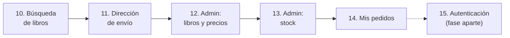

# Backend: orden de implementación y siguientes funcionalidades

> Secciones 10 y 11 de la guía.

## 10. Orden de implementación

```mermaid
flowchart LR
    F0["0. Scaffold ✅"] --> F1["1. Platform<br/>config, Prisma, filtro,<br/>Swagger, health, requestId"]
    F1 --> F2["2. Shared kernel<br/>y contracts"]
    F2 --> F3["3. Dominio Ventas<br/>+ unitarios"]
    F3 --> F4["4. Catálogo"]
    F4 --> F5["5. Inventario<br/>reservar y liberar"]
    F5 --> F6["6. Outbox<br/>writer, relay<br/>+ tests de integración"]
    F6 --> F7["7. PlaceOrder + saga<br/>compensaciones, checkout<br/>y job de recuperación"]
    F7 --> F8["8. Consumidores<br/>email y confirmar reserva"]
    F8 --> F9["9. e2e completos"]
```



| Fase | Listo cuando… |
|---|---|
| 0 ✅ | **Hecha**: `apps/main-api` compila y responde `Hello World!` en `GET /` |
| 1 | `docker compose up` y `pnpm run start:dev` levantan; `/health/ready` y `/docs` responden, con el header `X-Request-Id`, y los logs incluyen el `requestId` (campo de primer nivel en JSON en producción, prefijo en texto en desarrollo) |
| 2–3 | `contracts/` no importa nada de `contexts/`; las invariantes tienen tests y pasan |
| 4–5 | `GET /books/:isbn` responde; reservar sin stock lanza `OutOfStockError` y no cambia nada |
| 6 | Los tests de integración del Outbox pasan, incluido el del `correlationId` |
| 7 | `POST /orders` devuelve 201; los casos de compensación (incluidos timeout y commit ambiguo) y los tests de recuperación pasan |
| 8 | Tras `POST /orders`, el email aparece en el log, la reserva queda `CONFIRMED` y `/health/outbox` responde 200 |
| 9 | Los e2e pasan: flujo feliz, sin stock y pago rechazado |

**Para agregar una reacción nueva más adelante** (Envíos, SUNAT o puntos): crea una clase con `@OutboxHandler()` que implemente `OutboxConsumer`, en el módulo que reacciona, y regístrala en sus `providers`. Ventas no se toca.

---

## 11. Siguientes funcionalidades

LibroYa es una **tienda propia**: vende sus libros, con un catálogo, un stock y un cobro por pedido. Para que funcione como tienda real faltan estas funcionalidades. Todas van en los contextos que ya existen y siguen los mismos patrones: **las lecturas son queries que leen directo con Prisma, y las escrituras son comandos con su handler**.



| # | Funcionalidad | Endpoint | Contexto | Tipo |
|---|---|---|---|---|
| 10 | Listar y buscar libros | `GET /books?q=&page=&pageSize=` | Catálogo | Query |
| 11 | Dirección de envío en el pedido | `POST /orders` (campo nuevo `shippingAddress`) | Ventas | Cambio del comando |
| 12 | Crear libro, editar datos y precio, desactivar | `POST /admin/books`, `PATCH /admin/books/:isbn` | Catálogo | Comandos |
| 13 | Cargar stock | `POST /admin/stock/:isbn/additions` | Inventario | Comando |
| 14 | Historial de pedidos | `GET /orders?customerId=&cursor=` (solo con `ADMIN_API_ENABLED`, hasta tener autenticación) | Ventas | Query |

> [!warning] Los endpoints `/admin` y el historial no pueden quedar abiertos
> Mientras no haya autenticación, solo funcionan con **`ADMIN_API_ENABLED=true`** (por defecto `false`, y rechazado por el schema de Zod cuando `NODE_ENV=production`). Si está desactivado, responden **404**, como si no existieran. Así sirven en desarrollo sin quedar expuestos en un despliegue.

```ts
// platform/http/admin-api-enabled.guard.ts: @UseGuards(AdminApiEnabledGuard) en la clase de cada controller de /admin,
// y en el historial solo en su método (OrderController también tiene POST /orders, que no lleva guard)
@Injectable()
export class AdminApiEnabledGuard implements CanActivate {
  constructor(private readonly config: ConfigService) {}

  canActivate(): boolean {
    if (!this.config.get<boolean>('ADMIN_API_ENABLED')) throw new NotFoundException();
    return true;
  }
}
```

Un guard es más simple que registrar controllers de forma condicional, que en Nest exige módulos dinámicos.

### Fase 10: Listar y buscar libros

```ts
// catalog/infrastructure/book/search-books.handler.ts
@QueryHandler(SearchBooksQuery)
export class SearchBooksHandler implements IQueryHandler<SearchBooksQuery> {
  constructor(private readonly prisma: PrismaService) {}

  async execute({ q, page, pageSize }: SearchBooksQuery) {
    const where = {
      active: true,                                   // los desactivados no se muestran
      ...(q && { OR: [
        { title: { contains: q, mode: 'insensitive' as const } },
        { author: { contains: q, mode: 'insensitive' as const } },
      ] }),
    };
    const [items, total] = await this.prisma.$transaction([
      this.prisma.book.findMany({ where, orderBy: [{ title: 'asc' }, { isbn: 'asc' }], skip: (page - 1) * pageSize, take: pageSize }),
      this.prisma.book.count({ where }),
    ]);
    return {
      items: items.map((b) => ({ isbn: b.isbn, title: b.title, author: b.author, price: { amount: b.price.toFixed(2), currency: b.currency } })),
      page, pageSize, total,
    };
  }
}
```

- **El orden incluye el ISBN como desempate:** con títulos repetidos, ordenar solo por título puede repetir un libro en dos páginas u omitirlo.
- **`pageSize` con máximo de 50** en el DTO (`@Max(50)`), para que nadie pida el catálogo entero de una vez.
- **Los comodines se escapan:** Prisma pasa el texto tal cual a `ILIKE`, donde `%` y `_` son comodines. El handler antepone una barra invertida a `\`, `%` y `_` (`q.trim().replace(/[\\%_]/g, '\\$&')`) para que se busquen como texto; sin esto, `?q=%` devolvía todo el catálogo.
- **`page` tiene tope (100 000)** y `q` largo máximo (100): un `skip` enorme desbordaría el entero de la base.
- **No ignora los acentos** ("programacion" no encuentra "Programación"): decisión D3, hasta que el catálogo crezca y se agreguen `unaccent` y `pg_trgm`.
- **Cuando el catálogo crezca**, `contains` (un `ILIKE`) se vuelve lento: agrega en la migración la extensión `pg_trgm` y un índice GIN sobre `title` y `author`.

### Fase 11: Dirección de envío

Se guarda como **snapshot en el pedido**, igual que el título y el precio: si el cliente cambia su dirección después, el pedido de ayer conserva la de entrega.

```prisma
model Order {
  // …
  // Admiten nulo para poder agregar las columnas a una base que ya tiene pedidos (decisión D1): los de antes quedan
  // sin dirección. La dirección completa es obligatoria al CREAR un pedido (DTO y dominio); una CHECK de la
  // migración exige que estén los seis campos obligatorios o ninguno, y la referencia no puede existir sola
  shipRecipient  String? @map("ship_recipient") @db.VarChar(100)
  shipPhone      String? @map("ship_phone") @db.VarChar(20)
  shipLine1      String? @map("ship_line1") @db.VarChar(200)
  shipDistrict   String? @map("ship_district") @db.VarChar(60)       // distrito
  shipProvince   String? @map("ship_province") @db.VarChar(60)       // provincia
  shipDepartment String? @map("ship_department") @db.VarChar(60)     // departamento
  shipReference  String? @map("ship_reference") @db.VarChar(200)     // referencia para el repartidor (opcional)
}
```

- **El dominio la valida con el valor `ShippingAddress`** (`sales/domain/order/shipping-address.vo.ts`): recorta cada campo, exige los seis obligatorios, acota el largo (los mismos tamaños de las columnas), rechaza saltos de línea y otros caracteres de control, y pide un teléfono de al menos 6 dígitos con solo dígitos, espacios, `+`, `-` y paréntesis. `ShippingAddress.create` valida; `ShippingAddress.restore` lee lo que ya está en la base sin validar, para que una regla nueva no impida leer pedidos antiguos. El mapper trata la dirección con todas las columnas en nulo como "pedido anterior" (`null`) y una dirección a medias como un dato roto.
- **El DTO valida la forma** como objeto anidado (`@ValidateNested`, `@IsObject`): obligatoria, los seis campos con texto no vacío y su largo máximo, y la referencia opcional; lo que falte es un `400`. **El contenido lo valida el dominio** (teléfono, caracteres de control): un `422 INVALID_SHIPPING_ADDRESS`, igual que un ISBN mal formado.
- **Forma parte del hash de la `Idempotency-Key`:** un reintento con la misma clave y otra dirección responde `422 IDEMPOTENCY_KEY_REUSED`, igual que si cambiara el carrito. Cambian dos firmas:

```ts
// PlaceOrderCommand agrega la dirección (sin validar: el handler la normaliza con ShippingAddress.create)
new PlaceOrderCommand(key, dto.customerId, dto.items, dto.shippingAddress, dto.cardToken);

// hashRequest la recibe ya normalizada (recortada; una referencia vacía es null) y la incluye como lista JSON.
// El código completo está en 04-flujo-pedido-y-saga.md
hashRequest(customerId, items, address);
```
- **`OrderPlacedEvent` pasa a `eventVersion = 2`** e incluye la dirección, porque Envíos la necesitará. Los consumidores actuales ignoran el campo nuevo. Los eventos ya guardados siguen siendo de la versión 1 y los consumidores los leen igual (hay un test que lo comprueba).
- **`GET /orders/:id` no la devuelve** (decisión D2): el endpoint no tiene autenticación, y la calle y el teléfono son datos personales. La dirección viaja en el evento y, más adelante, en el historial de administración.
- **Cambiar `hashRequest` invalida las claves de idempotencia en vuelo:** una compra a medias iniciada antes de esta versión, reintentada después, daría `IDEMPOTENCY_KEY_REUSED`. Es aceptable antes de desplegar.

### Fase 12: Administrar libros y precios

| Comando | Qué valida |
|---|---|
| `CreateBookCommand` | ISBN válido (`Isbn.create`) y no repetido (`409 BOOK_ALREADY_EXISTS`); precio > 0 |
| `UpdateBookCommand` | El libro existe (`404`); precio > 0 si cambia |
| `DeactivateBookCommand` | Pone `active = false`. **Nunca se borra**: otros contextos lo referencian por ISBN |

- **Cambiar un precio no afecta pedidos ya hechos:** el precio quedó copiado en cada línea (snapshot).
- **El handler de `CreateBookCommand` guarda el libro y su evento en la misma transacción:** `prisma.$transaction(async (tx) => { await tx.book.create({ … }); await this.outbox.append(tx, [new BookCreatedEvent(isbn)]); })`. El evento va en `contracts/catalog/book-created.event.ts`, con `aggregateId` = ISBN. Guardados por separado, una caída entre ambos dejaría un libro sin registro de stock.
- **Al crear un libro también se crea su registro de stock en cero**, en Inventario. Se hace con un consumidor del Outbox (`inventory.create-stock-item`, tipo `db`) que reacciona a un evento nuevo, `catalog.book.created`. Así todo libro nuevo tiene su registro de stock. El caso de `STOCK_ITEM_NOT_FOUND` queda reducido a la breve ventana (alrededor de 1 s) entre que se crea el libro y el relay entrega el evento: si alguien compra justo entonces, recibe 422 y no se cobra nada, porque falla antes de reservar. En la práctica no ocurre, porque un libro recién creado tiene stock cero y no se puede vender hasta cargarle unidades (fase 13).

### Fase 13: Cargar stock

```ts
// inventory/infrastructure/stock/add-stock.handler.ts
@CommandHandler(AddStockCommand)
export class AddStockHandler implements ICommandHandler<AddStockCommand> {
  constructor(private readonly prisma: PrismaService) {}

  async execute({ isbn, quantity }: AddStockCommand): Promise<void> {
    if (!Number.isInteger(quantity) || quantity <= 0) throw new DomainError('INVALID_QUANTITY', 'La cantidad debe ser un entero positivo');
    // Incremento atómico: no se pisa con reservas simultáneas
    const { count } = await this.prisma.stockItem.updateMany({ where: { isbn }, data: { available: { increment: quantity } } });
    if (count === 0) throw new StockItemNotFoundError(isbn);
  }
}
```

- **Una entrada de stock es una suma, no un "fijar en N"**: con `increment`, una carga y una reserva al mismo tiempo no se pisan.
- **Toca una sola fila**, así que no rompe la regla de bloquear en orden de ISBN.

### Fase 14: Historial de pedidos

```ts
// sales/infrastructure/order/list-customer-orders.handler.ts
@QueryHandler(ListCustomerOrdersQuery)
export class ListCustomerOrdersHandler implements IQueryHandler<ListCustomerOrdersQuery> {
  constructor(private readonly prisma: PrismaService) {}

  async execute({ customerId, cursor, limit }: ListCustomerOrdersQuery) {
    const rows = await this.prisma.order.findMany({
      where: { customerId },
      orderBy: [{ createdAt: 'desc' }, { id: 'desc' }],
      take: limit + 1,                                      // uno de más para saber si hay otra página
      ...(cursor && { cursor: { id: cursor }, skip: 1 }),
      include: { lines: true },
    });
    const page = rows.slice(0, limit);
    return { items: page.map(toOrderView), nextCursor: rows.length > limit ? page.at(-1)!.id : null };
  }
}
```

- **Paginación por cursor** (no por número de página): el historial solo crece, y con páginas numeradas un pedido nuevo desplazaría a los demás.
- **Agrega el índice `@@index([customerId, createdAt])`** en `Order`.
- **Hoy el `customerId` llega como parámetro**, y cualquiera que lo conozca vería los pedidos de ese cliente, con nombre, teléfono y dirección. Por eso, hasta tener autenticación, el método `list` de `OrderController` usa también `AdminApiEnabledGuard`, **en el método y no en la clase**, para que `POST /orders` siga abierto. Con la autenticación, el `customerId` saldrá del token y el endpoint pasará a `GET /me/orders`, sin el guard.

### Fase 15: Autenticación (fase aparte)

Es la funcionalidad más grande y **bloquea el despliegue público**: sin ella, cualquiera puede comprar a nombre de otro cliente o usar los endpoints de administración. Se trabaja en una fase propia: un contexto de Identidad, roles (comprador, administrador), guards de Nest y el `customerId` tomado del token. Cuando llegue, recuerda que los guards corren antes que el interceptor de correlación (ver [05-piezas-clave.md](05-piezas-clave.md)).

| Fase | Listo cuando… |
|---|---|
| 10 | `GET /books?q=clean` devuelve los libros activos que coinciden, paginados |
| 11 | `POST /orders` sin dirección responde 400; con dirección, la guarda en el pedido y en `OrderPlacedEvent` v2 |
| 12 | Se crea un libro con `POST /admin/books`, aparece en la búsqueda, y su stock en cero existe en Inventario |
| 13 | `POST /admin/stock/:isbn/additions` suma unidades, y una compra posterior las reserva |
| 14 | `GET /orders?customerId=` devuelve los pedidos del cliente, del más reciente al más antiguo, con cursor |
