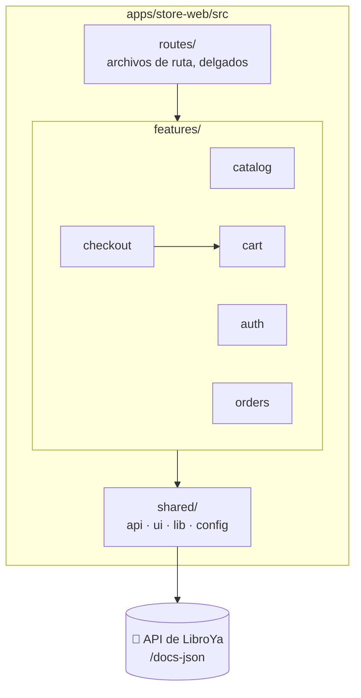

# Frontend: decisiones, stack y arquitectura

## 1. Decisiones

| Tema | Decisión |
|---|---|
| Tipo de app | **SPA** servida como archivos estáticos. Sin SSR: el SEO no es prioridad del MVP (DP-08) |
| Base | **Vite+** (`vp`), la que ya trae `apps/store-web`: Vite, Rolldown, Vitest, Oxlint y Oxfmt |
| Framework | **React 19** con TypeScript |
| Rutas | **TanStack Router**, por archivos. Los parámetros de URL llevan tipos (`/?q=&page=`) y `beforeLoad` exige la sesión |
| Datos del servidor | **TanStack Query**: caché, reintentos y estados de carga y error |
| Cliente de API | **openapi-typescript + openapi-fetch**, con los tipos generados del contrato del backend. **Un generador completo** (hey-api u orval) queda como camino futuro, sin reescribir las pantallas: ver [el final de este documento](#4-del-cliente-de-hoy-a-un-generador-completo-camino-futuro) |
| Formularios | **React Hook Form + Zod 4** (Zod ya es la librería de validación del backend) |
| Estado del cliente | **Zustand** con `persist` para el carrito (DP-04). Todo lo demás es estado de servidor o de la URL |
| Estilos y componentes | **Tailwind CSS 4 + shadcn/ui** (Radix): accesibilidad AA lista (foco, teclado, ARIA). Los valores visuales (colores, tipografía, espaciado) son los [tokens de diseño](../product/diseno/01-tokens.md), en un solo archivo, `src/styles.css`; los componentes propios, los de [02-componentes](../product/diseno/02-componentes.md) |
| Pruebas | **Vitest** (el de Vite+) + **Testing Library + MSW**; Playwright cuando el flujo de compra esté armado |
| Montos | **Nunca se calculan ni se convierten a número** (RN-08): se muestran los textos de la API |
| Sesión | Token de acceso **en memoria** y token de refresco en **`localStorage`** (DP-16), con renovación serializada entre pestañas |
| Idioma | Solo `es-PE`; el texto vive en un solo lugar para poder traducirlo después |

Todo lo anterior son las decisiones del [producto](../product/09-decisiones-y-preguntas.md) llevadas a lo técnico. Si algo cambia, se cambia primero ahí.

## 2. Stack

| Pieza | Para qué | Nota |
|---|---|---|
| Vite+ 1.4 | Servidor, compilación, lint, formato y pruebas | Ya instalado. `vp dev`, `vp build`, `vp check`, `vp test` |
| TypeScript 6 | Tipos | Ya instalado. Ver las restricciones de abajo |
| React 19 | Interfaz | |
| `@tanstack/react-router` + su plugin de Vite | Rutas por archivos, con tipos | El plugin genera `routeTree.gen.ts` |
| `@tanstack/react-query` | Datos del servidor | |
| `openapi-typescript`, `openapi-fetch` | Tipos y cliente desde OpenAPI | Script `api:types`, ver [03](03-integracion-con-la-api.md) |
| `react-hook-form`, `@hookform/resolvers`, `zod` | Formularios y validación de forma | El servidor decide siempre; la validación del cliente solo avisa antes |
| `zustand` | Carrito persistido | |
| `tailwindcss` (+ su plugin de Vite) y `shadcn/ui` | Estilos y componentes | Los componentes de shadcn se copian al repo en `shared/ui/` |
| `jsdom`, `@testing-library/react` y `user-event`, `msw`, `axe-core` | Pruebas y accesibilidad | Vitest ya viene con Vite+ (se importa de `vite-plus/test`). `axe-core` se usa directo, sin envoltorio; `jest-dom` no se usa |
| `@playwright/test` | e2e del flujo de compra | Se añade en el corte F6 |

> [!tip] Versiones reproducibles
> Como en el backend: se instala todo con `-E` (versión exacta), se sube `pnpm-lock.yaml` y se valida el conjunto en CI. Antes de instalar se comprueba la versión vigente de cada paquete; esta tabla no fija números a propósito.

### Qué NO se agrega

ESLint, Prettier, Jest ni Babel (ya existen Oxlint, Oxfmt y Vitest dentro de Vite+); Redux (el estado de servidor lo cubre TanStack Query y el del cliente es solo el carrito); una librería decimal (el frontend no calcula montos); ni una librería de fechas (`Intl.DateTimeFormat` basta).

### Restricciones del TypeScript que ya hay

La configuración de la plantilla se **conserva** y se amplía lo mínimo (`jsx`, alias `@/*`):

- `erasableSyntaxOnly`: nada de `enum`, `namespace` ni propiedades de parámetro en constructores. Se usan uniones de literales y objetos `as const`.
- `verbatimModuleSyntax`: los imports de solo tipos llevan `import type`.
- `noUnusedLocals` y `noUnusedParameters`: el compilador y el lint fallan con código sin usar.
- El lint corre con tipos (`typeAware`, `typeCheck`) y con la regla `vite-plus/prefer-vite-plus-imports`: se importa de `vite-plus` y no de `vite` ni `vitest`.
- Los imports llevan la extensión del archivo (`.ts`, `.tsx`), como en la plantilla. El CLI de shadcn genera imports sin extensión: se ajustan al añadir cada componente.

## 3. Arquitectura

Se organiza **por funcionalidad**, y cada una refleja un contexto del backend:

**Reglas** (las comprobará `test/unit/dependency-rules.test.ts`, que lee los imports como hace la prueba equivalente del backend):

1. **Una funcionalidad no importa las entrañas de otra.** Solo su API pública, `features/<x>/index.ts`. La única dependencia prevista es `checkout → cart` (el carrito y su total).
2. **`shared/` no importa de `features/`, `routes/` ni `app/`.**
3. **`routes/` solo conecta:** cada archivo declara la ruta, su acceso (`beforeLoad`) y qué página de `features/` muestra. No lleva lógica. **`app/` es el armazón** (cabecera, layout y las pantallas de error): compone `features/` y `shared/`, y solo lo importan `routes/` y `main.tsx`.
4. **Solo `shared/api/` habla con la red.** Ninguna página llama a `fetch`; usa los hooks de su funcionalidad, que usan el cliente.
5. **Los montos son texto** de la API (`{ amount, currency }`) hasta el momento de mostrarlos. No se convierten a `number` (RN-08).
6. **El mensaje al usuario sale del `errorCode`**, nunca del `message` de la API (ver [03](03-integracion-con-la-api.md) y [`07-contenido-y-mensajes`](../product/07-contenido-y-mensajes.md)).
7. **Dónde vive cada estado:** del servidor, en TanStack Query; de la navegación (búsqueda, página), en la URL; de la sesión, en `features/auth`; del carrito, en `features/cart`; del intento de pago en curso, en `sessionStorage`.
8. **El cliente no se filtra.** Nada fuera de `shared/api/` y de los `api.ts` de cada funcionalidad conoce `openapi-fetch` ni el tipo `Response`. Los tipos de la API se importan de `shared/api/types.ts`, nunca de `schema.d.ts`.
9. **La sesión y los errores son funciones sueltas** (`getAccessToken`, `refreshSession`, `toApiError`), no código atado a la API de `openapi-fetch`, para poder enchufarlas en otro cliente sin reescribirlas.

### Qué es de cada lado

| Pregunta | La responde |
|---|---|
| ¿Cuánto cuesta el pedido, el envío y el descuento? | El backend (cotización, RN-08) |
| ¿Hay stock? | El backend, al pagar (RN-13) |
| ¿Es premium? | El backend. El frontend no lo sabe (DP-10) |
| ¿La contraseña es débil, el correo válido? | El backend. El formulario solo avisa de lo obvio (largo mínimo, correo con forma) |
| ¿Qué muestro para cada error? | El frontend, según el `errorCode` |
| ¿Cuántas unidades caben en el carrito? | Los dos: el frontend avisa (RN-10), el backend decide |

## 4. Del cliente de hoy a un generador completo (camino futuro)

**Decisión:** el MVP usa **openapi-typescript + openapi-fetch** y escribe a mano los hooks de TanStack Query de cada funcionalidad (unos doce endpoints, así que son pocos y pequeños). Pasar más adelante a un generador completo (**hey-api** con su plugin de TanStack Query, u **orval**) es posible sin tocar las pantallas, porque la arquitectura aísla el cliente (reglas 4, 8 y 9 de arriba).

**Cuándo tendría sentido migrar:** si el backend crece a muchas decenas de endpoints, si el contrato cambia con mucha frecuencia, o si se quieren esquemas de Zod y handlers de MSW derivados del contrato.

### Qué cambiaría al migrar

| Se queda igual | Cambia |
|---|---|
| Las pantallas y los componentes | El cuerpo de `api.ts` en cada `features/*` |
| Los hooks de cada funcionalidad (nombres y lo que devuelven) | `shared/api/client.ts`, que pasa a configurar el cliente generado |
| Las claves de consulta (un archivo por funcionalidad) | El script `api:types`, que pasa a `api:generate` |
| El mapa de errores por `errorCode` | El contenido de `shared/api/types.ts` (reexporta los tipos del generador) |
| La renovación del token y la clave de idempotencia | Dónde se enchufan: interceptores (hey-api) o *mutator* (orval) |

Los dos enfoques pueden **convivir** durante la migración, de a un endpoint, porque cada generador escribe su propio código.

### Requisitos para que el cambio sea barato (ya incluidos en las reglas)

1. **Las funciones de sesión y de errores son sueltas** (regla 9): `getAccessToken`, `refreshSession` y `toApiError` no dependen de `openapi-fetch`.
2. **Los tipos de la API salen de un solo archivo** (`shared/api/types.ts`, regla 8). Al cambiar de generador solo cambia ese archivo.
3. **Las claves de consulta están en un solo archivo por funcionalidad** ([04](04-flujos-de-pantalla.md#1-rutas-y-acceso)), así los hooks las conservan aunque cambien por dentro.
4. **Nada fuera de `shared/api/` y de los `api.ts` conoce `openapi-fetch` ni `Response`.** La prueba de dependencias lo comprueba ([06](06-tests.md)).

### Pendiente del backend

Para que un generador produzca nombres legibles (`getBook`, `placeOrder`, `login` y no `BookController_get`), el backend debe configurar **`operationIdFactory`** al crear el documento de Swagger. No hace falta para el MVP, pero conviene hacerlo antes de migrar. Está anotado en los [problemas abiertos del backend](../backend/00-avance.md#problemas-abiertos).
