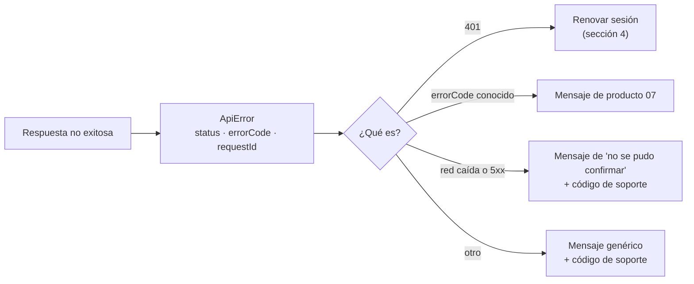

# Frontend: integración con la API

> Cómo habla la tienda con el backend. Rutas, respuestas y errores en [`../api-contrato.md`](../api-contrato.md); reglas en [`../product/03-reglas-de-negocio.md`](../product/03-reglas-de-negocio.md).

## 1. El contrato y los tipos

El contrato es el OpenAPI que publica el backend. Se pasa a tipos en dos pasos, como se acordó:

| Paso | Cómo | Cuándo |
|---|---|---|
| **1 (inicio)** | `vp run api:types` lee `API_DOCS_URL` (por defecto `http://localhost:3000/docs-json`, del backend levantado) y escribe `src/shared/api/schema.d.ts`, que **se sube a git** | Desde el corte F0 |
| **2 (después)** | El mismo script lee un `openapi.json` guardado en el backend, con un test que avisa cuando queda viejo | Cuando el backend lo implemente (corte 9 propuesto, aún no existe) |

Con el paso 1, las operaciones `/admin/*` pueden no aparecer en los tipos si el backend corre con `ADMIN_API_ENABLED=false`. Es lo que se espera: la tienda MVP no usa administración.

**Los tipos solo cubren la forma de los datos.** No dicen "un pedido ajeno da `404`" ni qué mensaje mostrar: eso está en el producto y en los tests.

### Lo que el contrato aún no describe

| Hueco | Qué hace el frontend mientras tanto |
|---|---|
| Los `operationId` de Nest salen como `BookController_get`, ilegibles | Con `openapi-fetch` no importa (se llama por ruta y método). Es un pendiente del backend (`operationIdFactory`) para cuando se migre a un generador ([01 sección 4](01-decisiones-y-stack.md#4-del-cliente-de-hoy-a-un-generador-completo-camino-futuro)) |
| El formato de error (`{ statusCode, errorCode, message }`) no está en el esquema | `shared/api/errors.ts` lo declara a mano y se cubre con una prueba |
| Los `errorCode` solo aparecen en texto de las descripciones | `shared/api/error-messages.ts` lista los de [producto 07](../product/07-contenido-y-mensajes.md); un código desconocido muestra el mensaje genérico |
| Las respuestas de Swagger son clases que "describen" lo que devuelven los handlers, sin estar atadas a ellos | Las pruebas con MSW usan fábricas tipadas con el esquema, y el e2e (F6) comprueba contra el backend real |

## 2. Qué endpoint usa cada pantalla, y si ya existe

| Funcionalidad | Endpoint | Backend hoy | Historias |
|---|---|---|---|
| Catálogo | `GET /books`, `GET /books/:isbn` | ✅ | HU-10, HU-11 |
| Registro y login | `POST /auth/register`, `POST /auth/login` | ✅ | HU-01, HU-02 |
| Sesión | `POST /auth/refresh`, `POST /auth/logout` | ✅ | HU-03, HU-04 |
| Cotización | `POST /orders/quote` | ⬜ **corte 8** (`8.1` a `8.4`), depende de `7.7` | HU-22, HU-31 |
| Compra | `POST /orders` (`Idempotency-Key`) | 🔄 hoy el cuerpo lleva `customerId`; **`7.7`** lo quita | HU-30 a HU-33 |
| Confirmación y detalle | `GET /orders/:id` | 🔄 hoy es abierto; **`7.7`** lo limita a su dueño (y, con DP-15, añade la dirección) | HU-34, HU-41 |
| Mis pedidos | `GET /me/orders` | ⬜ **`7.8`** (forma: DP-18) | HU-40 |

Mientras una ruta no exista, el frontend trabaja contra **handlers de MSW que siguen el contrato propuesto** y que están marcados como tales ([06-tests](06-tests.md)). Esto permite avanzar sin esperar al backend, pero **no se cierra la historia** hasta probarla contra la ruta real.

## 3. El cliente

Un solo cliente (`shared/api/client.ts`) creado con `openapi-fetch`, con la URL base de `VITE_API_BASE_URL` y tres comportamientos:

1. **Pone el token de acceso** (`Authorization: Bearer …`) en toda petición, salvo las de `/auth/*` y las públicas del catálogo.
2. **Reintenta una vez ante un `401`**: pide un token nuevo (sección 4) y repite la petición original. Si la renovación falla, cierra la sesión local y lleva a PA-04 (HU-03).
3. **Convierte los errores** en un `ApiError` con `status`, `errorCode` y el `X-Request-Id` de la respuesta (sección 6). El resto de la app no trabaja con `Response` crudas.

Todas las peticiones llevan un `X-Request-Id` propio (un UUID). La API lo acepta o genera uno y lo devuelve. Sirve para que el aviso de error genérico muestre un **código de soporte** que se puede buscar en los logs del backend.

## 4. Sesión: tokens y renovación

Decisión DP-16: token de acceso **en memoria** y token de refresco en **`localStorage`**.

| Dato | Dónde | Por qué |
|---|---|---|
| Token de acceso (JWT, 15 min) | Memoria del módulo `features/auth` | No persiste: recargar la página lo pierde, y se recupera con el de refresco |
| Token de refresco (opaco, 14 días, de un solo uso) | `localStorage`, clave `libroya.refresh` | La sesión sobrevive a cerrar el navegador |
| Usuario (`id`, `email`, `role`) | Memoria, y se recupera con cada login o renovación | `role` solo se usa para elegir qué mostrar; el servidor decide |

**Al abrir la app** con un token de refresco guardado pero sin token de acceso: se renueva antes de mostrar nada que lo necesite (la ruta con sesión espera ese resultado en `beforeLoad`).

**El problema de la renovación y las pestañas.** Un token de refresco **sirve una sola vez** y reutilizarlo cierra la sesión entera (RN-34). Si dos peticiones, o dos pestañas, renuevan a la vez con el mismo token, la segunda se toma como robo. Por eso:

1. **Dentro de una pestaña**, una sola renovación en vuelo: las demás peticiones esperan su resultado.
2. **Entre pestañas**, la renovación corre dentro de un candado de **Web Locks** (`navigator.locks`). Quien entra al candado **vuelve a leer** el token de refresco de `localStorage` (puede haberlo cambiado otra pestaña) y lo usa; al terminar guarda el nuevo y suelta el candado.
3. **Cerrar sesión** llama a `POST /auth/logout` con el token de refresco, y borra los dos tokens aunque la llamada falle (HU-04). Una pestaña que ve desaparecer el token (evento `storage`) pasa a estado "sin sesión".

Código de referencia en [05-piezas-clave](05-piezas-clave.md).

## 5. Idempotencia de la compra

`POST /orders` exige `Idempotency-Key` (un UUID por intento de compra) y la misma clave con el mismo carrito devuelve el mismo pedido (RN-21). Reglas para el frontend:

| Situación | La clave |
|---|---|
| Primer intento | Se genera con `crypto.randomUUID()` y se guarda en `sessionStorage` junto con una **huella** del intento (líneas del carrito y dirección) |
| Reintento tras un corte, un `5xx` o `CHECKOUT_IN_PROGRESS`, con la misma huella | **La misma clave** |
| `PREVIOUS_ATTEMPT_FAILED` o `IDEMPOTENCY_KEY_REUSED` | Una clave **nueva** |
| Cambió el carrito o la dirección | Una clave **nueva** (la huella ya no coincide) |
| El pedido se creó (`201`) | Se borra |
| Recarga de la página en medio del pago | Se conserva (DP-14) |

La huella evita reutilizar una clave con otro carrito, que el backend rechazaría con `IDEMPOTENCY_KEY_REUSED`. El backend normaliza el ISBN y recorta la dirección; la huella del frontend hace lo mismo para no generar claves nuevas por diferencias sin importancia.

## 6. Errores

- El texto sale de `errorCode` mediante `shared/api/error-messages.ts` (de [producto 07](../product/07-contenido-y-mensajes.md)). **Nunca** del `message` del servidor.
- Los `400` (forma del cuerpo) no deberían ocurrir si el formulario valida; si ocurren, se muestra el genérico y se registra en consola con el `requestId`.
- Una pérdida de red o un `5xx` en el pago **no afirma que no se cobró**: no se sabe (RN-21). Ofrece reintentar con la misma clave.
- Un `429` (límite de intentos, `7.10`) muestra el aviso de "demasiados intentos".

## 7. Montos, fechas y números

- **Montos:** el objeto `{ amount: "90.00", currency: "PEN" }` viaja y se guarda tal cual. `shared/lib/money.ts` lo formatea (`S/ 90.00`, `90.00 USD`, miles con coma) **manipulando el texto**; no usa `Number`, `parseFloat` ni `toFixed` (RN-07, RN-08). Una prueba lo verifica con importes que `number` redondearía mal.
- **Fechas:** `createdAt` llega en ISO (UTC) y se muestra con `Intl.DateTimeFormat('es-PE', { timeZone: 'America/Lima' })`.
- **ISBN:** se muestra como lo devuelve la API (13 dígitos, sin guiones).

## 8. Lo que bloquea cada corte

| Dependencia del backend | Bloquea | Mientras tanto |
|---|---|---|
| `7.7` compra con el cliente del token | **La salida a producción** (DP-09) | `POST /orders` con `customerId` = `id` del usuario con sesión; el campo se quita al llegar `7.7` |
| Corte 8, cotización | HU-22 completa y el paso de pago | El carrito muestra precios y cantidades, sin totales; MSW simula la cotización |
| `7.8` `GET /me/orders` | HU-40 y la salida a producción | MSW con la forma de DP-18 |
| `7.10` límites y CORS | **La salida a producción** | Proxy de Vite en desarrollo |
| `shippingAddress` en `GET /orders/:id` (DP-15, con `7.7`) | La sección de envío de HU-41 | La sección no se muestra |

Ver el orden completo en [07-fases-y-roadmap](07-fases-y-roadmap.md).
