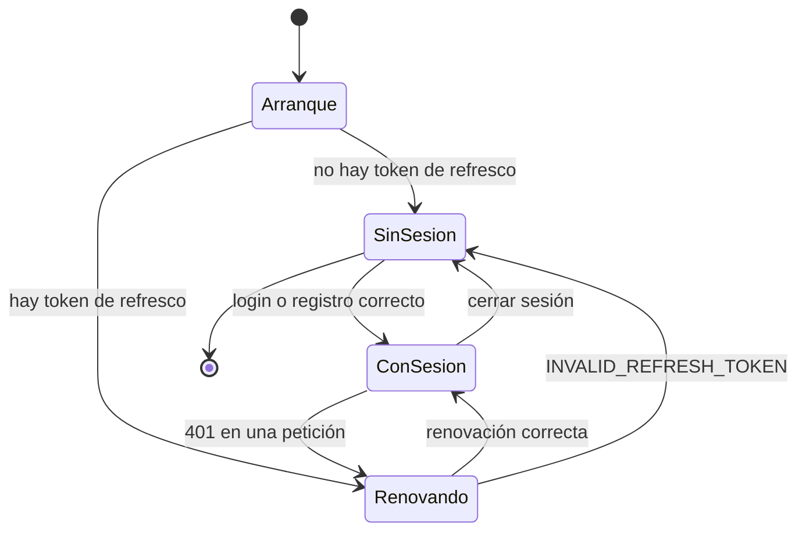

# Frontend: flujos de pantalla

> Cómo se arma cada pantalla de [`../product/06-pantallas-y-navegacion.md`](../product/06-pantallas-y-navegacion.md): ruta, acceso, datos y estados. El qué (historias y textos) está en el producto.

## 1. Rutas y acceso

Las rutas son las provisionales del producto y quedan fijadas aquí. **Acceso:** una ruta con sesión lleva un `beforeLoad` que, sin sesión, redirige a `/ingresar?returnTo=<ruta de origen>` (HU-02, HU-03). Con sesión ya iniciada, `/registro` y `/ingresar` redirigen al catálogo.

| Pantalla | Ruta | Acceso | Parámetros de URL | Datos (consulta) | Historias |
|---|---|---|---|---|---|
| PA-01 | `/` | Público | `q`, `page` (validados con Zod; `page` ≥ 1) | `books.search({ q, page })` | HU-10 |
| PA-02 | `/libros/$isbn` | Público | — | `books.detail(isbn)` | HU-11, HU-20 |
| PA-03 | `/registro` | Público (sin sesión) | `returnTo?` | — (mutación `register`) | HU-01 |
| PA-04 | `/ingresar` | Público (sin sesión) | `returnTo?` | — (mutación `login`) | HU-02, HU-03 |
| PA-05 | `/carrito` | **Sesión** | — | carrito local + `books.detail` por línea + `quote` | HU-20 a HU-22 |
| PA-06 | `/compra` | **Sesión** | — | `quote` + mutación `placeOrder` | HU-30 a HU-33 |
| PA-07 | `/pedidos/$id/gracias` | **Sesión** | — | `orders.detail(id)` | HU-34 |
| PA-08 | `/pedidos` | **Sesión** | — | `orders.mine` (paginado por cursor) | HU-40 |
| PA-09 | `/pedidos/$id` | **Sesión** | — | `orders.detail(id)` | HU-41 |
| PA-10 | `*` | Público | — | — | HU-11, HU-41 |

- **`returnTo`** guarda solo una ruta interna (empieza por `/` y no por `//`); cualquier otro valor se ignora, para no permitir una redirección a un sitio ajeno tras iniciar sesión.
- **La búsqueda y la página viven en la URL**, no en el estado: se pueden compartir y el botón "atrás" funciona. El campo de búsqueda de la cabecera navega a `/?q=…&page=1`.
- **Claves de consulta** (TanStack Query), por funcionalidad: `['books', 'search', { q, page }]`, `['books', 'detail', isbn]`, `['orders', 'detail', id]`, `['orders', 'mine']`, `['quote', huella del carrito]`. Al cerrar sesión se vacía toda la caché de consultas para que la siguiente persona del equipo no vea datos ajenos.

## 2. Estados de toda pantalla con datos

Los mismos cinco de producto 06, resueltos con **un componente por estado** reutilizable en `shared/ui/` y no con texto suelto en cada página:

| Estado | Cómo se resuelve |
|---|---|
| Cargando | Esqueleto del contenido, con las mismas dimensiones que el contenido final (sin saltos de diseño) |
| Vacío | Componente con mensaje y una acción (textos en [producto 07](../product/07-contenido-y-mensajes.md)) |
| Error de red o `5xx` | Aviso genérico con "Reintentar" y el código de soporte (`requestId`) |
| No encontrado | `404`/`NOT_FOUND`/`400` del id → "No está disponible", con enlace útil |
| Sesión vencida | Lo resuelve el cliente (renovación silenciosa); si falla, redirige a PA-04 |

## 3. Sesión

Las rutas con sesión esperan en `Arranque` y `Renovando` (no muestran contenido ni redirigen a medias). Al pasar a `SinSesion` por una renovación fallida, se muestra el aviso "Tu sesión terminó" una sola vez.

## 4. Carrito

El carrito es un mapa `{ [userId]: líneas[] }` persistido en `localStorage`. Cada línea guarda `isbn`, `title`, `author`, `unitPrice` y `quantity` **tal como se vio al agregarla**; al abrir PA-05 se vuelve a consultar cada libro para detectar cambios de precio o desactivación (HU-22).

| Evento | Resultado |
|---|---|
| Agregar | Cantidad 1, o +1 si ya está; no pasa de 10 (RN-10); si la moneda difiere de la del carrito, no se agrega (RN-05) |
| Cambiar cantidad | De 1 a 10 |
| Quitar | Sale de la lista, con deshacer unos segundos |
| Un libro cambió de precio | Se actualiza al precio vigente y se avisa |
| Un libro se desactivó o desapareció (`NOT_FOUND`) | Se marca "no disponible" y bloquea el pago hasta quitarlo |
| Comprar con éxito | Se vacía solo el carrito de ese usuario |
| Cerrar sesión | El carrito **se conserva** (DP-04) |

Los montos de la línea son los textos de la API. El **subtotal de cada línea** y todos los totales llegan en la cotización (`POST /orders/quote`, corte 8, DP-20) y el frontend no los calcula.

## 5. Pago (PA-06)

Máquina de estados del paso de pago. La **cotización vigente** es condición para poder pagar.

```mermaid
stateDiagram-v2
    [*] --> Cotizando
    Cotizando --> Listo: cotización recibida
    Cotizando --> ErrorCotizacion: red o 5xx
    ErrorCotizacion --> Cotizando: reintentar
    Listo --> Cotizando: cambia el carrito
    Listo --> Enviando: pagar (dirección válida)
    Enviando --> Confirmado: 201
    Enviando --> Esperando: CHECKOUT_IN_PROGRESS
    Esperando --> Enviando: reconsultar con la misma clave
    Enviando --> Incierto: red caída o 5xx
    Incierto --> Enviando: reintentar con la misma clave
    Enviando --> Fallido: 422 de negocio
    Fallido --> Listo: corregir; clave nueva en el próximo intento
    Confirmado --> [*]: PA-07
```

| Estado | Qué ve la persona | Notas |
|---|---|---|
| `Cotizando` | Total anterior atenuado o indicador de carga; "Pagar" deshabilitado | Se repite al cambiar el carrito |
| `Listo` | Resumen con total y botón "Pagar S/ 90.00" | |
| `Enviando` | "Procesando tu pago…"; no se puede pulsar otra vez ni salir sin confirmar | La pasarela simulada tarda unos 3 s |
| `Esperando` | "Estamos procesando tu pago, espera un momento" | Reconsulta sola cada pocos segundos |
| `Incierto` | "No pudimos confirmar tu pago…" con "Reintentar" | **No afirma que no se cobró** |
| `Fallido` | El mensaje del `errorCode`, con la acción correspondiente (volver al carrito, cambiar tarjeta, corregir dirección) | Siempre dice si se cobró |
| `Confirmado` | Redirige a PA-07 y vacía el carrito | Muestra el `charged` real (RN-08) |

Tras registrarse, la primera compra puede dar `404 NOT_FOUND` porque el cliente de Ventas se crea en segundo plano. El frontend reintenta **una vez** con la misma clave tras un par de segundos (HU-31) antes de mostrar el error. La clave se maneja como en [03](03-integracion-con-la-api.md#5-idempotencia-de-la-compra).

La dirección se escribe en cada compra y no se recuerda (DP-13); solo se conserva mientras dure el intento (si se vuelve al carrito y se regresa).

## 6. Formularios

Los de registro, login y dirección usan React Hook Form con un esquema de Zod que replica **solo lo evidente** (campos obligatorios, largos máximos de [producto RN-22](../product/03-reglas-de-negocio.md), contraseña de 10 a 128). El servidor manda: un error de campo del backend (`INVALID_EMAIL`, `WEAK_PASSWORD`, `INVALID_SHIPPING_ADDRESS`, `EMAIL_ALREADY_REGISTERED`) se muestra junto al campo, sin perder lo escrito. El botón se deshabilita mientras la petición está en curso.
