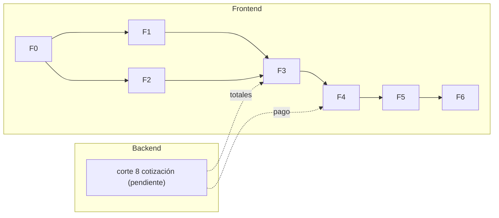

# Frontend: fases y roadmap

> El orden en que se construye la tienda y qué necesita cada fase del backend. El detalle de tareas y su estado está en [00-avance](00-avance.md).

## Cortes

| Corte | Qué se construye | Historias | Pantallas | Necesita del backend |
|---|---|---|---|---|
| **F0** Fundaciones | La plantilla pasa a React + el stack; cliente con tipos generados; cabecera y layout; MSW y pruebas; proxy; CI | — | PA-10 | Solo `/docs-json` |
| **F1** Catálogo | Buscar, listar y ver un libro | HU-10, HU-11 | PA-01, PA-02, PA-10 | ✅ Ya existe |
| **F2** Cuenta y sesión | Registro, login, renovación, cierre de sesión y guardia de rutas | HU-01 a HU-04 | PA-03, PA-04 | ✅ Ya existe |
| **F3** Carrito | Carrito persistido por usuario y PA-05 | HU-20, HU-21, HU-22 (sin totales) | PA-05 | Corte 8 para los totales |
| **F4** Compra | Dirección, cotización, pago con reintento seguro, errores y confirmación | HU-30 a HU-34, y HU-22 completa | PA-06, PA-07 | **Corte 8** (`7.7` ya está) |
| **F5** Pedidos | Mis pedidos y su detalle | HU-40, HU-41 | PA-08, PA-09 | Nada (`7.7`, `7.8` y la dirección en el detalle, DP-15, ya están) |
| **F6** Calidad y salida | Auditoría de accesibilidad, e2e con Playwright, rendimiento, despliegue y README | — | — | Nada (`7.10` ya está): configurar `CORS_ORIGINS` o el proxy inverso |

La administración (`HU-50` a `HU-53`) queda **fuera** de este plan: es la segunda etapa del producto (DP-03).

## Dependencias con el backend

- **Ruta crítica:** `F0 → F2 → F3 → F4`. F1 y F2 pueden ir en paralelo tras F0.
- **No hay que esperar al backend para empezar:** F0 a F2 usan rutas que ya existen, y F3 a F5 avanzan con MSW siguiendo el contrato propuesto. Lo que **no se puede** es cerrar una historia hasta probarla contra la ruta real.
- **El corte 7 del backend está cerrado** (`7.7`, `7.8`, `7.10` y también `7.9`, `7.11`): ya se cumplen las condiciones de DP-09 para abrirla al público, salvo la cotización (corte 8), que bloquea el paso de pago. `POST /orders` ya no admite `customerId`.

## Diseño antes de cada corte

Los [tokens y la cabecera](../product/diseno/README.md#cuándo-se-diseña) están listos antes de `F0`, y cada pantalla se revisa justo antes de construirla (DP-23):

| Corte | Wireframes que se revisan antes de empezar |
|---|---|
| F0 | [Cabecera y navegación](../product/diseno/03-wireframes.md#cabecera-y-navegación) y [PA-10](../product/diseno/03-wireframes.md#pa-10-no-encontrado--error) |
| F1 | [PA-01](../product/diseno/03-wireframes.md#pa-01-catálogo-y-búsqueda) y [PA-02](../product/diseno/03-wireframes.md#pa-02-detalle-del-libro) |
| F2 | [PA-03](../product/diseno/03-wireframes.md#pa-03-registrarse) y [PA-04](../product/diseno/03-wireframes.md#pa-04-iniciar-sesión) |
| F3 | [PA-05](../product/diseno/03-wireframes.md#pa-05-carrito) |
| F4 | [PA-06](../product/diseno/03-wireframes.md#pa-06-dirección-y-pago) y [PA-07](../product/diseno/03-wireframes.md#pa-07-confirmación) |
| F5 | [PA-08](../product/diseno/03-wireframes.md#pa-08-mis-pedidos) y [PA-09](../product/diseno/03-wireframes.md#pa-09-detalle-del-pedido) |

Si al verla en el navegador una pantalla no funciona como su wireframe, se corrige **el wireframe** y no solo el código.

## Qué hacer cuando el backend cambia

| Cambio | Acción en el frontend |
|---|---|
| `7.7` (ya llegó) | Quitar `customerId` del cuerpo de `POST /orders` (la API responde `400` si va); actualizar los handlers de MSW. PA-09 puede mostrar la dirección: `GET /orders/:id` la devuelve (DP-15) |
| Llega el corte 8 | Sustituir el handler de MSW de la cotización por la ruta real; completar HU-22 y el paso de pago |
| `7.8` (ya llegó) | Apuntar PA-08 a `GET /me/orders` con la forma de DP-18 (ya existe) |
| `7.10` (ya llegó) | Quitar la dependencia del proxy de desarrollo si se usa CORS (poniendo el origen de la tienda en `CORS_ORIGINS`); manejar `429` con `Retry-After` |
| Cambia el contrato | `vp run api:types` y corregir lo que deje de compilar |
