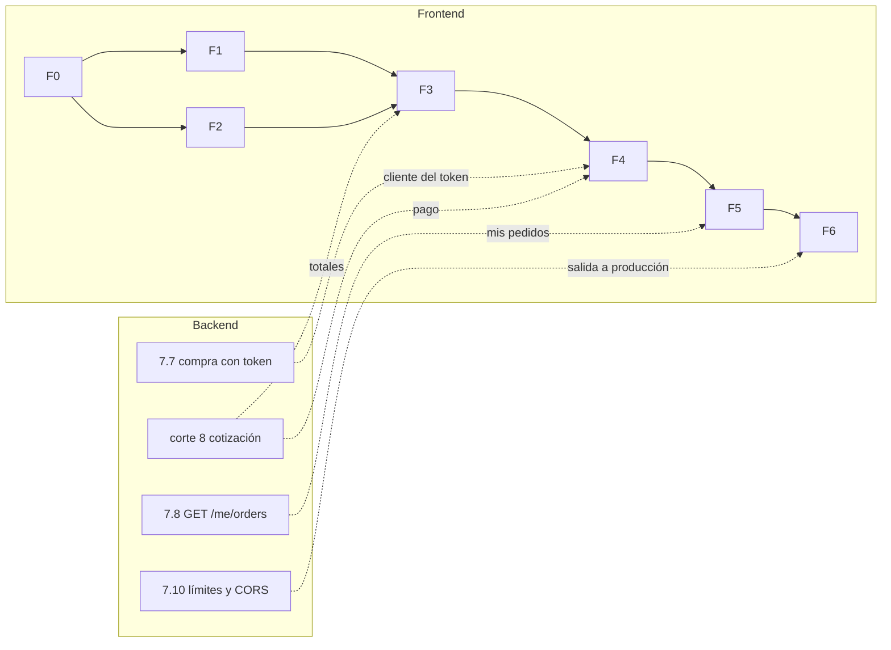

# Frontend: fases y roadmap

> El orden en que se construye la tienda y qué necesita cada fase del backend. El detalle de tareas y su estado está en [00-avance](00-avance.md).

## Cortes

| Corte | Qué se construye | Historias | Pantallas | Necesita del backend |
|---|---|---|---|---|
| **F0** Fundaciones | La plantilla pasa a React + el stack; cliente con tipos generados; cabecera y layout; MSW y pruebas; proxy; CI | — | PA-10 | Solo `/docs-json` |
| **F1** Catálogo | Buscar, listar y ver un libro | HU-10, HU-11 | PA-01, PA-02, PA-10 | ✅ Ya existe |
| **F2** Cuenta y sesión | Registro, login, renovación, cierre de sesión y guardia de rutas | HU-01 a HU-04 | PA-03, PA-04 | ✅ Ya existe |
| **F3** Carrito | Carrito persistido por usuario y PA-05 | HU-20, HU-21, HU-22 (sin totales) | PA-05 | Corte 8 para los totales |
| **F4** Compra | Dirección, cotización, pago con reintento seguro, errores y confirmación | HU-30 a HU-34, y HU-22 completa | PA-06, PA-07 | **`7.7`** y **corte 8** |
| **F5** Pedidos | Mis pedidos y su detalle | HU-40, HU-41 | PA-08, PA-09 | **`7.8`** (y `7.7` para la dirección) |
| **F6** Calidad y salida | Auditoría de accesibilidad, e2e con Playwright, rendimiento, despliegue y README | — | — | **`7.10`** (límites y CORS), o el proxy inverso |

La administración (`HU-50` a `HU-53`) queda **fuera** de este plan: es la segunda etapa del producto (DP-03).

## Dependencias con el backend

- **Ruta crítica:** `F0 → F2 → F3 → F4`. F1 y F2 pueden ir en paralelo tras F0.
- **No hay que esperar al backend para empezar:** F0 a F2 usan rutas que ya existen, y F3 a F5 avanzan con MSW siguiendo el contrato propuesto. Lo que **no se puede** es cerrar una historia hasta probarla contra la ruta real.
- **Puede construirse ya, pero no abrirse al público,** hasta cerrar `7.7`, `7.8` y `7.10` (DP-09). Hasta `7.7`, `POST /orders` lleva el `customerId` en el cuerpo: el frontend manda el `id` del usuario con sesión.

## Qué hacer cuando el backend cambia

| Cambio | Acción en el frontend |
|---|---|
| Llega `7.7` | Quitar `customerId` del cuerpo de `POST /orders`; actualizar los handlers de MSW; mostrar la dirección en PA-09 si viene (DP-15) |
| Llega el corte 8 | Sustituir el handler de MSW de la cotización por la ruta real; completar HU-22 y el paso de pago |
| Llega `7.8` | Apuntar PA-08 a `GET /me/orders` con la forma de DP-18 |
| Llega `7.10` | Quitar la dependencia del proxy de desarrollo si se usa CORS; manejar `429` |
| Cambia el contrato | `vp run api:types` y corregir lo que deje de compilar |
