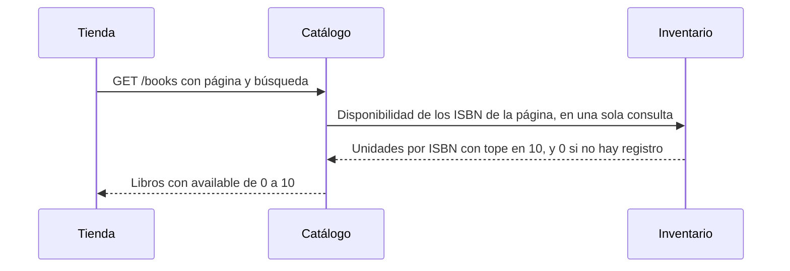
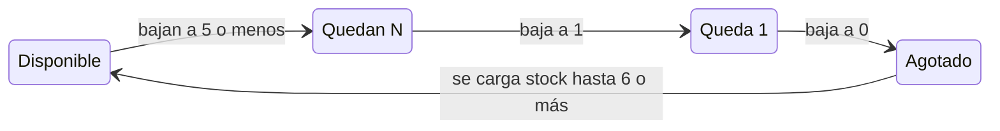

# HU-12 Ver si hay stock de un libro

> **Estado:** 📝 propuesta, pendiente de aprobación. Nace del pedido del 2026-10-30: «en la lista de libros no se indica si hay stock y recién al pagar sale un aviso». Es la primera de tres historias que comparten un mismo cambio de contrato (la disponibilidad en el catálogo y el `isbn` del error de stock): [HU-23](HU-23-el-carrito-marca-los-libros-sin-stock-suficiente.md) (el carrito) y [HU-35](HU-35-el-error-de-pago-nombra-el-libro.md) (el aviso de pago). Nada de esto está implementado.

**Como** comprador, **quiero** ver si un libro tiene stock desde la lista y desde su página, **para** no descubrirlo recién al pagar.
**Reglas:** RN-10 (máximo 10 por libro), RN-13 (hoy dice que la API no expone el stock: se reescribe en `HU-12.1`) · **Pantallas:** PA-01, PA-02 · **Rutas:** `GET /books`, `GET /books/:isbn`

**Decisiones del usuario (2026-10-30):** la API expone la cantidad **con tope en 10** (`min(unidades, 10)`: no regala el inventario completo, y el máximo por pedido ya es 10); va **dentro de `GET /books` y `GET /books/:isbn`** (la tienda ya llama a esas rutas; Catálogo le pregunta a Inventario por una consulta de contrato en proceso). Se registran como `DP-25` en `HU-12.1`. Recomendadas por mí y que se pueden cambiar al aprobar: la disponibilidad es **orientativa** (`POST /orders` sigue siendo la autoridad).

## Criterios

- **Dado** el catálogo, **cuando** veo un libro en la lista o en su página, **entonces** veo «Disponible» (6 o más), «Quedan N» (de 1 a 5) o «Agotado», siempre con texto además del color.
- **Dado** un libro agotado, **cuando** intento agregarlo, **entonces** el botón está deshabilitado y dice «Agotado».
- **Dado** un libro con 3 unidades, **cuando** lo agrego al carrito, **entonces** no puedo pasar de 3 y la tienda dice «Solo quedan 3».
- **Dado** que la disponibilidad es orientativa, **cuando** otra persona se lleva el último ejemplar antes de que yo pague, **entonces** el pago sigue siendo la autoridad y me lo dice ([HU-35](HU-35-el-error-de-pago-nombra-el-libro.md)).
- **Dado** un libro recién creado cuyo registro de stock aún no existe, **cuando** lo consulto, **entonces** figura como agotado, no como error.

## Listo cuando

Contra el backend real, una persona ve «Quedan 3» en un libro con 3 unidades y «Agotado» en uno sin stock, en la lista y en el detalle, a 360 y 1280 px y sin violaciones de axe, y no puede agregar más de lo que hay.

## Contrato

> Lo que se aprueba con la historia. La tarea `[API]` lo cumple tal cual; si al implementar hay que cambiarlo, se detiene y se vuelve a aprobar (no se decide al programar). Después de implementar, `docs/api-contrato.md` lo refleja.

**`GET /books?q=&page=&pageSize=`** y **`GET /books/:isbn`** (públicas, sin cambios en parámetros, ruta ni códigos de error). Cada libro de la respuesta gana un campo **`available`**:

```json
{
  "isbn": "9780132350884",
  "title": "Clean Code",
  "author": "Robert C. Martin",
  "price": { "amount": "45.00", "currency": "PEN" },
  "available": 3
}
```

| Campo | Tipo | Significado |
|---|---|---|
| `available` | entero, **siempre presente**, de 0 a 10 | `min(unidades disponibles, 10)`. `0` = agotado **o** libro sin registro de stock todavía. Es **orientativo**: puede quedar viejo, y `POST /orders` sigue decidiendo |

- **Compatibilidad: aditivo.** Un cliente que ignora `available` sigue funcionando. No se quita ni se renombra nada.
- **Errores:** los de hoy (`GET /books/:isbn`: `404 NOT_FOUND` si no existe o está inactivo, `422 INVALID_ISBN`); un libro sin registro de stock **no es un error**.
- **Una página** (`pageSize` hasta 50) pide la disponibilidad en **una sola** consulta.
- **No cambia:** `POST /orders/quote` (no mira el stock) ni `POST /orders`.
- **OpenAPI:** `BookResponse.available` como `integer`, `minimum: 0`, `maximum: 10`, requerido, con esta descripción.

**Cómo se obtiene `available`** (la tienda no hace nada distinto: sigue llamando a la misma ruta):



Resumen: Catálogo le pregunta a Inventario **una vez por página** y mezcla el resultado en cada libro.

## Pantalla

> Lo que se aprueba con la historia y se revisa en un navegador real a 360 y 1280 px. Reutiliza los [tokens](../product/diseno/01-tokens.md) y [componentes](../product/diseno/02-componentes.md) existentes; los wireframes PA-01 y PA-02 y el mockup PA-02 se actualizan en `HU-12.1`.

**Un componente nuevo y compartido: la nota de disponibilidad** (texto corto con un icono; el icono es decorativo y el significado siempre está en el texto, nunca solo en el color).

| Disponibles | Texto | Tono (tokens) |
|---|---|---|
| 6 a 10 | `Disponible` | éxito (`success`) |
| 2 a 5 | `Quedan N` | aviso (`warning`) |
| 1 | `Queda 1` | aviso (`warning`) |
| 0 | `Agotado` | error (`danger-text`) |

**En la lista (tarjeta de libro):** la nota va **entre el precio y el botón**, en su propia línea, sin cambiar el resto de la tarjeta.

```
┌─────────────────────────┐
│ Clean Code              │   título (enlace)
│ Robert C. Martin        │   autor
│ S/ 45.00                │   precio
│ ▲ Quedan 3              │   ← nota nueva (texto pequeño)
│ [ Agregar al carrito ]  │   botón; con 0 queda deshabilitado y dice «Agotado»
└─────────────────────────┘
```

**En el detalle del libro:**
- **Escritorio (1280 px):** la nota va **justo debajo del precio**, antes del botón.
- **Móvil (360 px):** la barra fija inferior (precio y botón) **no cambia de tamaño**; la nota va en el cuerpo, **bajo la línea del ISBN**. Solo cambia el botón: con 0 dice «Agotado» y queda deshabilitado.

**El botón:**
- Normal: sin cambios («Agregar al carrito»).
- Agotado: deshabilitado, texto «Agotado» y nombre accesible «Clean Code está agotado».
- Al llegar al límite (`min(10, disponibles)`): el aviso que hoy dice «Máximo 10 por pedido.» pasa a decir **«Solo quedan N.»** cuando el límite lo fija el stock; si el límite es 10, no cambia.

**Cómo cambia el texto de un libro** según las unidades que haya (por ejemplo, al comprarse unidades o al cargarse stock):



Resumen: 6 a 10 unidades → «Disponible», 2 a 5 → «Quedan N», 1 → «Queda 1», 0 → «Agotado».

**Todo igual en 360 y 1280 px** salvo la posición en el detalle de arriba. El botón conserva su alto táctil de al menos 44 px y el contraste de los tonos sale de los tokens (se comprueba con axe en `HU-12.5`).

## Tareas

| # | Capa | Tipo | Rigor | Tarea | Objetivo | Depende de | Estado |
|---|---|---|---|---|---|---|---|
| HU-12.1 | 📄 DOC | 📦 producto | 🟢 normal | Aprobar y registrar la decisión de producto de las tres historias | Que las reglas de producto digan que el stock se muestra, antes de tocar código | aprobación del usuario | ✏️ propuesta |
| HU-12.2 | ⚙️ API | 📐 regla | 🔴 critico | Inventario: leer la disponibilidad con tope | Que Inventario sepa decir cuántas unidades se pueden ofrecer (tope 10) sin exponer el inventario real | HU-12.1 | ✏️ propuesta |
| HU-12.3 | ⚙️ API | 📜 contrato | 🟢 normal | Catálogo: `available` en `GET /books` y `GET /books/:isbn` | Que la tienda reciba la disponibilidad en las mismas llamadas que ya hace, sin llamadas extra | HU-12.2 | ✏️ propuesta |
| HU-12.4 | 🌐 WEB | 🖼️ pantalla | 🟢 normal | Lista y detalle muestran la disponibilidad; el botón respeta el límite | Que la persona vea si hay stock desde la lista y el detalle, y no pueda agregar más de lo que hay | HU-12.3 | ✏️ propuesta |
| HU-12.5 | 🧪 E2E | 🔁 recorrido | 🟢 normal | Catálogo y detalle contra el backend real | Comprobar de punta a punta que la persona ve la disponibilidad real | HU-12.4 | ✏️ propuesta |

## Detalle de las tareas

### HU-12.1 Aprobar y registrar la decisión de producto de las tres historias

**Se comprueba**

- [ ] HU-12, HU-23 y HU-35 aprobadas por el usuario (`estado: aprobada` en su encabezado)
- [ ] `RN-13` y `DP-05` reescritas, y `DP-25` nueva (tope 10, dentro del catálogo, orientativa)
- [ ] `00-vision` sin «stock visible» en «fuera de alcance»; PA-01, PA-02 y PA-05, los wireframes y el mockup PA-02 actualizados
- [ ] `07-contenido` con los textos «Disponible», «Quedan N», «Agotado» y los del error con título
- [ ] un `grep` de «no se muestra stock» no deja restos, y `product/04` no se toca (histórico)

### HU-12.2 Inventario: leer la disponibilidad con tope

**Se comprueba**

- [ ] la función pura `reportedAvailability` aplica el tope 10 y nunca devuelve un número negativo
- [ ] un ISBN sin registro de stock cuenta 0
- [ ] la consulta de contrato responde por lote (varios ISBN en una sola consulta)
- [ ] el puerto de lectura tiene su fake y su contrato de pruebas contra la base real
- [ ] mutaciones sobre el tope, el 0 y la fila ausente: todas detectadas

**Reglas e invariantes**

- `available` ya excluye lo reservado; el tope es `REPORTED_AVAILABILITY_CAP = 10` y coincide con RN-10 (Inventario no importa de Ventas)
- un libro sin registro de stock es un libro agotado, nunca un error
- el número informado nunca es negativo ni mayor que el tope

### HU-12.3 Catálogo: `available` en `GET /books` y `GET /books/:isbn`

**Se comprueba**

- [ ] cumple el **Contrato** de la HU: campo `available` requerido, entero de 0 a 10, aditivo
- [ ] Catálogo pregunta a Inventario por contrato, una consulta por página (máx. 50 ISBN)
- [ ] el detalle deja de reutilizar la consulta de precio de Ventas
- [ ] el OpenAPI documenta `available`
- [ ] `CLAUDE.md` y las guías 01 y 05 del backend dicen la dirección nueva (Catálogo → Inventario por contrato; Inventario nunca llama a Catálogo)
- [ ] los specs de estructura exactos de catálogo e inventario al día

### HU-12.4 Lista y detalle muestran la disponibilidad; el botón respeta el límite

**Se comprueba**

- [ ] `/cambio-de-contrato`: `schema.d.ts` regenerado con `available`
- [ ] componente de aviso compartido en `shared/ui` con «Disponible», «Quedan N», «Queda 1» y «Agotado»
- [ ] «Agotado» deja el botón deshabilitado y el límite es min(10, disponibles)
- [ ] se reescribe la prueba «no muestra el stock» (`book-detail-page.test.tsx`)
- [ ] revisado en un navegador real a 360 y 1280 px contra la sección **Pantalla**, con la captura anotada en la bitácora

### HU-12.5 Catálogo y detalle contra el backend real

**Se comprueba**

- [ ] un libro con 3 unidades y otro sin stock (creados por la API de administración): «Quedan 3» y «Agotado» en la lista y en el detalle
- [ ] el botón respeta el límite
- [ ] axe sin violaciones a 360 y 1280 px
- [ ] `test:perf` sin regresión
- [ ] pasa contra `vp dev` y contra el build de producción

## Notas de diseño (orientativas, no vinculantes)

El detalle de implementación (qué archivos y clases) **se decide al ejecutar cada tarea** con `/tarea` (plan corto antes de codificar las `[API]` críticas); aquí solo lo que condiciona y no debería cambiar:

- **Inventario es dueño del número y del tope.** La función pura que aplica el tope (10, igual al máximo por pedido de RN-10) y la regla «sin registro de stock = 0» viven en el dominio de Inventario, que **no importa de Ventas**; es lo que se prueba con mutaciones.
- **Catálogo no ve el número real.** Le pregunta a Inventario por **contrato** (consulta en proceso, una por página) y la dependencia va en un solo sentido: Catálogo → Inventario; Inventario nunca llama a Catálogo. Hay que actualizar `CLAUDE.md` y las guías del backend, que hoy dicen que solo Ventas llama a otros contextos.
- **La tienda** muestra «Disponible» (6 o más), «Quedan N» (1 a 5) y «Agotado» con un componente compartido, siempre con texto además del color, y limita el carrito a `min(10, disponibles)`.
- **Riesgos:** es orientativo y puede quedar viejo; la ruta es pública y sin límite de intentos (por eso el tope en 10); la cotización sigue sin mirar el stock.

## Decisiones y desvíos

| Fecha | Qué se decidió o se desvió | Por qué |
|---|---|---|
| 2026-10-30 | Cantidad con tope en 10, dentro de `GET /books` y `GET /books/:isbn` (decisión del usuario) | Permite «Quedan N» y limitar el carrito sin regalar el inventario completo; cero llamadas extra de la tienda |
| 2026-10-30 | Las ampliaciones de HU-22 y HU-33 son historias nuevas (HU-23 y HU-35) | El histórico no se edita (decisión del usuario) |

## Bitácora

| Fecha | Qué se hizo |
|---|---|
| 2026-10-30 | Propuesta redactada y desglosada en 5 tareas, con exploración de solo lectura del backend y la tienda. Sin código ni documentos de producto cambiados |
