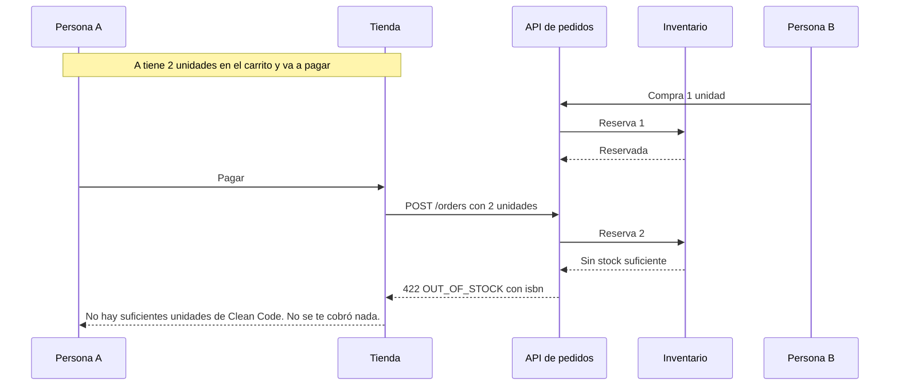

# HU-35 El error de pago nombra el libro sin stock

> **Estado:** 📝 propuesta, pendiente de aprobación. **Amplía** [HU-33](../../../product/04-historias-de-usuario.md#hu-33-entender-por-qué-falló-la-compra) (histórica, no se edita): hoy el aviso dice «uno de tus libros» y no cuál. Es independiente de [HU-12](HU-12.md) en el código, pero comparte con ella el cambio de contrato y su decisión de producto (`HU-12.1`).

**Como** comprador, **quiero** que el aviso de falta de stock diga cuál es el libro, **para** saber qué quitar o bajar sin adivinar.
**Reglas:** RN-13 (reescrita en `HU-12.1`) · **Pantallas:** PA-06 · **Rutas:** `POST /orders` (`422 OUT_OF_STOCK`, `422 STOCK_ITEM_NOT_FOUND`)

## Criterios

- **Dado** que el pago falla por falta de stock, **cuando** se muestra el aviso, **entonces** dice **qué libro** es («No hay suficientes unidades de «Clean Code». No se te cobró nada.»).
- **Dado** que el libro ya no está disponible (`STOCK_ITEM_NOT_FOUND`), **cuando** se muestra el aviso, **entonces** dice ««Clean Code» ya no está disponible. No se te cobró nada.».
- **Dado** que el aviso no trae el libro (o ya no está en el carrito), **cuando** se muestra, **entonces** queda el mensaje genérico de hoy.
- **Dado** el aviso, **cuando** pulso «Volver al carrito», **entonces** el carrito (que se revalida al abrirse) marca ese libro ([HU-23](HU-23.md)).

## Listo cuando

Contra el backend real: una persona tiene 2 unidades de un libro en el carrito y está lista para pagar; otra persona compra 1 por la API; al pagar, el aviso nombra el libro, dice que no se cobró, no se creó ningún pedido y «Volver al carrito» lleva al carrito.

## Contrato

> Lo que se aprueba con la historia (ver la nota de [HU-12](HU-12.md#contrato)).

**`POST /orders`** (sin cambios en ruta, cabeceras ni cuerpo de la petición). Los dos errores de stock añaden el campo **`isbn`** al cuerpo del `422`:

```json
{
  "statusCode": 422,
  "errorCode": "OUT_OF_STOCK",
  "message": "Sin stock suficiente para 9780132350884",
  "isbn": "9780132350884"
}
```

| Error | `isbn` |
|---|---|
| `422 OUT_OF_STOCK` | El libro que no alcanza (ISBN normalizado de 13 dígitos) |
| `422 STOCK_ITEM_NOT_FOUND` | El libro sin registro de stock |
| Cualquier otro error | **No** lleva `isbn` (el cuerpo no cambia) |

- **Compatibilidad: aditivo.** `statusCode`, `errorCode` y `message` siguen igual (y la tienda sigue sin leer `message`).
- **Solo el primero:** se informa **un** libro, el primero que falla en orden de ISBN (así reserva Inventario); si faltan varios, el resto se descubre al reintentar. Un reintento con la misma clave tras ese fallo responde `PREVIOUS_ATTEMPT_FAILED`, **sin** `isbn`.
- **No cambia:** `POST /orders/quote` (nunca responde falta de stock).
- **OpenAPI:** el esquema de error de `POST /orders` (422) documenta `isbn` como texto opcional con esta descripción.

**La carrera que produce el error** (el caso del «Listo cuando…»):



Resumen: el pedido de A falla en Inventario, la API devuelve el `isbn` y la tienda lo traduce al título que está en el carrito de A.

## Pantalla

**Sin cambios de diseño.** El aviso de falta de stock de `PA-06` conserva su lugar (la columna del resumen, sobre el botón de pagar), su variante de error y su acción «Volver al carrito»; cambia **solo el texto**, que pasa a nombrar el libro:

```
┌─ ⚠ ─────────────────────────────────────────┐
│ No hay suficientes unidades de «Clean Code». │  ← antes: «…de uno de tus libros.»
│ No se te cobró nada.                          │
│ [ Volver al carrito ]                         │
└───────────────────────────────────────────────┘
```

Textos exactos (los dos van a `07-contenido-y-mensajes.md` en `HU-12.1`): «No hay suficientes unidades de «{título}». No se te cobró nada.» y ««{título}» ya no está disponible. No se te cobró nada.»; sin título, el mensaje de hoy. Un título largo se parte en varias líneas sin desbordar a 360 px.

## Impacto en el producto

> Esta historia describe el **cambio**; lo vigente está en las reglas, decisiones y pantallas que enlaza (los documentos de `docs/product/` dicen siempre lo que es verdad hoy). Cada fila *pendiente* se escribe en su documento en la tarea `[DOC]`, antes del código, y pasa a *hecho* cuando la línea de ese documento lleva la marca «Cambios: HU-35 (fecha)». Una historia no se cierra con filas pendientes; `python3 scripts/historias.py` genera con estas tablas el [registro de cambios](../../../product/cambios.md).

| Documento | Qué cambia | Acción | Estado |
|---|---|---|---|
| [PA-06](../../../product/06-pantallas-y-navegacion.md) | El aviso de falta de stock nombra el libro (solo cambia el texto) | modifica | pendiente |
| [07-contenido-y-mensajes](../../../product/07-contenido-y-mensajes.md) | Textos de `OUT_OF_STOCK` y `STOCK_ITEM_NOT_FOUND` con el título del libro | modifica | pendiente |
| [api-contrato](../../../api-contrato.md) | `isbn` en el cuerpo del `422` de `OUT_OF_STOCK` y `STOCK_ITEM_NOT_FOUND` | modifica | pendiente |

## Tareas

| # | Capa | Tipo | Rigor | Tarea | Objetivo | Depende de | Estado |
|---|---|---|---|---|---|---|---|
| HU-35.1 | ⚙️ API | 📜 contrato | 🟢 normal | Los `422` `OUT_OF_STOCK` y `STOCK_ITEM_NOT_FOUND` llevan el `isbn` | Que la tienda pueda decir qué libro falló sin leer el texto del mensaje | HU-12.1 | ✏️ propuesta |
| HU-35.2 | 🌐 WEB | 🔀 comportamiento | 🟢 normal | El aviso de pago nombra el libro | Que el aviso diga «No hay suficientes unidades de «Título»» en lugar de «uno de tus libros» | HU-35.1 | ✏️ propuesta |
| HU-35.3 | 🧪 E2E | 🔁 recorrido | 🟢 normal | La carrera de dos compradores | Comprobar con el backend real que el aviso nombra el libro cuando otra persona se lleva el último ejemplar | HU-35.2 | ✏️ propuesta |

## Ejecución

> Lo completa `scripts/historias.py` (no se edita a mano): sella el **inicio** cuando una tarea pasa a `⏩ en-curso` y el **fin** cuando pasa a `✅ hecho`, con la hora de Lima. El **tiempo** es fin − inicio e **incluye las esperas** (aprobaciones, pausas); el tiempo de la matriz de `README.md` sale de git y no es el mismo dato.

<!-- EJECUCION:INICIO (la completa scripts/historias.py: no editar a mano) -->
| # | Inicio | Fin | Tiempo |
|---|---|---|---|
| HU-35.1 | — | — | — |
| HU-35.2 | — | — | — |
| HU-35.3 | — | — | — |
<!-- EJECUCION:FIN -->

## Detalle de las tareas

### HU-35.1 Los `422` `OUT_OF_STOCK` y `STOCK_ITEM_NOT_FOUND` llevan el `isbn`

**Se comprueba**

- [ ] `OutOfStockError` y `StockItemNotFoundError` (`contracts/inventory/stock.errors.ts`) exponen `isbn`
- [ ] `platform/http/domain-exception.filter.ts` lo añade al cuerpo solo cuando el error lo define
- [ ] cumple el **Contrato** de la HU: `isbn` solo en esos dos `422`, aditivo
- [ ] OpenAPI y `api-contrato.md` al día
- [ ] sigue informando solo el primer libro que falla (orden por ISBN)
- [ ] pruebas: `domain-exception.filter.spec`, `api-exception.filter.spec` y `orders.e2e.spec`

### HU-35.2 El aviso de pago nombra el libro

**Se comprueba**

- [ ] `/cambio-de-contrato` si el esquema aún no trae `isbn`
- [ ] `ApiError` conserva `isbn`
- [ ] un ayudante en `features/checkout/errors.ts` busca el título en el carrito; la forma de `Outcome` no cambia (`payment-outcome.test.ts` compara con `toEqual`)
- [ ] sin `isbn` o sin la línea del carrito, queda el mensaje genérico de hoy
- [ ] el aviso cumple la sección **Pantalla** (mismo lugar y variante, solo cambia el texto; un título largo no desborda a 360 px), revisado en un navegador real
- [ ] pruebas: `checkout-errors.test.tsx` y `errors.test.ts`

### HU-35.3 La carrera de dos compradores

**Se comprueba**

- [ ] un libro con 2 unidades: A lista para pagar con 2, B compra 1 por la API, A paga
- [ ] el aviso nombra el libro y dice que no se cobró; no se crea ningún pedido
- [ ] reemplaza el escenario viejo de `purchase.e2e.ts` (ya no llega al error cuando el carrito limita la cantidad)
- [ ] pasa contra `vp dev` y contra el build de producción

## Decisiones y desvíos

| Fecha | Qué se decidió o se desvió | Por qué |
|---|---|---|
| 2026-10-30 | El `isbn` va como campo estructurado del error, no se lee del `message` | El `message` es texto para desarrolladores: la tienda decide por `errorCode` y nunca lo lee (`shared/api/errors.ts`) |
| 2026-10-30 | Solo se nombra el primer libro que falla | `reserve` recorre las líneas ordenadas por ISBN y se detiene en la primera; el carrito marca el resto al abrirse (HU-23) |

## Bitácora

| Fecha | Qué se hizo |
|---|---|
| 2026-10-30 | Propuesta redactada y desglosada en 3 tareas. Sin código |
