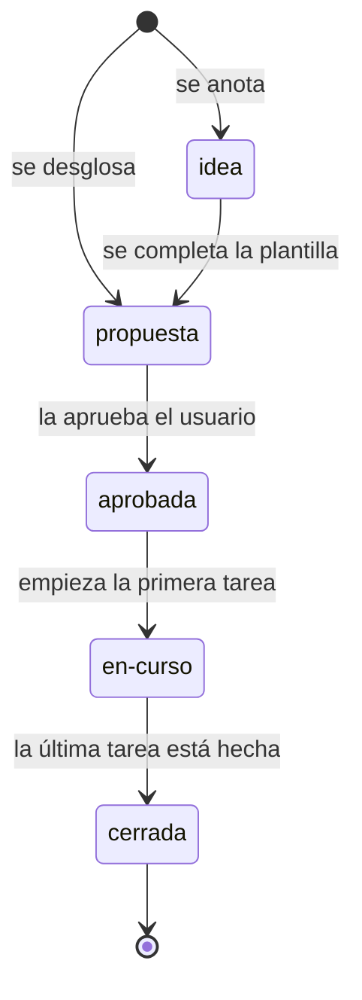

# Plantillas y diccionario de valores

> Aquí están las **plantillas** para crear una historia, un habilitador o una idea, y el **diccionario** que define cada campo del encabezado y cada valor que admite una columna: los estados, las capas, los tipos y el rigor de las tareas, las acciones del impacto y las épicas. **Cada tabla de valores la compara `scripts/historias.py` con sus constantes** (`python3 scripts/historias.py --check` falla si difieren): si cambia un valor, se cambia en el script **y** aquí. Las reglas de cómo se trabaja, la matriz de cada fase y el índice de fases están en el [README de historias](../README.md).

## Qué plantilla usar

| Quiero… | Plantilla | La copio a |
|---|---|---|
| Anotar un pendiente sin desglosarlo (una historia o un habilitador) | [`idea.md`](idea.md) | `docs/historias/fase-n/HU/HU-nn.md` o `docs/historias/fase-n/EN/EN-nn.md` |
| Desglosar algo que una persona ve o hace (una **historia**) | [`HU.md`](HU.md) | `docs/historias/fase-n/HU/HU-nn.md` |
| Desglosar trabajo técnico que no tiene una historia propia (un **habilitador**) | [`EN.md`](EN.md) | `docs/historias/fase-n/EN/EN-nn.md` |

El número (`nn`) es el siguiente libre de ese tipo: se mira en la matriz de la fase o en la carpeta. El nombre del archivo es **solo el correlativo** (`HU-12.md`, sin título) y es igual al `id` del encabezado. Los enlaces dentro del archivo se escriben con `../../../` para salir de `fase-n/HU/` o `fase-n/EN/` (por ejemplo, `../../../product/03-reglas-de-negocio.md`).

Cada plantilla lleva, en su nota inicial, las **tablas** que le tocan en vez de texto corrido: los campos del encabezado, las épicas, los estados, las secciones, las columnas, capas y rigor de la tabla de tareas, las acciones y estados del impacto, y lo que lleva cada sección. `idea.md` lleva solo la de los estados de la historia; `HU.md` y `EN.md`, todas. `scripts/historias.py` compara con el script las que dependen de valores (y los campos y las secciones, con el propio archivo), igual que las tablas de este diccionario.

## Ciclo de vida de una historia o un habilitador

## Valores del encabezado

El encabezado es el bloque `---` del principio del archivo, una línea `clave: valor` por campo.

### Tipo de historia

| Valor | Icono | Qué significa |
|---|---|---|
| `HU` | | Historia de usuario: algo que una persona ve o hace. Su `id` empieza por `HU-` y su archivo va en `fase-n/HU/` |
| `EN` | | Habilitador: trabajo técnico sin historia propia (arquitectura, rendimiento, seguridad, documentación…). Su `id` empieza por `EN-` y su archivo va en `fase-n/EN/` |

El `tipo` **debe coincidir** con el prefijo del `id`; el comprobador falla si no.

### Estados de una historia o un habilitador

| Valor | Icono | Qué significa | Quién lo cambia y cuándo | Qué comprueba el script |
|---|---|---|---|---|
| `idea` | 💡 | Un pendiente anotado, sin desglosar | Quien lo anota, al crear el archivo desde `idea.md` | Solo el encabezado: no pide tareas, secciones, impacto ni `ligado:`; no admite tareas hechas ni en curso |
| `propuesta` | 📝 | Desglosada y a la espera de aprobación | Al desglosarla (`/hu`) o al promover una idea completando la plantilla | Todas las secciones que le corresponden, cada tarea con su bloque de detalle, `ligado:` si es un habilitador; no admite tareas hechas ni en curso |
| `aprobada` | ⬜ | El usuario la aprobó: puede ejecutarse | Al aprobarla el usuario | Lo mismo que una propuesta |
| `en-curso` | 🔄 | Alguna de sus tareas ya empezó | Al pasar su primera tarea a `en-curso` | Lo mismo, más los sellos de inicio y fin de la tabla «Ejecución» |
| `cerrada` | ✅ | Todas sus tareas están hechas y su «Listo cuando…» se ejecutó | Al terminar la última tarea (en una historia, tras su `[E2E]`) | Todas las tareas `hecho`, una historia con su tarea `[E2E]` y ningún cambio de producto `pendiente` |

### Campos del encabezado

| Campo | Obligatorio en | Qué es |
|---|---|---|
| `id` | historias y habilitadores | `HU-nn` o `EN-nn`; igual al nombre del archivo sin `.md` |
| `titulo` | historias y habilitadores | Una línea; es el nombre que aparece en la matriz |
| `tipo` | historias y habilitadores | `HU` o `EN` (ver «Tipo de historia») |
| `epica` | solo historias | Una de las épicas de la lista; un habilitador **no** lleva épica |
| `estado` | historias y habilitadores | Uno de los estados de arriba |
| `amplia` | opcional | El `id` de una historia anterior que esta amplía (la anterior no se edita); vacío si no amplía ninguna |
| `reemplaza` | opcional | El `id` de la historia que esta deja sin efecto por completo; la matriz marca a la otra «superada por»; vacío si no |
| `ligado` | solo habilitadores (no en una idea) | A qué se debe: una `RN-nn`, una `DP-nn` o la ruta de un documento de `docs/` con ancla opcional (`backend/05-piezas-clave.md#convención-por-contexto`); el comprobador verifica que exista |

### Épicas de las historias

| Valor | Icono | Qué cubre |
|---|---|---|
| `Cuenta` | | Registrarse, entrar, mantener y cerrar la sesión |
| `Catálogo` | | Buscar libros, ver un libro y su disponibilidad |
| `Carrito` | | Agregar, cambiar y quitar libros; ver el carrito |
| `Compra` | | Dirección de envío, pago, reintentos y confirmación |
| `Pedidos` | | El historial y el detalle de un pedido |
| `Administración` | | Crear y editar libros, cargar stock, ver los pedidos de un cliente |

## Valores de las tareas

La tabla de tareas de cada historia y habilitador tiene las columnas de la tabla de abajo. **Capa, Tipo, Rigor y Estado se escriben «icono texto»** (`⚙️ API`, `📜 contrato`, `🔴 critico`, `⏳ pendiente`): el texto es el valor (kebab-case: minúsculas, sin acentos ni símbolos, con guiones en vez de espacios) y el icono de cada valor es siempre el mismo, en todas las filas. `python3 scripts/historias.py --formato` completa y corrige los iconos.

### Columnas de la tabla de tareas

| Columna | Qué lleva |
|---|---|
| `#` | El id de la tarea (`HU-nn.k` o `EN-nn.k`) |
| `Capa` | Dónde se trabaja (ver «Capas de una tarea») |
| `Tipo` | Qué cambia, y por tanto qué receta aplica (ver «Tipos de tarea») |
| `Rigor` | Qué tan crítica es (ver «Rigor de una tarea») |
| `Tarea` | Qué se hace, en una línea |
| `Objetivo` | El resultado que se busca, en una frase: responde «¿para qué existe esta tarea?», no «cómo se programa» |
| `Depende de` | Otra tarea (aunque sea de otra historia) o `—` |
| `Estado` | Uno de los estados de una tarea |

### Estados de una tarea

| Valor | Icono | Qué significa |
|---|---|---|
| `propuesta` | ✏️ | La tarea de una historia que aún no está aprobada |
| `pendiente` | ⏳ | Aprobada y sin empezar |
| `en-curso` | ⏩ | Empezada: el script sella su inicio al pasar a este estado |
| `hecho` | ✅ | Terminada, con todas las casillas de su bloque marcadas: el script sella su fin |
| `bloqueado` | ⛔ | No puede avanzar; se dice por qué en «Decisiones y desvíos» |

### Capas de una tarea

| Valor | Icono | Qué significa |
|---|---|---|
| `DOC` | 📄 | Producto y guías: reglas, decisiones, mensajes, diseño, documentos del proceso |
| `API` | ⚙️ | El backend (`apps/main-api`) y, por ahora, también las herramientas del propio proceso (`scripts/`) |
| `WEB` | 🌐 | La tienda (`apps/store-web`) |
| `E2E` | 🧪 | El recorrido de punta a punta contra el backend real, o una comprobación completa de la solución |

### Rigor de una tarea

| Valor | Icono | Qué significa |
|---|---|---|
| `critico` | 🔴 | Tarea crítica: mutaciones obligatorias y plan corto antes de codificar. Solo una tarea `[API]` puede serlo; `base-de-datos` y `evento` siempre lo son |
| `normal` | 🟢 | El resto |

## Tipos de tarea

**Tipo** (tercera columna): dice qué receta aplica y **se elige por lo que cambia**, no por cómo se programa:

| Capa | Tipo | ¿Qué cambia? | Ejemplos | ¿Siempre critico? |
|---|---|---|---|---|
| ⚙️ API | 📜 contrato | **Lo que la API le ofrece a la tienda** | Un endpoint nuevo, **un campo más en una respuesta**, un error nuevo, quién puede llamarlo | no |
| ⚙️ API | 📐 regla | **Cómo decide el negocio** | Un cálculo, un límite («máximo 10»), una condición | no |
| ⚙️ API | ⚡ evento | Un aviso entre partes del sistema (Outbox) | Reaccionar a «se registró un usuario» | sí |
| ⚙️ API | 🧊 base-de-datos | Las tablas, columnas, índices o restricciones | Una columna nueva | sí |
| ⚙️ API | 🛠️ configuracion | Una variable de entorno | `JWT_SECRET` | no |
| ⚙️ API | ♻️ refactor | **La estructura del código, no su comportamiento** | Renombrar o mover un archivo, extraer una clase, ajustar una regla de estructura | no |
| 🌐 WEB | 🖼️ pantalla | **Lo que se ve** | Mover un botón, un texto nuevo, un aviso | no |
| 🌐 WEB | 🔀 comportamiento | **Lo que la tienda hace**, sin cambiar lo que se ve | Pedir el campo nuevo a la API, el estado del carrito, validar un formulario | no |
| 🌐 WEB | ♻️ refactor | **La estructura del código de la tienda, no su comportamiento ni lo que se ve** | Mover un componente, dividir un módulo, renombrar un hook | no |
| 📄 DOC | 📦 producto | Reglas, decisiones, historias, mensajes, diseño | `RN-13`, un `DP` | no |
| 📄 DOC | 📘 guia | Guías técnicas, README, comandos | `CLAUDE.md` | no |
| 🧪 E2E | 🔁 recorrido | El recorrido de punta a punta | — | no |

**Esta es la única tabla de tipos** (la guía, los comandos y los índices la enlazan; `python3 scripts/historias.py --tipos` la imprime y el comprobador exige que coincida con `scripts/historias.py`). La columna «¿Siempre critico?» la lee el script: no la cambies sin cambiarlo.

**Receta por tipo** (qué comando o documento seguir al ejecutar la tarea): `contrato` → `/nueva-ruta` si es un endpoint nuevo y, en la primera tarea `[WEB]` que lo use, `/cambio-de-contrato`; `regla` → pruebas primero y, si toca dinero, seguridad o concurrencia, rigor `critico`; `evento` → `/nuevo-evento`; `base-de-datos` → `/nueva-migracion`; `configuracion` → `/nueva-variable-entorno`; `pantalla` → la sección «Pantalla» de la HU y la revisión en un navegador real; `comportamiento` → la compuerta de la tienda (y `/cambio-de-contrato` si consume un contrato nuevo); `refactor` → las pruebas existentes pasan **sin cambiar lo que esperan** (solo imports y rutas de lo movido; si hay que cambiar una expectativa, no es un refactor sino una regla o un contrato), pruebas nuevas solo si se añade una regla de estructura, la compuerta completa, la historia con «Sin cambios en el contrato», «Sin cambios visuales» y «Sin impacto en el producto», y rigor `critico` (con mutaciones) únicamente si toca dominio, seguridad, dinero o concurrencia; `producto` y `guia` → los documentos que toque; `recorrido` → Playwright contra el backend real.

Un endpoint nuevo con lógica nueva son **dos tareas**: la `regla` y el `contrato`. **Rigor** (escrito en todas las filas): `critico` marca una tarea **crítica** (mutaciones obligatorias y plan corto antes de codificar) y `normal` es el resto. Solo una tarea `[API]` puede ser `critico`, y `base-de-datos` y `evento` siempre lo son (el comprobador lo exige). Se marca `critico` cuando la tarea toca dinero y precios, seguridad (tokens, contraseñas, guards, roles, CORS, límites), concurrencia y transacciones (outbox, reservas, idempotencia), restricciones de la base o reglas del dominio críticas.

## Valores del impacto en el producto

Cada historia y habilitador declara en «Impacto en el producto» qué documentos vivos toca, con una fila por documento (`Documento | Qué cambia | Acción | Estado`), o dice «Sin impacto en el producto».

### Acciones del impacto en el producto

| Valor | Icono | Qué significa |
|---|---|---|
| `agrega` | | El documento (una regla, una decisión) todavía no existe y esta historia lo crea |
| `modifica` | | El documento existe y esta historia cambia lo que dice |
| `retira` | | El documento deja de valer; su línea lo dice («Retirada» o «reemplazada por …») |

### Estados del impacto en el producto

| Valor | Icono | Qué significa |
|---|---|---|
| `pendiente` | | Aún no está escrito en el documento vivo |
| `hecho` | | Ya está escrito y la línea del documento lleva la marca `Cambios: HU-nn (fecha)` |
