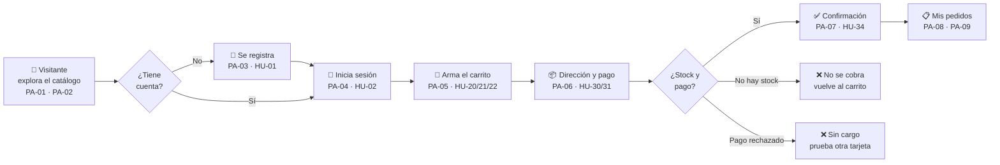
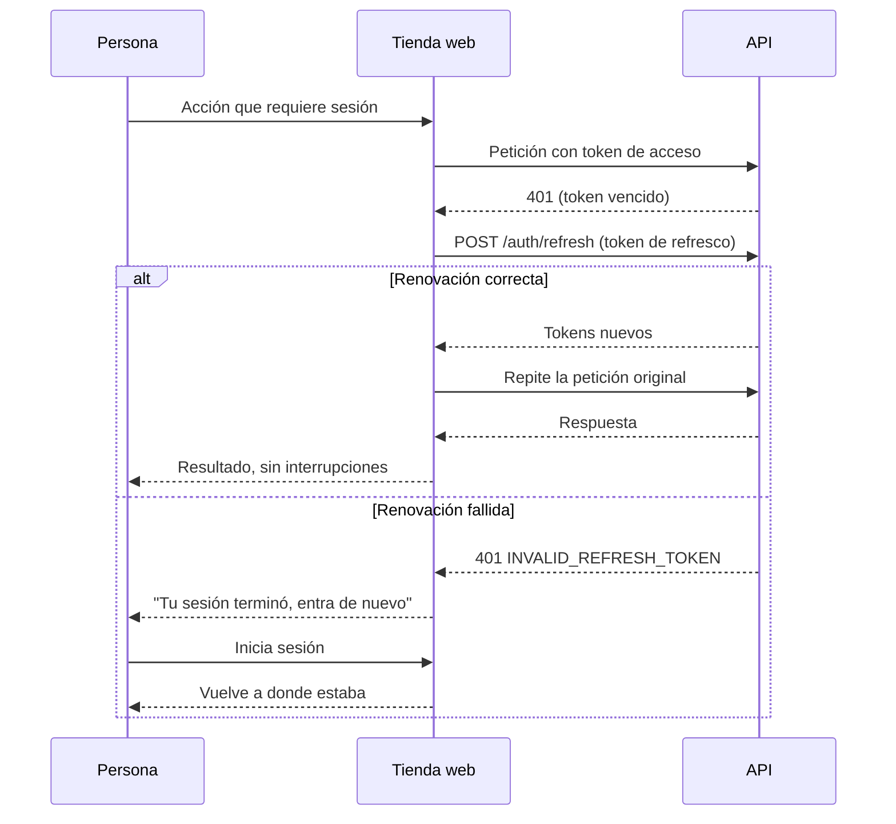

# Recorridos

> Los recorridos completos de la persona compradora, con sus caminos de error. Las pantallas (`PA`) están en [06](06-pantallas-y-navegacion.md) y las historias (`HU`) en [04](04-historias-de-usuario.md).

## 1. De visitante a primera compra



Para el comprador, todo ocurre en una sola acción al pagar: o la compra sale completa (pedido creado, pago hecho y unidades apartadas), o no sale y no pierde nada (RN-20).

## 2. Sesión: vencer y renovar



Solo una renovación a la vez: si varias peticiones reciben `401` a la vez, **una sola** pide el refresco y las demás esperan su resultado (un token de refresco sirve una sola vez, RN-34).

## 3. Pagar con reintento seguro

```mermaid
sequenceDiagram
    participant P as Persona
    participant W as Tienda web
    participant A as API
    P->>W: Pulsa "Pagar"
    W->>W: Genera Idempotency-Key (intento nuevo)
    W->>A: POST /orders (clave, líneas, dirección, cardToken)
    alt Todo bien
        A-->>W: 201 { orderId, charged }
        W-->>P: Confirmación (PA-07)
    else La respuesta no llegó
        W-->>P: "No pudimos confirmar tu pago" + Reintentar
        P->>W: Reintentar
        W->>A: POST /orders con la MISMA clave
        A-->>W: 201 con el mismo pedido (sin segundo cobro)
    else Falla de negocio (sin stock, tarjeta rechazada…)
        A-->>W: 422 con errorCode
        W-->>P: Mensaje claro; clave nueva para el próximo intento
    end
```

## 4. Compra justo después de registrarse

El cliente de Ventas se crea en segundo plano, alrededor de un segundo después del registro. Si la persona compra en ese instante, `POST /orders` responde `404 NOT_FOUND`. La tienda reintenta sola una vez, con la misma clave (HU-31); si persiste, muestra el error genérico.

## 5. Vuelta tras entrar

Cuando una acción pide sesión y la persona no la tiene (agregar al carrito, abrir el carrito, abrir "Mis pedidos"), la tienda la lleva a PA-04 guardando la ruta de origen y, al entrar, la devuelve ahí. La acción que quería hacer **no** se ejecuta sola (DP-12).
