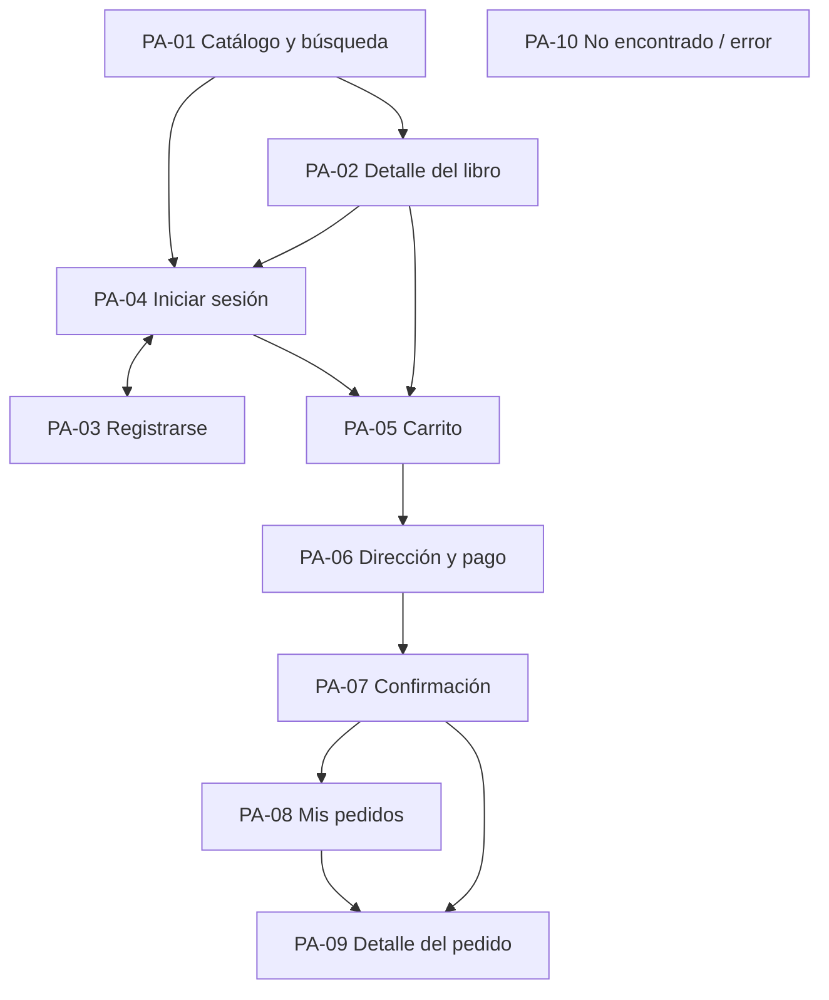

# Pantallas y navegación

> Inventario de pantallas de la tienda web MVP. Las rutas son **provisionales**: el frontend las fija en su guía. Las pantallas de administración quedan fuera de esta etapa ([DP-03](09-decisiones-y-preguntas.md)).

## Mapa del sitio

## Inventario

| ID | Pantalla | Ruta provisional | Sesión | Datos y endpoints | Historias |
|---|---|---|:-:|---|---|
| PA-01 | Catálogo y búsqueda | `/` y `/?q=&page=` | No | `GET /books` | HU-10 |
| PA-02 | Detalle del libro | `/libros/:isbn` | No | `GET /books/:isbn` | HU-11, HU-20 |
| PA-03 | Registrarse | `/registro` | No (si ya hay sesión, redirige) | `POST /auth/register` | HU-01 |
| PA-04 | Iniciar sesión | `/ingresar` | No (si ya hay sesión, redirige) | `POST /auth/login` | HU-02, HU-03 |
| PA-05 | Carrito | `/carrito` | **Sí** | Carrito local, `GET /books/:isbn` por línea para validar precio y vigencia, y `POST /orders/quote` (pendiente) para el total | HU-20, HU-21, HU-22 |
| PA-06 | Dirección y pago | `/compra` | **Sí** | `POST /orders/quote` (pendiente, corte 8) y `POST /orders` | HU-30, HU-31, HU-32, HU-33 |
| PA-07 | Confirmación | `/pedidos/:id/gracias` | **Sí** | `GET /orders/:id` | HU-34 |
| PA-08 | Mis pedidos | `/pedidos` | **Sí** | `GET /me/orders` | HU-40 |
| PA-09 | Detalle del pedido | `/pedidos/:id` | **Sí** | `GET /orders/:id` | HU-41 |
| PA-10 | No encontrado / error | `*` | No | — | HU-11, HU-41 |

Todas las pantallas comparten una **cabecera** con el logotipo, el buscador, el acceso a PA-05 con el número de unidades, y "Entrar" o el menú de la cuenta (PA-08 y "Cerrar sesión").

## Estados que toda pantalla con datos debe cubrir

| Estado | Qué ve la persona |
|---|---|
| **Cargando** | Un indicador o un esqueleto del contenido; sin saltos de diseño al llegar los datos |
| **Vacío** | Un mensaje y una acción (por ejemplo, "Ir al catálogo") |
| **Error de red o `5xx`** | Un mensaje genérico y un botón "Reintentar" |
| **No encontrado** | "No está disponible" con un enlace a un lugar útil (nunca una pantalla en blanco) |
| **Sesión vencida** | Renovación silenciosa; si falla, PA-04 con aviso (HU-03) |

## Notas por pantalla

- **PA-01 Catálogo.** Cada tarjeta muestra título, autor y precio; no hay portada ([DP-05](09-decisiones-y-preguntas.md)). La búsqueda y la página viven en la URL.
- **PA-02 Detalle.** Con la API actual solo hay ISBN, título, autor y precio; el diseño debe verse completo con ese contenido. No se muestra stock (la API no lo expone, RN-13): la falta de stock se descubre al pagar.
- **PA-05 Carrito.** El carrito está en el navegador, ligado al `id` del usuario para no mezclarse entre cuentas de un mismo equipo (DP-04). Muestra subtotal, descuento, envío y total a pagar, **todos tomados de la cotización del backend** (DP-07, RN-08); sin una cotización vigente no se puede continuar.
- **PA-06 Dirección y pago.** Un solo paso con dos bloques (dirección y pago) y un resumen del carrito con el total de la cotización. El botón dice el monto ("Pagar S/ 90.00") y se deshabilita mientras hay un intento en curso. El formulario de dirección empieza vacío: no se recuerda entre compras (DP-13).
- **PA-07 Confirmación.** Se lee el pedido de la API; el aviso del email dice "te enviamos una confirmación", sin garantizar el momento de llegada.
- **PA-08 y PA-09.** PA-08 usa la forma de cada ítem del historial (DP-18). La dirección y el teléfono se muestran en PA-09 solo cuando el pedido trae `shippingAddress` (`GET /orders/:id` la devuelve a su dueño, DP-15; es `null` en un pedido anterior a la dirección).
