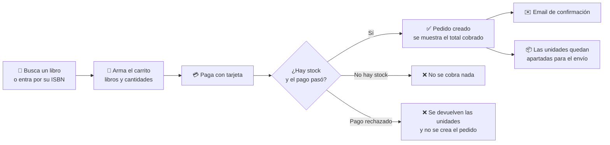

# LibroYa: el producto

> Qué es LibroYa, quién lo usa, el recorrido de una compra y las reglas del negocio. Es la base común de backend y frontend.

## 0. El producto

### Qué es LibroYa

LibroYa es una **librería online propia**: la tienda compra sus libros, los publica en su catálogo y los vende directamente al público. Una persona entra, busca un libro, lo agrega al carrito y paga con tarjeta. La tienda confirma la compra por email y aparta las unidades vendidas para enviarlas.

No es un marketplace: no hay vendedores externos ni comisiones. Hay **un solo vendedor (LibroYa)**, un solo catálogo y un solo almacén. Los libros pueden tener precio en soles (`PEN`) o en dólares (`USD`); cada pedido usa una sola moneda.

### Para qué existe

| Necesidad | Cómo la resuelve LibroYa |
|---|---|
| El comprador quiere encontrar y comprar un libro sin complicaciones | Catálogo con búsqueda, precio visible y compra en un solo paso |
| El comprador no quiere pagar algo que no se le puede entregar | Antes de cobrar, se **aparta el stock**. Si no hay unidades, no se cobra |
| El comprador no quiere que le cobren dos veces | Si la conexión falla y el comprador reintenta, **recibe el mismo pedido y no se le cobra otra vez** |
| La tienda no quiere vender más de lo que tiene | El stock nunca queda en negativo, aunque muchos compren a la vez |
| La tienda quiere premiar a sus clientes frecuentes | Los **clientes premium** tienen descuento y envío gratis |
| La tienda necesita saber qué pasó con cada compra | Cada compra tiene un identificador que aparece en todos sus registros, desde el pago hasta el email |

### Quiénes lo usan

| Actor | Qué hace | Disponible |
|---|---|---|
| 🧑 **Comprador** | Busca libros, compra y paga | Hoy (búsqueda en la Fase 10) |
| ⭐ **Cliente premium** | Lo mismo, con 10 % de descuento y envío gratis | Hoy (se marca en la BD; aún no hay forma de suscribirse) |
| 🧑‍💼 **Administrador de la tienda** | Crea libros, cambia precios, desactiva libros y carga stock | Fases 12 y 13 |
| 💳 **Pasarela de pago** (sistema externo) | Cobra y reembolsa | Hoy, simulada |
| ✉️ **Proveedor de email** (sistema externo) | Envía la confirmación de compra | Hoy, simulado (se escribe en el log) |

### El recorrido de una compra

Para el comprador, todo ocurre en una sola acción: o la compra sale completa (pedido creado, pago hecho y unidades apartadas), o no sale y no pierde nada.

### Reglas del negocio

| Regla | Detalle |
|---|---|
| **Precio del libro** | Lo define el catálogo. Al comprar, el título y el precio **se copian en el pedido**: si después el precio cambia, el pedido conserva el que pagó el cliente |
| **Descuento premium** | 10 % sobre el subtotal |
| **Costo de envío** | S/ 10.00 en soles · 3.00 USD en dólares |
| **Envío gratis** | Si el subtotal (antes del descuento) es **de S/ 150.00 o más** (**40.00 USD o más** en pedidos en dólares), o si el cliente es premium |
| **Máximo por libro** | 10 unidades del mismo libro por pedido |
| **Una sola moneda** | Todos los libros de un pedido deben tener la misma moneda. El mínimo de envío gratis y el costo de envío tienen un valor propio por moneda; no se convierten. El descuento premium, al ser un porcentaje, es igual en ambas |
| **Redondeo** | El total se calcula con todos los decimales y se redondea **una sola vez**, a 2 decimales y con la mitad hacia arriba, justo antes de cobrar |
| **Libros desactivados** | Un libro no se borra: se desactiva. Ya no se puede comprar, pero los pedidos antiguos lo siguen mostrando |

**Ejemplos del total cobrado:**

| Cliente | Subtotal | Descuento | Envío | Total |
|---|---|---|---|---|
| Normal | S/ 100.00 | — | S/ 10.00 | **S/ 110.00** |
| Normal | S/ 160.00 | — | Gratis (≥ S/ 150) | **S/ 160.00** |
| Premium | S/ 100.00 | −S/ 10.00 | Gratis (premium) | **S/ 90.00** |
| Premium | S/ 200.00 | −S/ 20.00 | Gratis | **S/ 180.00** |

**Ejemplos en dólares:**

| Cliente | Subtotal | Descuento | Envío | Total |
|---|---|---|---|---|
| Normal | 20.00 USD | — | 3.00 USD | **23.00 USD** |
| Normal | 50.00 USD | — | Gratis (≥ 40 USD) | **50.00 USD** |
| Premium | 20.00 USD | −2.00 USD | Gratis (premium) | **18.00 USD** |
| Premium | 100.00 USD | −10.00 USD | Gratis | **90.00 USD** |

### Qué hace hoy y qué viene después

| Ya está en el diseño (fases 0–9) | Viene después ([roadmap](backend/07-fases-y-roadmap.md)) | Fuera de alcance por ahora |
|---|---|---|
| Ver un libro por su ISBN | Buscar y listar libros (Fase 10) | Vendedores externos (marketplace) |
| Comprar y pagar con tarjeta | Dirección de envío en el pedido (Fase 11) | Cancelaciones y devoluciones |
| Ver un pedido | Administrar libros y precios (Fase 12) | Cupones y promociones |
| Email de confirmación | Cargar stock (Fase 13) | Envíos, factura electrónica (SUNAT) y puntos: el diseño ya los prevé como reacciones a la compra |
| Reintentos seguros y recuperación ante caídas | Historial de pedidos (Fase 14) · Inicio de sesión y roles (Fase 15) | |

> [!warning] Antes de abrirlo al público
> Mientras no exista el inicio de sesión (Fase 15), la API identifica al comprador por el `customerId` que viene en la petición. Sirve para desarrollar y probar, pero **no para producción**: cualquiera podría comprar a nombre de otro.

### Cómo se reparte el producto en el sistema

| Área del negocio | Contexto en el código | De qué se encarga |
|---|---|---|
| Qué libros vendemos y a qué precio | **Catálogo** (`catalog`) | Datos del libro, precio y si está activo |
| Cuántas unidades hay | **Inventario** (`inventory`) | Stock disponible y unidades apartadas por pedido |
| Clientes, pedidos y pagos | **Ventas** (`sales`) | Carrito, cálculo del total, cobro, pedido y confirmación |

Cada área es dueña de sus datos y solo se comunica con las demás por su API pública ([arquitectura](backend/01-decisiones-y-stack.md)).

### Palabras que se usan en esta guía

| Término | Significado |
|---|---|
| **ISBN** | Código de 13 dígitos que identifica a un libro |
| **Pedido** | Una compra completada: libros, cantidades, precios y total cobrado |
| **Checkout** | El intento de compra, desde que el comprador paga hasta que el pedido queda creado o anulado |
| **Reserva** | Unidades apartadas para un pedido, que ya no se pueden vender a otro |
| **Subtotal** | Suma de precio × cantidad de cada libro, antes de descuentos y envío |
| **Clave de idempotencia** (`Idempotency-Key`) | Identificador que la app del comprador envía con cada intento de compra, para que un reintento no cobre dos veces |
